# Concert Ticketing Engine (High-Load & Stateless Booking Platform)

Платформа для онлайн-бронювання та продажу квитків на концерти в умовах високої конкуренції за спільні ресурси (High Contention / Flash Crowds). Систему спроєктовано з урахуванням пікових навантажень на старті продажів популярних подій із забезпеченням транзакційної цілісності, захисту від подвійного продажу (Double-Booking) та **горизонтального масштабування (Stateless Architecture)**.

Підтримуються комбіновані типи майданчиків:

- **Сидячі сектори (Seated):** із фіксованими координатами крісел (ряд, номер місця).
- **Зони вільного входу (Standing / General Admission):** фан-зони з контролем загальної місткості (Capacity).

---

## Зміст

1. [Аудит та класифікація стану](#1-аудит-та-класифікація-стану-state-audit-report)
   - [1.1. Рефакторинг та декомпозиція локального стану](#11-рефакторинг-та-декомпозиція-локального-стану-stateless-architecture)
   - [1.2. Специфікація Stateless Request Flow](#12-специфікація-stateless-request-flow)
2. [Архітектура системи](#2-архітектура-системи-c4-container--component-model)
3. [Схема даних](#3-схема-даних-erd--persistence-layer)
4. [Специфікація REST API](#4-специфікація-rest-api)
5. [Матриця відповідальності (RACI)](#5-матриця-відповідальності-raci)
6. [Інструкція із детермінованого запуску системи](#6-інструкція-із-детермінованого-запуску-системи)
7. [Результати аналізу вузьких місць](#7-результати-аналізу-вузьких-місць-bottleneck-analysis)
8. [Лабораторна робота №3: балансування, відмовостійкість, масштабування](#8-лабораторна-робота-3-балансування-відмовостійкість-масштабування)
9. [Лабораторна робота №4: розподілене кешування (Redis)](#9-лабораторна-робота-4-розподілене-кешування-redis)
10. [Лабораторна робота №5: базовий рівень продуктивності](#10-лабораторна-робота-5-базовий-рівень-продуктивності-load-performance-baseline)
11. [Лабораторна робота №6: реплікація БД та Read/Write Separation](#11-лабораторна-робота-6-реплікація-бд-та-readwrite-separation)
12. [Лабораторна робота №7: шардинг і партиціонування](#12-лабораторна-робота-7-шардинг-і-партиціонування-data-scaling)

---

## 1. Аудит та класифікація стану (State Audit Report)

Для підготовки backend-сервісу `TicketBooking.Api` до горизонтального масштабування та переведення в безстатусну архітектуру (**Stateless Application Architecture**) було проведено аудит вихідного коду проєкту. Усі компоненти та типи даних, якими оперує сервіс під час обробки запитів, класифіковано за трьома категоріями.

### Таблиця класифікації стану системи

| Категорія стану | Компоненти та елементи коду | Сховище та час життя | Статус та обґрунтування Stateless-придатності |
|---|---|---|---|
| **1. Ephemeral / Local Safe**<br/>*(Тимчасовий / локально безпечний)* | • HTTP-контекст запиту (`HttpContext`)<br/>• Вхідні DTO (`CreateBookingRequest`, `ConfirmPaymentRequest`, `RegisterRequest`, `LoginRequest`)<br/>• Локальні стекові змінні методів у контролерах<br/>• Контекст логування (Trace ID, HTTP Request logs) | RAM .NET-процесу<br/>*(Managed Heap, Gen 0 / Stack frame)* | **Безпечно.** Існує виключно протягом обробки одного HTTP-запиту. Автоматично знищується Garbage Collector (GC) після формування відповіді. Не впливає на обробку інших запитів. |
| **2. Shared / Externalized**<br/>*(Спільний / зовнішній бізнес-стан)* | • Каталог подій, секторів та крісел (`Events`, `Sections`, `SeatSlots`)<br/>• Квитки та їх транзакційні статуси (`Tickets`: `Available`, `Reserved`, `Sold`)<br/>• Бронювання та TTL-резерви (`Bookings`: `Pending`, `Confirmed`, `Expired`, `Cancelled`)<br/>• Користувачі та хеші паролів (`Users`, PBKDF2)<br/>• Сесії та авторизаційні дані | **Primary DB:** PostgreSQL 16<br/>**Distributed Cache (каталог подій):** Redis 7<br/>**Client:** JWT Bearer tokens | **Винесено у зовнішній шар.** Увесь транзакційний та бізнес-стан зберігається в централізованих зовнішніх сховищах. Будь-який інстанс API може прочитати або змінити цей стан через асинхронні запити. |
| **3. Critical Stateful Dependencies**<br/>*(Критичні stateful-залежності, підлягають вилученню)* | • In-Memory колекції (`List<T>`, `ConcurrentDictionary` для збереження сесій чи броней)<br/>• Local Locks (`lock()`, `SemaphoreSlim` для блокування квитків)<br/>• In-Memory кеш (`IMemoryCache`)<br/>• Локальні лічильники / Singleton state<br/>• Sticky Sessions / Session Cookies | **Пам'ять (RAM) конкретного контейнера/процесу** | **Повністю усунено / відсутні.** Жодні бізнес-дані, прапорці стану або внутрішньопроцесні блокування не зберігаються у пам'яті C#-процесу. Інстанси є 100% взаємозамінними (Interchangeable Workers). |

### Детальний аналіз та докази усунення In-Memory залежностей у коді

1. **Безстатусна автентифікація (Stateless JWT Authentication).**
   У файлах `AuthController.cs` та `JwtTokenService.cs` авторизація побудована на стандарті RFC 7519 (JWT). Усі дані про користувача зашифровані в підписаному токені (HMAC-SHA256). Сервер не зберігає таблиці активних сесій у локальній пам'яті (`SessionState`). Кожен екземпляр API верифікує токен самостійно за допомогою єдиного ключа `Jwt:Key`, що дозволяє будь-якому інстансу обробити запит `GET /api/v1/auth/me`.

2. **Відмова від Application-Level Locks (`lock` / `SemaphoreSlim`) на користь DB ACID та OCC.**
   У `BookingsController.cs` під час створення броні не використовуються C#-блокування. Натомість виконується відкриття асинхронної транзакції бази даних `BeginTransactionAsync()` та перевірка токена оптимістичного блокування `Version` (`[ConcurrencyCheck]` на сутності `Ticket`). Захист від Double-Booking працює на рівні PostgreSQL, а не у пам'яті .NET-процесу.

3. **Розподілений фоновий сервіс (`ExpiredBookingsCleaner`).**
   У файлі `Services/ExpiredBookingsCleaner.cs` фонова задача оновлення прострочених бронювань спирається на прямий SQL-запит до бази даних (`WHERE Status = Pending AND ExpiresAt < UtcNow`). Сервіс не зберігає таймери або списки броней у RAM, спираючись на індекс `IX_Bookings_Status_ExpiresAt`.

4. **Централізований Distributed Cache (Redis 7).**
   Каталог подій (`GET /api/v1/events`, TTL 5 хв) і доступність квитків (`GET /api/v1/events/{id}/tickets`, TTL 30 с + явна інвалідація після кожної зміни статусу квитків) кешуються в Redis за патерном Cache-Aside (`Infrastructure/Caching/ResilientCache.cs`). Кеш спільний для всіх інстансів, тому запис з одного вузла видно на інших. Якщо Redis недоступний, дані віддаються з БД (збій кешу не валить API). Деталі — [розділ 9 (ЛР4)](#9-лабораторна-робота-4-розподілене-кешування-redis).

---

## 1.1. Рефакторинг та декомпозиція локального стану (Stateless Architecture)

На основі проведеного аудиту було виконано рефакторинг архітектури backend-сервісу `TicketBooking.Api` з дотриманням принципів безстатусності (Stateless Application Architecture).

1. **Забезпечення взаємозамінності вузлів (Interchangeable Workers).**
   - Усі контролери та сервіси позбавлені локального стану (`static` колекцій, in-memory сесій чи синглтон-прапорців).
   - Сервіс спирається на безстатусну JWT-автентифікацію (HMAC-SHA256). Будь-який вузол за балансувальником Nginx здатний обробити довільний HTTP-запит, спираючись на стан у PostgreSQL 16 та заголовок `Authorization: Bearer <token>`. Redis використовується лише як кеш читань (каталог, доступність квитків), а не як сховище сесій.

2. **Декомпозиція та винесення кешу в Redis 7.**
   - Зареєстровано `AddStackExchangeRedisCache`; кеш читань живе у зовнішньому сховищі `redis:6379`, а не в пам'яті процесу (`IMemoryCache` не використовується).
   - Щоб уникнути застарілих даних (Stale Data Cache), ключі доступності квитків видаляються після кожного коміту, що змінює статус квитків (бронювання, оплата, скасування, протермінування). Сама перевірка доступності при бронюванні завжди йде в PostgreSQL (OCC), кеш на неї не впливає.

3. **Розподілена транзакційність та захист від Race Condition.**
   - Захист від подвійного бронювання (Double-Booking) перенесено на рівень **PostgreSQL ACID-транзакцій** (`BeginTransactionAsync`) та токена оптимістичного блокування **`Version` (OCC)**.
   - Оскільки перевірка та оновлення статусу квитка є атомарною операцією СУБД, цілісність даних гарантується без використання локальних C#-блокувань (`lock`, `SemaphoreSlim`).

4. **Механізм ідентифікації вузлів (`X-Instance-ID`).**
   - Впроваджено HTTP Middleware, яке автоматично додає до всіх відповідей заголовок `X-Instance-ID: Environment.MachineName`. Це дозволяє фіксувати конкретний контейнер/вузол, що обробив запит під час балансування Nginx.

---

## 1.2. Специфікація Stateless Request Flow

Для підтвердження безстатусності сервісу було зафіксовано та деталізовано сквозний потік виконання запиту (Request Flow) для ключового бізнес-сценарію — **транзакційне створення бронювання квитків (`POST /api/v1/bookings`)**.

### Схема сквозного потоку (Sequence Diagram)

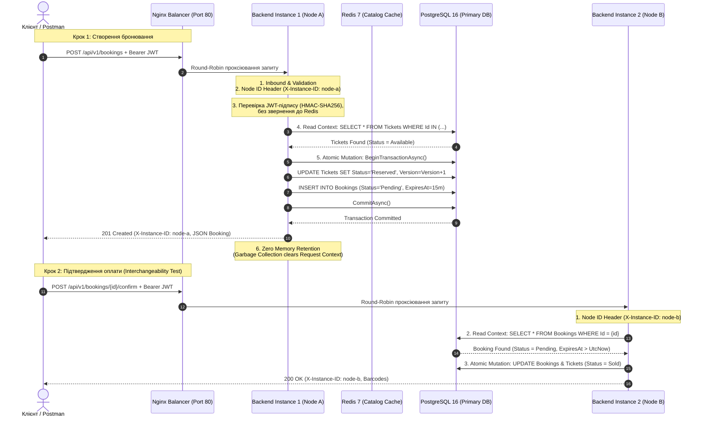

### Фіксація параметрів та дій за вимогами

1. **Вхідні параметри (Inbound Parameters & Token).**
   - HTTP-маршрут: `POST /api/v1/bookings`
   - Header: `Authorization: Bearer <jwt_access_token>` (самодостатній токен з `UserId` та `Email`).
   - Body: `{"userId": "8a7d183f-...", "ticketIds": ["7b0a793c-..."]}`

2. **Вичитування контексту зі Shared Storage.**
   - Перевірка токена виконується без звернення до локальної пам'яті (криптографічний верифікатор `JwtOptions`).
   - Читання статусу квитків з **PostgreSQL 16** (`SELECT ... FROM Tickets WHERE Id = ANY(@ids)`). Redis на цьому кроці не використовується.

3. **Атомарні зміни стану.**
   - Відкриття явної транзакції `BeginTransactionAsync()`.
   - Оновлення статусу квитків із токеном версіонування `Version += 1` (OCC-блокування).
   - Фіксація броні у СУБД та `CommitAsync()`.

4. **Відсутність залишкових мутацій у пам'яті (Zero Memory Retention).**
   - Після відправки відповіді `201 Created` усі об'єкти запиту виходять із зони видимості й утилізуються Garbage Collector (GC).
   - У RAM `Instance 1` не залишається локальних локів або прапорців броні.
   - Наступний запит `POST /confirm` перенаправляється на `Instance 2`, який зчитує створену бронь напряму з PostgreSQL і успішно завершує оплату.

---

## 2. Архітектура системи (C4 Container & Component Model)

Архітектурна схема з кількома інстансами API за балансувальником Nginx (upstream `api_servers`, алгоритм Round Robin за замовчуванням; без sticky sessions). Усі інстанси ходять у спільний PostgreSQL 16 (бізнес-стан) і Redis 7 (розподілений кеш); жодного стану в пам'яті контейнера немає, тому будь-який інстанс може обробити будь-який запит.

З ЛР6 база — це топологія **Primary + Read Replica**: записи й строгі читання йдуть на Primary, читання з допустимою eventual consistency — на репліку, яка асинхронно програє WAL Primary. Маршрут обирає `DbRouter` у шарі доступу до даних (розділ [11](#11-лабораторна-робота-6-реплікація-бд-та-readwrite-separation)).

З ЛР7 історія **замовлень** (`Orders`) винесена на два незалежні шарди PostgreSQL (`shard-a`, `shard-b`), кожен — Primary зі своєю Read Replica. Вузол обирає `ShardRouter` у коді API за `hash(UserId)` → віртуальний бакет → шард (розділ [12](#12-лабораторна-робота-7-шардинг-і-партиціонування-data-scaling)).

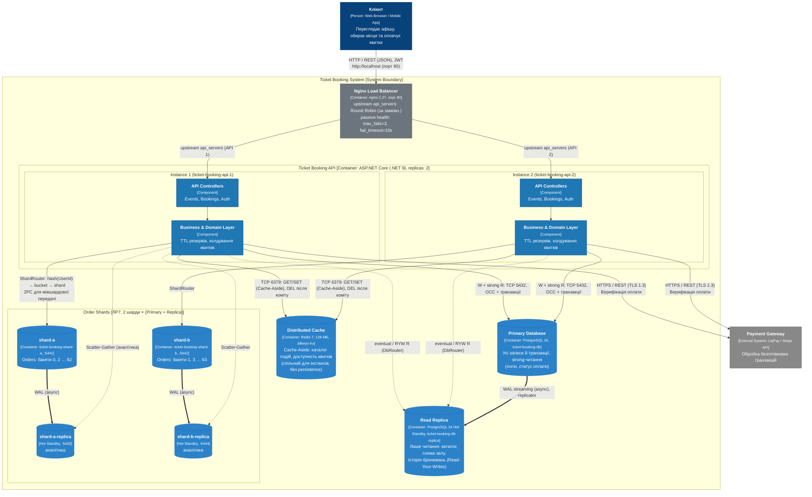

## 3. Схема даних (ERD & Persistence Layer)

Модель нормалізована до 3NF. Топологія майданчика (`Venue`, `Section`, `SeatSlot`) строго відділена від комерційних сутностей події (`Event`, `Ticket`), що дозволяє повторно використовувати конфігурацію майданчика для різних концертів без дублювання записів геометрії.

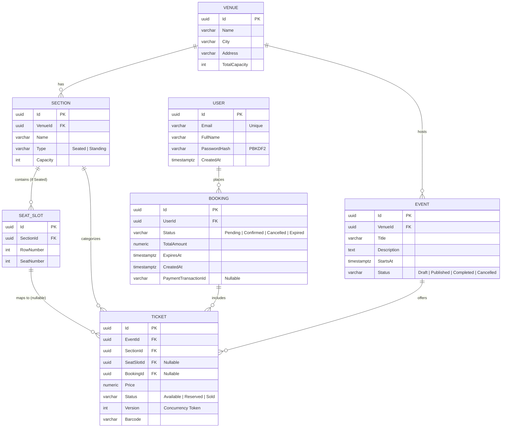

### Ключові оптимізації бази даних

- **Фан-зони:** для квитків стоячих секторів поле `SeatSlotId` встановлюється в `NULL`, а контроль переповнення виконується на рівні квоти сектора `Section.Capacity`.
- **Індексація:** складений індекс `IX_Tickets_EventId_Status` оптимізує фільтрацію доступних квитків під час перегляду схеми залу.
- **Concurrency Check:** поле `Version` у сутності `Ticket` реалізує токен оптимістичного блокування (OCC) для контролю паралельного доступу.
- **TTL резервів:** індекс `IX_Bookings_Status_ExpiresAt` використовується фоновим сервісом `ExpiredBookingsCleaner`, який кожні 30 с переводить прострочені `Pending`-броні в `Expired` і повертає квитки у продаж.
- **Унікальність:** `IX_Users_Email` (логін) та `IX_Tickets_Barcode` (штрихкод квитка).

---

## 4. Специфікація REST API

Інтерактивна документація ендпоінтів та тестування доступні через Swagger UI:

- **Swagger URL:** <http://localhost/swagger> (через Nginx)

### Перелік контрактів системи

| Метод | Маршрут | Опис | Відповідає |
|---|---|---|---|
| `GET` | `/api/v1/events` | Отримання каталогу подій з фільтрацією за містом | Катерина |
| `GET` | `/api/v1/events/{id}/tickets` | Перегляд схеми залу та доступних квитків за подією | Катерина |
| `POST` | `/api/v1/bookings` | Транзакційне холдування квитків (TTL 15 хв, захист від Race Condition) | Напарник |
| `POST` | `/api/v1/bookings/{id}/confirm` | Підтвердження оплати, генерація штрихкодів, статус `Sold` | Напарник |
| `DELETE` | `/api/v1/bookings/{id}` | Скасування бронювання та повернення квитків у продаж | Напарник |
| `GET` | `/api/v1/bookings/{id}` | Перегляд бронювання з квитками та залишком TTL | Напарник |
| `GET` | `/api/v1/users/{userId}/bookings` | Історія бронювань користувача (ЛР6: Read-Your-Writes, репліка або Primary) | Напарник |
| `POST` | `/api/v1/auth/register` | Реєстрація користувача (пароль хешується PBKDF2), повертає JWT | Напарник |
| `POST` | `/api/v1/auth/login` | Автентифікація за email/паролем, повертає JWT (HMAC-SHA256, 60 хв) | Напарник |
| `GET` | `/api/v1/auth/me` | Профіль поточного користувача (`Authorization: Bearer <token>`) | Напарник |
| `GET` | `/health` | Health check для оркестрації контейнерів | Напарник |

### Коди відповідей бронювання

| Ендпоінт | Успіх | Помилки |
|---|---|---|
| `POST /api/v1/bookings` | `201 Created` + `Location` | `400` валідація / квитки з різних подій, `404` користувач або квиток не існує, `409` квиток уже `Reserved`/`Sold` (Double-Booking) або паралельний конфлікт `Version` |
| `POST /api/v1/bookings/{id}/confirm` | `200 OK` + штрихкоди `TCK-XXXXXXXX` | `400` валідація, `404` бронь не існує, `409` статус не `Pending` або вичерпано TTL (бронь → `Expired`, квитки → `Available`) |
| `DELETE /api/v1/bookings/{id}` | `204 No Content` | `404` бронь не існує, `409` бронь уже `Confirmed` / `Cancelled` / `Expired` |

### Захист від Double-Booking

1. Бронювання виконується в явній транзакції (`BeginTransactionAsync`).
2. Перевіряється, що **всі** квитки мають статус `Available`; інакше — `RollbackAsync` і `409 Conflict`.
3. Під час оновлення квитків `Version += 1`. Оскільки `Version` позначено `[ConcurrencyCheck]`, EF Core генерує `UPDATE ... WHERE "Id" = @id AND "Version" = @old`. Якщо дві транзакції одночасно прочитали той самий вільний квиток, друга після коміту першої оновить 0 рядків → `DbUpdateConcurrencyException` → `409 Conflict`. Таким чином подвійний продаж неможливий навіть за гонки між перевіркою і записом.

### Input Validation (FluentValidation)

| DTO | Правила |
|---|---|
| `CreateBookingRequest` | `UserId` ≠ `Guid.Empty`; `TicketIds` не `null` і не порожній; не більше **4** квитків в одні руки; без дублікатів; жоден id ≠ `Guid.Empty` |
| `ConfirmPaymentRequest` | `PaymentTransactionId` обов'язковий, 6–100 символів, лише `[A-Za-z0-9_-]` |
| `RegisterRequest` | коректний email ≤ 255; пароль 8–128 символів, щонайменше одна літера й одна цифра; `FullName` обов'язковий |
| `LoginRequest` | коректний email, пароль обов'язковий |

Валідатори підключені глобальним фільтром `FluentValidationFilter` — контролери отримують уже перевірені дані.

### Формат помилок (RFC 7807 ProblemDetails)

Усі помилки (валідація, 401/404/409, неперехоплені винятки) повертаються як `application/problem+json`. Глобальний `GlobalExceptionHandler` (`IExceptionHandler` + `UseExceptionHandler`) не віддає стек-трейси назовні.

```json
{
  "type": "https://tools.ietf.org/html/rfc9110#section-15.5.10",
  "title": "Квитки вже заброньовані або продані",
  "status": 409,
  "detail": "Один або кілька вибраних квитків недоступні для бронювання.",
  "instance": "POST /api/v1/bookings",
  "traceId": "00-...",
  "unavailableTickets": [ { "ticketId": "7b0a793c-...", "status": "Reserved" } ]
}
```

### Тестові дані (seed)

| Сутність | Значення |
|---|---|
| Користувач | `8a7d183f-6712-401c-b26a-9f5e13d1fa82`, `katerina@example.com` / пароль `Katerina123` |
| Подія | `e5b87192-3c2b-4d43-9821-82d2cbb54d01` — «Океан Ельзи. Світовий тур» |
| Квитки | 2 місця в партері (850 грн) + 30 квитків фан-зони (600 грн) |

### Колекція запитів для захисту

- `postman/TicketBooking.postman_collection.json` — імпортувати в Postman (File → Import). Містить 4 папки: сценарій захисту за регламентом, негативні кейси, авторизацію та тест персистентності. ID події/квитків/броней зберігаються у змінні колекції автоматично, кожен запит має автотести (вкладка *Test Results*).
- `TicketBooking.Api.http` — той самий сценарій для VS Code REST Client / Visual Studio.

---

## 5. Матриця відповідальності (RACI)

Розподіл інженерних завдань між учасниками команди згідно з вимогами лабораторних робіт № 1 та № 2:

| Етап / Модуль розробки | Катерина | Напарник |
|---|---|---|
| **Проєктування домену, структури секторів та ER-моделі** | **A / R** | C |
| **Шар персистентності (EF Core, Npgsql, DDL, Seeder)** | **A / R** | I |
| **Модуль каталогу подій (`EventsController`)** | **A / R** | I |
| **Інтеграція та налаштування OpenAPI / Swagger UI** | **A / R** | I |
| **Проведення аудиту стану (State Audit Report) та класифікація за 3 категоріями** | **A / R** | C |
| **Рефакторинг Stateless Architecture та Middleware `X-Instance-ID`** | **A / R** | I |
| **Специфікація Stateless Request Flow (Sequence Diagram)** | **A / R** | I |
| **Модуль бронювання (`BookingsController`) та автентифікації (`AuthController`)** | C | **A / R** |
| **Input Validation (FluentValidation) та глобальний Middleware помилок** | I | **A / R** |
| **Контейнеризація, Nginx Balancer та `docker-compose.yml` (`--scale api=2`)** | I | **A / R** |
| **Resilience & Cross-Instance Consistency Testing (`docker kill`)** | I | **A / R** |
| **Аналіз вузьких місць (Bottleneck Analysis за шаблоном)** | C | **A / R** |
| **Колекція API-запитів (Postman/Bruno з негативними кейсами)** | I | **A / R** |

---

## 6. Інструкція із детермінованого запуску системи

Потрібні лише Docker та Docker Compose (локальні .NET SDK, PostgreSQL і Redis не потрібні). Порти `80` (Nginx) і `5432` (PostgreSQL) мають бути вільні.

```bash
# 1. Клонування репозиторію
git clone https://github.com/katushhiaa/ticket-booking-platform.git
cd ticket-booking-platform

# 2. Збірка і запуск: PostgreSQL 16, Redis 7, 2 інстанси API та Nginx
docker compose up -d --build --scale api=2

# 3. Перевірка статусу: db і redis — healthy; api-1, api-2, nginx — Up
docker compose ps
docker compose logs api
```

- **Після `--scale`** перезапустіть Nginx (`docker compose restart nginx`): він запам'ятовує адреси upstream при старті, тому без перезапуску бачить лише старі репліки.
- **Топологія:** клієнт → Nginx (`http://localhost`, порт 80) → `api` (2 репліки, Round-Robin) → спільні PostgreSQL та Redis. Порт API напряму назовні не публікується: усі запити йдуть через Nginx.
- **Перевірка балансування:** кожна відповідь містить заголовок `X-Instance-ID` (ID контейнера, що обробив запит). Послідовні запити до `http://localhost/api/v1/events` мають чергувати два різні значення:

  ```bash
  for i in 1 2 3 4; do curl -s -D - -o /dev/null http://localhost/api/v1/events | grep -i x-instance-id; done
  ```

- **Swagger UI:** <http://localhost/swagger>
- При старті API сам створює схему (`EnsureCreated`) і заповнює тестові дані (див. розділ «Тестові дані (seed)»).
- **Тестовий логін:** `POST /api/v1/auth/login` з `{"email": "katerina@example.com", "password": "Katerina123"}` → JWT; для `GET /api/v1/auth/me` додати заголовок `Authorization: Bearer <token>`.
- **Postman:** File → Import → `postman/TicketBooking.postman_collection.json`, далі Run collection (папки виконувати по порядку 01 → 02 → 03 → 05; змінні зберігаються між запитами). Колекційний тест перевіряє `X-Instance-ID` у кожній відповіді.
- **Newman (CLI):**

  ```bash
  npx newman run postman/TicketBooking.postman_collection.json \
    --folder "01 Сценарій захисту (регламент викладача)" \
    --folder "02 Негативні кейси (валідація, 404, 409)" \
    --folder "03 Авторизація (JWT)" \
    --folder "05 Cross-Instance (2 репліки за Nginx)"
  ```

- **Реплікація БД (ЛР6):** разом зі стеком стартує `ticket-booking-db-replica` (порт 5433 на хості), яка при першому запуску сама знімає копію Primary. Стан: `scripts/replication-status.sh`; з якого вузла прочитано відповідь — заголовки `X-Db-Node` / `X-Db-Route`. Деталі — [розділ 11](#11-лабораторна-робота-6-реплікація-бд-та-readwrite-separation).
- **Шарди замовлень (ЛР7):** разом зі стеком стартують `ticket-booking-shard-a` і `ticket-booking-shard-b` (порти 5441 і 5442 на хості), схема `Orders` створюється при старті API. Куди потрапить користувач: `GET /api/v1/lab/sharding/route/{userId}`; розподіл: `scripts/sharding/distribution.sh`. Деталі — [розділ 12](#12-лабораторна-робота-7-шардинг-і-партиціонування-data-scaling).
- **Скидання бази (чистий стан перед повторним прогоном):**

  ```bash
  docker compose down -v && docker compose up -d --build
  ```

- **Тест персистентності:** створити бронювання, виконати `docker compose restart db`, дочекатися `healthy` у `docker compose ps` і перевірити `GET /api/v1/bookings/{id}` (статус `Pending`) та `GET /api/v1/events/{eventId}/tickets` (квиток `Reserved`). Дані зберігаються у volume `pgdata`; «мертві» з'єднання в пулі Npgsql після рестарту БД перевіряються й замінюються автоматично (`Infrastructure/PooledConnectionValidator.cs`).
- **Сценарій А (Cross-Instance Consistency):** логін → створення броні → перегляд → оплата. Запити обробляють різні інстанси (`X-Instance-ID` у відповідях), але стан однаковий: броня, створена на одному вузлі, видна і підтверджується на іншому. Папка `05` у Postman робить це автоматично.
- **Сценарій Б (Instance Loss):** створити бронь, знайти інстанс, що її обробив, вбити його `docker kill ticket-booking-api-1`, одразу підтвердити оплату. Запит проходить через уцілілий `api-2`, квиток стає `Sold`. Вбитий контейнер Docker сам не піднімає (ручна зупинка вимикає `restart`), тому повернути другу репліку можна так: `docker compose up -d --scale api=2`.
- **Зупинка:** `docker compose down` (дані зберігаються), `docker compose down -v` (разом з даними).

### 6.1. Інтеграційні тести

Проєкт `tests/TicketBooking.IntegrationTests` (xUnit + `WebApplicationFactory` + Testcontainers). Кожен запуск сам піднімає тимчасові `postgres:16-alpine` і `redis:7-alpine` у Docker, стартує справжнє API в пам'яті й ганяє запити по HTTP; між тестами база скидається до стану після сідера.

Покрито: успішне бронювання, Double-Booking (у т.ч. 20 паралельних запитів → рівно один `201`), валідацію (`400`), `404`/`409`, оплату і штрихкоди, TTL (прострочена бронь → `409`, квитки знову `Available`), скасування, авторизацію (JWT), кеш (Cache-Aside, інвалідація, gzip, fallback без Redis — див. 9.8).

```bash
# Варіант 1: повністю в Docker (потрібен лише Docker)
docker compose --profile tests run --rm tests

# Варіант 2: локально (потрібні .NET 9 SDK/runtime і запущений Docker)
dotnet test tests/TicketBooking.IntegrationTests
```

> **Примітка.** Варіант 1 збирає проєкт усередині Linux-контейнера й перезаписує `bin/`/`obj/`; перед локальним `dotnet test` може знадобитися `dotnet restore`.

---

## 7. Результати аналізу вузьких місць (Bottleneck Analysis)

### 7.1. Row Lock Contention (транзакційне блокування при купівлі популярних місць)

- **Точка відмови:** таблиця `Tickets` під час одночасного виконання транзакцій бронювання (`POST /api/v1/bookings`) за наявності тисяч запитів на обмежений пул квитків.
- **Причина:** конкуренція за ексклюзивне блокування рядків у реляційній базі даних. У разі використання песимістичного блокування виникає черга очікування локів (Lock Wait Timeout) і ризик виникнення Deadlock.
- **Вплив:** різке зростання p99-затримки відповіді з <100 мс до кількох секунд, масові помилки `504 Gateway Timeout` та `409 Conflict`.
- **Шляхи оптимізації:** використання черги повідомлень (RabbitMQ/Kafka) для серіалізації запитів на бронювання або застосування in-memory сховища (Redis) з атомарними операціями через Lua-скрипти перед записом у реляційну БД.

### 7.2. Database Connection Pool Exhaustion (вичерпання пулу з'єднань БД)

- **Точка відмови:** пул підключень Npgsql / PostgreSQL (`Max Pool Size`).
- **Причина:** під час сплеску трафіку (Flash Crowd) кількість одночасних HTTP-запитів значно перевищує ліміт пулу з'єднань до бази даних (за замовчуванням 100 підключень).
- **Вплив:** потоки ASP.NET Core блокуються в очікуванні вільного підключення з пулу, що призводить до вичерпання пулу потоків веб-сервера (Thread Pool Starvation) і відмови всього API.
- **Шляхи оптимізації:** впровадження connection pooler (PgBouncer) на рівні інфраструктури, агресивне кешування незмінних даних (каталог подій, геометрія залу) на рівні Redis/CDN, скорочення часу утримання відкритих транзакцій до мінімуму.

### 7.3. Read Amplification & I/O Overhead при читанні схеми залу

- **Точка відмови:** дискова підсистема СУБД (Disk I/O) під час масового опитування схеми квитків (`GET /api/v1/events/{id}/tickets`).
- **Причина:** користувачі постійно оновлюють сторінку вибору місць, генеруючи важкі `SELECT`-запити з `JOIN` до таблиць `Sections`, `SeatSlots` і `Tickets`.
- **Вплив:** вичерпання буферного пулу PostgreSQL (`shared_buffers`), зростання черги читання з диска, деградація продуктивності всієї системи.
- **Шляхи оптимізації:** використання HTTP-кешування із заголовками `ETag` / `If-None-Match`, оновлення стану зайнятих місць на клієнті через Server-Sent Events (SSE) або WebSockets замість частих опитувань (polling).

---

## 8. Лабораторна робота №3: балансування, відмовостійкість, масштабування

Усі числа нижче отримано на одному MacBook (Docker Desktop, спільна VM на всі контейнери) інструментом ApacheBench (`ab`): 2000 запитів при паралельності 50 до `GET /api/v1/events/{eventId}/tickets` (на момент ЛР3 читав PostgreSQL напряму; кеш додано в ЛР4). Сирі виводи лежать у `experiments/raw/`.

> **Застереження про точність.** На одній машині шум між прогонами ±20–30%, а між серіями, виконаними в різний час, значення помітно відрізняються. Тому порівнюються лише прогони **однієї серії**, а висновки є напрямними, а не абсолютними. Для точних цифр потрібні окремі хости.

### 8.1. Алгоритми балансування (пункт 2.3)

Конфіги лежать у `nginx/algorithms/`. Перемикання: `scripts/switch-balancer.sh <алгоритм>` (копіює конфіг в `nginx/active/default.conf` і перезавантажує Nginx). Замір: `scripts/bench.sh <мітка>`.

| Алгоритм | Конфіг | Запис у upstream | Поведінка |
|---|---|---|---|
| **Round Robin** (базовий) | `round_robin.conf` | `server api:8080` | По черзі на кожен сервер; розподіл рівний (≈50/50) |
| **Least Connections** | `least_conn.conf` | `least_conn;` | Новий запит — на сервер з найменшою кількістю активних з'єднань |
| **IP Hash** | `ip_hash.conf` | `ip_hash;` | Хеш від IP клієнта: один клієнт → один сервер (псевдо-sticky) |

Результати (2 інстанси, пул Npgsql = 20, два прогони кожного алгоритму):

| Алгоритм | RPS (прогін 1 / 2) | Середнє RPS | p99, мс | Розподіл запитів |
|---|---|---|---|---|
| Round Robin | 1390 / 1102 | **1246** | 132 / 133 | ≈50/50 (1001 / 999 у прогоні з пулом 50) |
| Least Connections | 1404 / 1529 | **1467** | 125 / 107 | ≈50/50 (998 / 1002 у прогоні з пулом 50) |
| IP Hash | 1552 | 1552 | 81 | **2000 / 0** (усі запити з одного IP → один вузол) |

**Висновок.** На симетричних інстансах Round Robin і Least Connections дають однаковий розподіл, різниця в RPS у межах шуму. **IP Hash** на тестовому стенді зламаний за дизайном: `ab`, `curl` та Newman працюють з одного IP, тож весь трафік іде на один вузол, інший простоює. Для реальних клієнтів (багато IP) розподіл був би рівномірнішим, але при NAT (багато користувачів за одним IP) ситуація повторюється. Тому для stateless API за Nginx кращий Round Robin або Least Connections.

### 8.2. Асиметричне навантаження (затримка на одному інстансі)

Експеримент: пул із трьох серверів — `api` (2 репліки) і `api-slow`, у якого кожен API-запит затримується на 300 мс (`Lab:SimulatedLatencyMs=300`, сервіс у профілі `experiment`). Конфіги: `round_robin_asymmetric.conf`, `least_conn_asymmetric.conf`.

| Алгоритм | RPS | p50, мс | p95, мс | p99, мс | Запитів на повільний вузол |
|---|---|---|---|---|---|
| Round Robin | 400 | 10 | 323 | **639** | 668 з 2000 (33%) |
| Least Connections | **1136** | 14 | 309 | **344** | 316 з 2000 (16%) |

**Висновок.** Round Robin шле третину трафіку на повільний вузол незалежно від його стану, і кожен такий запит тримає клієнта 300+ мс. Least Connections бачить, що повільний вузол має більше активних з'єднань, і відправляє йому вдвічі менше. Результат: RPS вищий приблизно у 2.8 раза, p99 нижчий на 46% (639 → 344 мс). Цифри p50 майже однакові, бо більшість запитів обслуговують швидкі вузли; різниця видна саме в хвості розподілу, тобто в p99.

### 8.3. Passive Health Checks та відмовостійкість (пункт 2.4)

Директиви в усіх конфігах:

```nginx
upstream api_servers {
    server api:8080 max_fails=2 fail_timeout=10s;
}
# у location /
proxy_next_upstream error timeout http_500 http_502 http_503;   # у ЛР6 http_503 прибрано, див. 11.5
proxy_next_upstream_tries 3;
```

Як працює: після 2 помилок поспіль сервер виключається з ротації на 10 с (`max_fails`/`fail_timeout`), а `proxy_next_upstream` повторює запит на наступному сервері. Повтор робиться **до** того, як відповідь пішла клієнту, тож клієнт помилки не бачить.

Сценарій: 8000 запитів при паралельності 20, через 2 с після старту вбиваємо `ticket-booking-api-2` (`docker kill`). Скрипт: `scripts/failover-experiment.sh <мітка>`.

| Конфігурація | Запитів | Помилок для клієнта (Failed / Non-2xx) | Записів про недоступний upstream у логах Nginx |
|---|---|---|---|
| **З `proxy_next_upstream`** (наш конфіг) | 8000 | **0 / 0** | 161 |
| **Контроль** `proxy_next_upstream off` (`round_robin_no_failover.conf`) | 8000 | **24 / 24** (502) | 243 |

**Висновок.** Без повторів (контроль) за секунду падіння клієнти отримують 502 (0.3% запитів). З повторами втрат немає: Nginx фіксує помилки на вбитому інстансі (ті самі записи в логах) і переадресовує запит на живий. Важливо: **за замовчуванням** Nginx уже має `proxy_next_upstream error timeout`, тож відмова з'єднання повторюється і без наших директив; явний рядок у конфігу додає повтори для 5xx-відповідей (`http_500/502/503`), які самі по собі за замовчуванням не повторюються.

Відновлення: Docker не перезапускає вручну зупинений (`docker kill`) контейнер, тому повертаємо репліку `docker compose up -d --scale api=2`, а потім `docker compose restart nginx`, щоб Nginx побачив нову адресу.

### 8.4. Масштабування: 1, 2, 3+ інстанси (пункт 2.5)

Серія: Round Robin, пул Npgsql = 20, по 3 прогони на кожну кількість інстансів (2000 запитів, паралельність 50, усі в межах одного часу).

| Інстанси API | RPS (прогони) | Середнє RPS | p99, мс (прогони) | Помилки |
|---|---|---|---|---|
| 1 | 2346 / 2169 / 2600 | **2372** | 55 / 48 / 35 | 0 |
| 2 | 1223 / 1729 / 1882 | **1611** | 302 / 92 / 65 | 0 |
| 3 | 1198 / 1688 / 1584 | **1490** | 184 / 100 / 105 | 0 |

Завантаження CPU при 3 інстансах (`docker stats`, під навантаженням, 1645 RPS): `api-1..3` разом ~366%, PostgreSQL ~153%, Nginx ~42%, Redis <1%.

**Висновок 1: горизонтальне масштабування на одній машині не додає пропускної здатності.** З 1 до 3 інстансів RPS падає з ~2370 до ~1490, а p99 росте. Причина: усі інстанси ділять один CPU-ресурс (Docker VM), а кожен новий вузол додає накладні витрати (додатковий hop через Nginx, ще один пул з'єднань, ще одна ASP.NET-процес з GC і JIT). Масштабування має сенс, коли компонент, що обмежує, — сам обчислювальний шар, а на цьому стенді обмежує спільний ресурс.

**Висновок 2: після масштабування обчислень вузьке місце переходить до бази.** Перевірено на практиці:

1. **Пул з'єднань БД (підтверджено).** За замовчуванням Npgsql тримає до 100 з'єднань на інстанс, а PostgreSQL за замовчуванням приймає 100 клієнтів загалом. Три інстанси під навантаженням вичерпують ліміт: `FATAL: sorry, too many clients already` (зафіксовано в логах API, а на рівні `psql` клієнт не міг підключитися). Виправлено обмеженням `Maximum Pool Size=20` у рядку підключення: 3×20 = 60 з'єднань, помилок немає. Побічний ефект: пул 20 на одному інстансі обмежує паралельність і без збільшення `max_connections` скоро стане новою межею.
2. **CPU спільної VM (виміряно).** PostgreSQL сам споживає ~153% CPU, а API разом ~366%. Додавання інстансів збільшує конкуренцію за той самий CPU, а не потужність.
3. **Locks на рядках квитків (за дизайном, не відтворено під масштабуванням).** Конфлікти на одному квитку вирішуються OCC (`Version`) і `UPDATE ... WHERE Version = @v`: при 20 паралельних бронюваннях одного квитка рівно один отримує 201, решта 409 (інтеграційний тест). Під високою конкуренцією за **різні** квитки цей механізм не дає блокувань, але кожен невдалий OCC-запит — це повтор від клієнта, тобто додаткове навантаження на БД.
4. **Network I/O та Nginx (очікування, не виміряно окремо).** Кожен запит проходить додатковий hop клієнт → Nginx → API → БД. Nginx при 3 інстансах споживає ~42% CPU; окремого стенду для вимірювання мережевого I/O у цій роботі немає. За власним оцінюванням, при багатьох інстансах на одному хості Nginx і мережа стають наступним обмеженням після БД.

**Шляхи подальшої оптимізації.** Пул з'єднань за інстансом або PgBouncer (поширює обмеження `max_connections`), реплікація читань для `GET /tickets` (вони не потребують узгодженості з записом), окремі хости для API, БД і Nginx (щоб CPU не був спільним).

### 8.5. Як відтворити

```bash
docker compose up -d --build --scale api=2              # базовий стенд
scripts/switch-balancer.sh round_robin                  # або least_conn | ip_hash
scripts/bench.sh "мітка" 2000 50                        # замір RPS, p99, розподіл по інстансах
scripts/failover-experiment.sh "мітка" ticket-booking-api-2   # вбиття інстансу під навантаженням

docker compose --profile experiment up -d --scale api=2 # + api-slow з затримкою 300 мс
scripts/switch-balancer.sh round_robin_asymmetric
```

---

## 9. Лабораторна робота №4: розподілене кешування (Redis)

### 9.1. Які ендпоінти кешуємо і чому (Read-Intensive)

Продаж квитків — типовий read-heavy профіль: на кожну спробу бронювання припадають десятки переглядів афіші й карти залу (користувачі оновлюють сторінку, чекаючи на вільні місця). Аналіз контролерів:

| Ендпоінт | Частота читання | Частота зміни | Вартість для БД | Рішення |
|---|---|---|---|---|
| `GET /api/v1/events[?city=]` — афіша | дуже висока (головна сторінка) | майже ніколи (через API подій не змінюють) | `JOIN Events + Venues` | **кешуємо**, TTL 5 хв |
| `GET /api/v1/events/{id}/tickets[?status=]` — карта залу | найвища (polling вибору місць) | при кожному бронюванні / оплаті / скасуванні | `JOIN Tickets + Sections + SeatSlots`; для залу на 1000 місць — 1000 рядків і ~149 КБ JSON | **кешуємо**, TTL 30 с + явна інвалідація |
| `GET /api/v1/bookings/{id}` | низька (власник броні) | часто (оплата, протермінування) | 1 рядок за PK | не кешуємо: дешево і має бути строго актуальним |
| `GET /api/v1/auth/me` | низька | — | 1 рядок за PK | не кешуємо |
| `POST/…` бронювання, оплата, скасування | — | — | транзакції з OCC | ніколи не кешуємо; **перевірка доступності при бронюванні завжди йде в PostgreSQL**, тож застарілий кеш не може призвести до подвійного продажу |

### 9.2. Розгортання Redis

- Окремий контейнер `ticket-booking-redis` (`redis:7-alpine`) у `docker-compose.yml`, спільний для всіх інстансів API (кеш, записаний одним вузлом, читає інший — перевірено: `MISS` на `api-1` → `HIT` на `api-2`).
- `--maxmemory 128mb --maxmemory-policy allkeys-lru` — при заповненні витісняються найдавніше використані ключі, кеш ніколи не відмовляє в записі.
- `--save "" --appendonly no` — кеш без persistence: після рестарту Redis порожній, тому не може повернути дані, що застаріли, поки він лежав.
- Клієнт: `IDistributedCache` (`Microsoft.Extensions.Caching.StackExchangeRedis`), рядок підключення `ConnectionStrings:RedisConnection`.

### 9.3. Патерн Cache-Aside

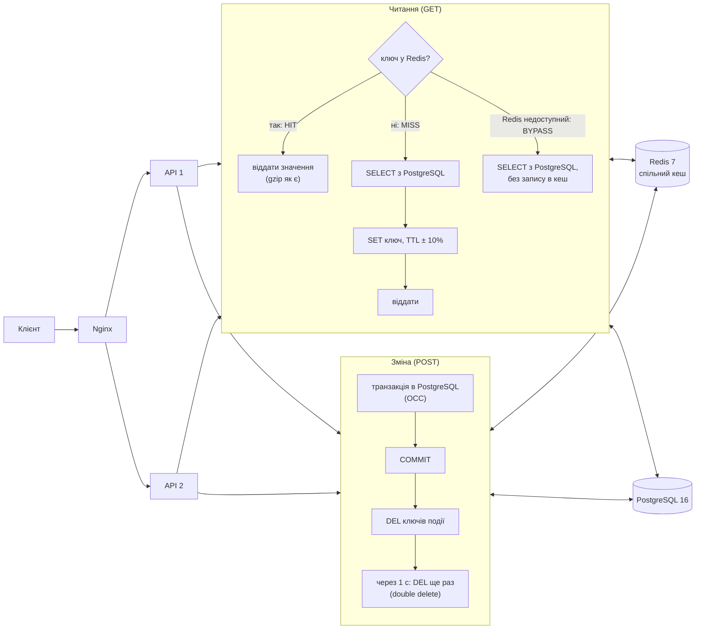

Реалізація — `Infrastructure/Caching/ResilientCache.cs` (`GetOrCreateAsync` / `InvalidateAsync`), використання — `EventsController`. Кожна відповідь має заголовок **`X-Cache: HIT | MISS | BYPASS`**, а в лог пишеться `Cache HIT/MISS/BYPASS/INVALIDATE <ключ>`.

Значення зберігаються **стиснутими (gzip)**, якщо вони більші за 1 КБ (`CachedPayload.cs`): карта залу на 1000 місць займає ~5 КБ замість ~149 КБ. Клієнтам з `Accept-Encoding: gzip` (браузери, k6) стиснуте значення віддається без розпакування (`Content-Encoding: gzip`, `Vary: Accept-Encoding`), іншим — розпакований JSON. Навіщо це знадобилось, описано в [розділі 10.6](#106-знахідка-redis-не-витримував-великих-значень-і-як-це-виправлено).

### 9.4. Специфікація ключів

Шаблон: **`tb:v1:{domain}:{entity}:{id}:{params}`** (`Infrastructure/Caching/CacheKeys.cs`):

- `tb` — простір імен застосунку (Redis можна ділити з іншими сервісами); `v1` — версія формату значення: зміна DTO → `v2`, старі ключі просто протухнуть за TTL, без ручного очищення;
- `{id}` — ідентифікатор сутності (`Guid` у форматі `N`) або `-` для списків;
- `{params}` — канонічні параметри запиту: `all` без фільтрів; `k=v` у нижньому регістрі для коротких ASCII-значень; інакше `h-` + перші 16 hex SHA-256 від канонічного рядка (кирилиця, довгі значення, `:`). Однаковий запит завжди дає той самий ключ (`?city=Чернівці` і `?city= чернівці ` → один ключ), різні — різні.

| Ендпоінт | Приклад ключа | TTL | Інвалідація |
|---|---|---|---|
| `GET /events` | `tb:v1:catalog:events:-:all` | 300 с ± 10% | лише expiration (змін через API немає) |
| `GET /events?city=Чернівці` | `tb:v1:catalog:events:-:h-de9b7f8d0898eeca` | 300 с ± 10% | лише expiration |
| `GET /events/{id}/tickets` | `tb:v1:catalog:event-tickets:e5b871923c2b4d43982182d2cbb54d01:all` | 30 с ± 10% | явна + expiration |
| `GET /events/{id}/tickets?status=Available` | `tb:v1:catalog:event-tickets:e5b871923c2b4d43982182d2cbb54d01:status=available` | 30 с ± 10% | явна + expiration |

### 9.5. Політика TTL та інвалідації

- **Каталог (300 с).** Афіша змінюється рідко й не через цей API, тож допустима затримка — хвилини. TTL обмежує застарілість, якщо подію змінять напряму в БД.
- **Доступність квитків (30 с).** Основний механізм свіжості — **явна інвалідація**, TTL лише страховка (якщо `DEL` не дійшов через збій Redis, застарілі дані живуть не довше 30 с).
- **Jitter ±10%** до кожного TTL — ключі, записані одночасно (після рестарту або flush), протухають у різний час → немає Cache Avalanche.
- **Явна інвалідація після коміту** (ключі всіх варіантів фільтра `status` для зачеплених подій — `CacheKeys.AllEventTickets`):

  | Подія | Де | Причина в лозі |
  |---|---|---|
  | `POST /bookings` (квитки → `Reserved`) | `BookingsController.Create` | `booking created` |
  | `POST /bookings/{id}/confirm` (→ `Sold`) | `BookingsController.Confirm` | `booking confirmed` |
  | оплата простроченої броні (→ `Available`) | `BookingsController.Confirm` | `booking expired on confirm` |
  | `POST /bookings/{id}/cancel` (→ `Available`) | `BookingsController.Cancel` | `booking cancelled` |
  | фонове протермінування броней | `ExpiredBookingsCleaner` | `bookings expired` |

- **Чому видаляємо ключ, а не оновлюємо його.** Перерахунок карти залу при кожній бронi дорожчий, ніж наступний MISS, і при паралельних записах оновлення можуть прийти в іншому порядку (lost update у кеші).
- **Double delete.** Паралельний читач міг прочитати БД **до** коміту і записати старе значення **після** нашого `DEL`. Тому ключі видаляються ще раз через 1 с (`Cache:InvalidationRetryDelayMs`).
- Перевірка: `POST /bookings` → наступний `GET /tickets` дає `X-Cache: MISS` і квиток уже `Reserved` (інтеграційний тест `Tickets_BookingInvalidatesCache_NextReadIsFreshMiss`).

### 9.6. Відмовостійкість: Redis недоступний

`ResilientCache` ловить будь-яку помилку Redis і обслуговує запит з PostgreSQL (`X-Cache: BYPASS`), тобто кеш — оптимізація, а не точка відмови:

- **Обрив з'єднання** (`RedisConnectionException`) відкриває circuit breaker на 15 с: наступні запити інстансу одразу йдуть у БД, не чекаючи на таймаут. Через 15 с — нова спроба.
- **Таймаут команди** (`RedisTimeoutException`, 2 с) обслуговує з БД лише цей запит і **не** вимикає кеш: під навантаженням таймаут означав перевантажений інстанс API, а не мертвий Redis (див. [10.6](#106-знахідка-redis-не-витримував-великих-значень-і-як-це-виправлено)).
- Інвалідація при недоступному Redis пропускається з попередженням; оскільки Redis без persistence, після підйому він порожній і застарілих значень не має.

Перевірка (`docker stop ticket-booking-redis` під час роботи):

```
200 0.21s X-Cache: HIT       ← Redis працює
200 2.83s X-Cache: BYPASS    ← Redis зупинено: перший запит інстансу чекає таймаут підключення, далі circuit breaker
200 0.01s X-Cache: BYPASS
200 0.005s X-Cache: BYPASS
                             ← docker start ticket-booking-redis, через 15 с:
200 0.06s X-Cache: MISS      ← кеш порожній (без persistence), значення береться з БД
200 0.006s X-Cache: HIT
```

Бронювання при зупиненому Redis також проходить (`201`) — інтеграційний тест `RedisUnavailable_FallsBackToDatabase`.

### 9.7. Cold vs Hot: вплив кешу на латентність

`scripts/cache-latency.sh` — для кожної з 30 пар: `DEL` ключа → запит (**MISS**: БД + запис у кеш) → такий самий запит (**HIT**). Запити йдуть через Nginx, клієнт надсилає `Accept-Encoding: gzip`. Сирий вивід: `experiments/raw/lab4_cache_latency.txt`.

| Запит | Розмір відповіді | MISS p50 / p95, мс | HIT p50 / p95, мс | Прискорення p50 |
|---|---|---|---|---|
| Схема залу, 1000 квитків | ~149 КБ JSON (~5 КБ gzip) | 9.14 / 29.27 | **3.38 / 12.16** | **×2.7** |
| Квитки демо-події, 32 квитки | ~6 КБ | 5.01 / 8.01 | **2.75 / 4.00** | ×1.8 |
| Каталог подій | ~2 КБ | 3.94 / 5.52 | **2.32 / 3.10** | ×1.7 |

Що більший і дорожчий запит до БД, то більший виграш: для схеми залу MISS — це `JOIN` 1000 рядків, серіалізація ~149 КБ і gzip, а HIT — один `HMGET` у Redis і віддача готових ~5 КБ. Абсолютні значення невеликі, бо БД на тому ж хості й дані в `shared_buffers`; під навантаженням різниця значно більша (розділ 10.5: p99 17 мс з кешем проти 1.6 с без кешу при 100 VU).

Вплив кешу на навантаження БД і пропускну здатність під навантаженням виміряно в [розділі 10.5](#105-кеш-увімкнено-vs-вимкнено).

### 9.8. Інтеграційні тести кешу

`tests/TicketBooking.IntegrationTests/EventsTests.cs`, `CacheKeysTests.cs`, `CachedPayloadTests.cs` (Testcontainers піднімає ще й `redis:7-alpine`, між тестами — `FLUSHALL`): MISS → HIT; окремі ключі для фільтрів; 404 не кешується; інвалідація після бронювання, оплати, скасування; gzip-віддача з кешу; fallback при недоступному Redis; вимкнений кеш (`Cache:Enabled=false` → `BYPASS`). Усього **40/40** тестів.

### 9.9. Теорія до захисту

- **Cache Stampede / Thundering Herd.** Популярний ключ протухає, і сотні паралельних запитів одночасно отримують MISS та йдуть у БД з тим самим важким запитом. Захист: (1) блокування на перерахунок (лише один запит рахує значення, інші чекають або отримують старе; у Redis — `SET lock NX PX`); (2) ймовірнісне раннє оновлення (XFetch: значення перераховується трохи раніше TTL з імовірністю, що зростає ближче до кінця); (3) stale-while-revalidate. У нашому проєкті ризик обмежено: один MISS на ключ коштує ~10 мс, а в навантажувальному тесті кількість MISS — десятки на ~50 000 запитів (розділ 10). Для продакшну з flash crowd варто додати lock на перерахунок карти залу.
- **Cache Avalanche.** Масове одночасне протухання багатьох ключів (усі записані в один момент з однаковим TTL) або падіння всього кешу → вся хвиля запитів падає на БД. Захист: **jitter TTL** (у нас ±10%), прогрів, кластер/репліки Redis, circuit breaker і обмеження паралельності до БД. Під навантаженням ми бачили схожий ефект: коли кеш вимикався через таймаути, весь трафік інстансу йшов у БД і перевантаження ставало самопідтримним (розділ 10.6).
- **LRU vs LFU.** LRU (Least Recently Used) витісняє ключ, до якого найдовше не зверталися; LFU (Least Frequently Used) — ключ з найменшою частотою звернень (у Redis — ймовірнісний лічильник із затуханням). LRU краще реагує на зміну «модних» даних (нова подія відразу стає гарячою), LFU стійкіше до одноразових сканувань, які інакше вимили б гарячі ключі. Ми обрали **`allkeys-lru`**: інтерес до подій зміщується в часі (стартує продаж нової події), а ключів-«сканів» у нас немає. `allkeys-*`, а не `volatile-*`, бо всі ключі мають TTL і є кешем.
- **Expiration vs Invalidation.** Expiration (TTL) — пасивний механізм: дані можуть бути застарілими до TTL, зате нічого не треба відстежувати; підходить для даних, що змінюються поза нашим контролем або рідко (каталог). Invalidation — активне видалення при зміні: свіжість одразу після коміту, але кожен шлях запису має пам'ятати про кеш (у нас 5 точок) і є гонки (лікуємо double delete). Для доступності квитків використовуємо обидва: інвалідацію як основний механізм, TTL як страховку від пропущеного `DEL`.

---

## 10. Лабораторна робота №5: базовий рівень продуктивності (Load Performance Baseline)

Усі скрипти — у `load-tests/`, сирі результати кожного прогону — у `load-tests/results/` (`<мітка>.txt` — вивід k6, `.json` — метрики по ступенях, `.env.txt` — середовище, навантаження на БД, Redis і CPU throttling, `.stats.csv` — `docker stats` кожні 5 с). Зведення всіх прогонів: `load-tests/results/REPORT.md` (генерує `load-tests/report.py`).

### 10.1. Сценарії

| Сценарій | Скрипт | Що робить | Яку підсистему навантажує |
|---|---|---|---|
| **A — Read-Intensive** | `a-read.js` | 70% схема залу на 1000 місць (`GET /events/{id}/tickets?status=Available`), 20% афіша, 10% квитки демо-події; пауза 0.2 с | кеш Redis, серіалізація/мережа API; PostgreSQL лише при MISS |
| **B — Write-Intensive** | `b-write.js` | `POST /bookings` на унікальний квиток із пулу 400 000 (детермінований UUID за номером ітерації, тож 409 немає); пауза 0.2 с | транзакції PostgreSQL (SELECT → UPDATE з OCC → INSERT → COMMIT), WAL, пул з'єднань, інвалідація кешу |
| **C — Complex Workflow** | `c-complex.js` | наскрізний шлях покупця: логін (раз на VU) → афіша → схема залу → бронювання → оплата → перегляд броні; пауза 0.3 с між кроками | усе разом: кеш + 2 транзакції запису + читання за PK + JWT |

Тестові дані: `load-tests/seed.sql` (ідемпотентний) додає подію READ (1000 квитків, `c0ffee00-…-0000000000a1`) і подію WRITE (400 000 квитків, `…-0000000000b1`). Перед кожним прогоном `run.sh` скидає квитки цих подій (`reset.sql`), робить `FLUSHALL` у Redis і обнуляє його статистику — кожен прогін стартує з однакового стану з **холодним кешем**.

### 10.2. Середовище (Baseline Environment)

| Параметр | Значення |
|---|---|
| Хост | Apple M1 (8 ядер: 4 продуктивні + 4 енергоефективні), 8 ГБ RAM, macOS 26.6 |
| Віртуалізація | Docker Desktop (Engine 29.8.1), Linux VM: 8 vCPU, ~3.8 ГБ |
| API | ASP.NET Core .NET 9, **2 інстанси** (для масштабування — 1 і 3), **1 CPU / 512 МБ на інстанс**, логування `Warning`, `ThreadPool.MinThreads = 32` |
| PostgreSQL 16 | 2 CPU / 1 ГБ, Npgsql `Maximum Pool Size = 20` на інстанс |
| Redis 7 | 0.5 CPU / 256 МБ, `maxmemory 128mb`, `allkeys-lru`, без persistence; на старті прогону порожній, наповнюється на warm-up |
| Nginx | 1 CPU / 128 МБ, Round Robin, HTTP/1.1 до upstream |
| Генератор навантаження | k6 v2.4.0 **на хості, поза Docker VM**: ліміти CPU контейнерів (`load-tests/docker-compose.loadtest.yml`) гарантують, що SUT не забирає ядра в генератора і навпаки |

> **Обмеження ізоляції.** Генератор і SUT все ж на одній фізичній машині: k6 ділить з VM ядра й пам'ять (усього 8 ГБ), а планувальник macOS може переносити потоки VM на енергоефективні ядра. Через це між однаковими прогонами буває розкид (приклад нижче — два прогони A). Ліміти CPU роблять порівняння конфігурацій чесними, але абсолютні числа справедливі лише для цього стенду.

### 10.3. Профіль навантаження і методика

- **Warm-up** 20 с при 10 VU (JIT, пули з'єднань, наповнення кешу) — у метрики не входить.
- **Ступені** 10 → 25 → 50 → 100 → 200 VU: перехід 5 с + **утримання 30 с**. Кожен запит має тег `stage` (`warmup` / `ramp` / `vus_010` …), у таблиці потрапляють лише вікна утримання (`load-tests/lib/profile.js`).
- **Два режими:** «стандартний» — з паузою (think time) 0.2–0.3 с, як у живого користувача; **stress** — `THINK_SECONDS=0`, кожен VU шле запити без пауз, щоб знайти межу пропускної здатності.
- Модель навантаження k6 `ramping-vus` — **закрита** (VU чекає на відповідь перед наступним запитом); наслідки для percentiles — у 10.10.
- Навантаження на БД — дельта `pg_stat_database` (транзакції, прочитані рядки) за прогін; CPU — `docker stats` і `cpu.stat` cgroup (частка CFS-періодів, у яких контейнер вперся в ліміт).

### 10.4. Результати по сценаріях (2 інстанси, кеш увімкнено)

**Сценарій A — Read-Intensive** (стандартний режим). інстансів API: **2**; кеш: **true**; транзакцій БД: **386** (8 на 1000 запитів); рядків прочитано: 86 724; Redis hit ratio: 99.91% (53883 / 50); API CFS throttled: 16% періодів

| VUs | Запитів | RPS | avg, мс | p50, мс | p95, мс | p99, мс | max, мс | Помилки, % | cache_hit |
|---:|---:|---:|---:|---:|---:|---:|---:|---:|---:|
| 10 | 1430 | 47.7 | 10.1 | 8.8 | 19.2 | 47.7 | 59.8 | 0.00 | 99.4% |
| 25 | 3579 | 119.3 | 9.4 | 8.0 | 20.2 | 27.0 | 100.8 | 0.00 | 99.6% |
| 50 | 7350 | 245.0 | 3.9 | 3.6 | 7.7 | 10.8 | 18.9 | 0.00 | 99.9% |
| 100 | 14688 | 489.6 | 4.0 | 3.2 | 8.8 | 17.3 | 98.6 | 0.00 | 100.0% |
| 200 | 19625 | 654.2 | 105.5 | 41.9 | 399.5 | 1 688.1 | 3 833.1 | 0.00 | 99.9% |

**Сценарій B — Write-Intensive** (стандартний режим). інстансів API: **2**; кеш: **true**; транзакцій БД: **312 997** (6808 на 1000 запитів); рядків прочитано: 773 670; Redis hit ratio: 0.00% (0 / 0); API CFS throttled: 33% періодів

| VUs | Запитів | RPS | avg, мс | p50, мс | p95, мс | p99, мс | max, мс | Помилки, % |
|---:|---:|---:|---:|---:|---:|---:|---:|---:|
| 10 | 1235 | 41.2 | 40.8 | 19.8 | 141.0 | 465.6 | 585.1 | 0.00 |
| 25 | 3419 | 114.0 | 16.5 | 14.1 | 32.4 | 59.6 | 244.6 | 0.00 |
| 50 | 6092 | 203.1 | 45.2 | 12.4 | 263.8 | 606.3 | 1 113.9 | 0.00 |
| 100 | 12487 | 416.2 | 39.7 | 15.5 | 127.1 | 518.4 | 1 327.9 | 0.00 |
| 200 | 22739 | 758.0 | 63.5 | 60.8 | 154.3 | 215.3 | 322.9 | 0.00 |

**Сценарій C — Complex Workflow** (стандартний режим; `flows_completed` — завершених покупок за секунду). інстансів API: **2**; кеш: **true**; транзакцій БД: **112 255** (2671 на 1000 запитів); рядків прочитано: 448 617; Redis hit ratio: 99.92% (18644 / 14); API CFS throttled: 21% періодів

| VUs | Запитів | RPS | avg, мс | p50, мс | p95, мс | p99, мс | max, мс | Помилки, % | flows_completed |
|---:|---:|---:|---:|---:|---:|---:|---:|---:|---:|
| 10 | 1180 | 39.3 | 12.3 | 11.3 | 25.9 | 33.7 | 68.5 | 0.00 | 7.87 |
| 25 | 3001 | 100.0 | 10.2 | 7.7 | 26.3 | 35.9 | 79.1 | 0.00 | 20.00 |
| 50 | 6101 | 203.4 | 6.2 | 4.8 | 13.8 | 38.2 | 152.5 | 0.00 | 40.67 |
| 100 | 12181 | 406.0 | 8.2 | 4.2 | 11.9 | 50.6 | 1 277.1 | 0.00 | 81.20 |
| 200 | 19566 | 652.2 | 40.5 | 17.7 | 108.0 | 394.8 | 2 770.6 | 0.00 | 130.43 |

**Stress-режим (без пауз), A і B:**

| VUs | Запитів | RPS | avg, мс | p50, мс | p95, мс | p99, мс | max, мс | Помилки, % | cache_hit |
|---:|---:|---:|---:|---:|---:|---:|---:|---:|---:|
| 10 | 22220 | 740.7 | 13.3 | 7.8 | 50.9 | 65.9 | 153.8 | 0.00 | 100.0% |
| 25 | 19221 | 640.7 | 38.9 | 21.9 | 87.1 | 313.0 | 981.4 | 0.00 | 99.9% |
| 50 | 19950 | 665.0 | 71.7 | 50.5 | 115.9 | 755.3 | 3 592.1 | 0.00 | 99.9% |
| 100 | 20388 | 679.6 | 146.3 | 88.3 | 381.2 | 1 534.6 | 3 824.8 | 0.00 | 99.9% |
| 200 | 16031 | 534.4 | 372.1 | 176.1 | 1 650.8 | 4 475.3 | 6 095.5 | 0.00 | 99.3% |

| VUs | Запитів | RPS | avg, мс | p50, мс | p95, мс | p99, мс | max, мс | Помилки, % |
|---:|---:|---:|---:|---:|---:|---:|---:|---:|
| 10 | 15665 | 522.2 | 18.9 | 10.8 | 58.8 | 68.7 | 173.4 | 0.00 |
| 25 | 19935 | 664.5 | 37.4 | 23.2 | 80.5 | 128.2 | 497.0 | 0.00 |
| 50 | 22806 | 760.2 | 65.6 | 68.8 | 127.8 | 195.4 | 395.0 | 0.00 |
| 100 | 24132 | 804.4 | 124.0 | 112.6 | 253.1 | 290.6 | 395.4 | 0.00 |
| 200 | 19734 | 657.8 | 303.6 | 309.2 | 721.5 | 992.3 | 1 291.7 | 0.00 |

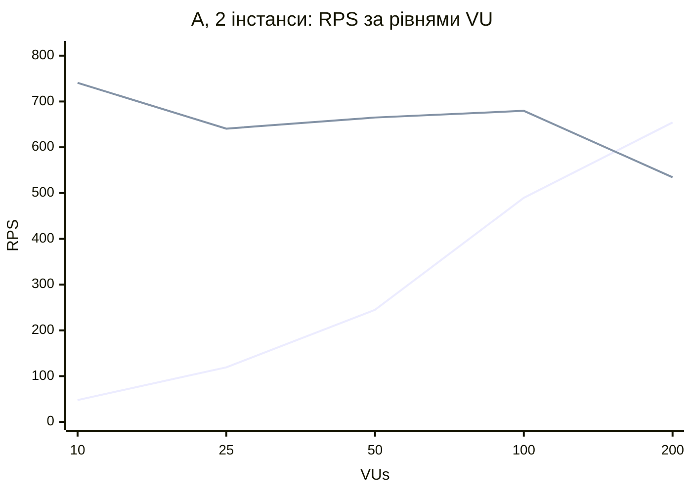

<sub>лінія 1 — `стандартний` · лінія 2 — `stress`</sub>

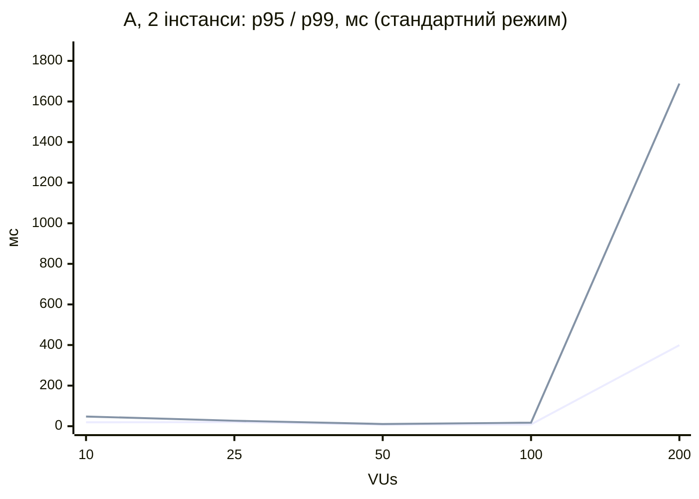

<sub>лінія 1 — `p95` · лінія 2 — `p99`</sub>

**Повторюваність.** Той самий стандартний прогін A, виконаний двічі поспіль (`A_read_2inst_cache_run1` / `run2`), на 100 VU дав 305 / 490 RPS і p99 4350 / 17 мс: у першому прогоні один інстанс на ~30 с «застряг» на 100% CPU (інший у цей час простоював на ~20%), і через закриту модель навантаження VU накопичились на ньому. Повторний прогін C (`C_complex_2inst_stalled`) теж зловив зависання стенду. Тому в таблицях — прогони без таких епізодів, а ці файли залишено як свідчення шуму стенду.

#### Аналіз хвостової латентності (Tail Latency)

- **До насичення хвіст короткий.** A, 100 VU: p50 3.2 мс, p99 17.3 мс (×5). C, 50 VU: p50 4.8, p99 38 мс.
- **Після насичення p99 відривається від p50 на порядок.** A, 200 VU: p50 42 мс, p99 1688 мс (×40), max 3.8 с; stress A, 200 VU: p50 176 мс, p99 4475 мс.
- **Причини хвоста, виміряні на стенді:**
  1. **CFS throttling.** Ліміт `cpus: 1.0` = 100 мс CPU на кожні 100 мс. Коли інстанс витратив квоту, **усі** його потоки заморожуються до наступного періоду. У stress A інстанси впиралися в ліміт у **85%** періодів (B, 1 інстанс — 99%). Саме тому вже на 10 VU без пауз p50 7.8 мс, а p95 51 мс: частина запитів чекає «розморожування» на десятки мс.
  2. **Черги в закритій моделі.** Після насичення кожен новий VU лише подовжує чергу: за законом Літтла `W = N / X`, у stress A на 200 VU `200 / 534 RPS ≈ 375 мс` — збігається з виміряним avg 372 мс.
  3. **Нерівномірність Round Robin.** Якщо один інстанс тимчасово сповільнився (GC, throttling, E-ядро), він отримує стільки ж нових запитів, скільки й швидкий, і VU накопичуються на ньому (прогін `run1`). Least Connections з ЛР3 цей ефект зменшує.
  4. **Перший ступінь B (10 VU, p99 466 мс, max 585 мс)** — холодний старт записів: ріст пулу з'єднань Npgsql, перші транзакції після `VACUUM`, tiered JIT для шляху бронювання (warm-up у 20 с прогріває його лише частково). На 25 VU p99 уже 60 мс.

### 10.5. Кеш увімкнено vs вимкнено

Однаковий стенд (2 інстанси), сценарій A; кеш вимикається змінною `CACHE_ENABLED=false` (→ `Cache__Enabled`), відповіді тоді мають `X-Cache: BYPASS`. «Увімкнено» — кеш, прогрітий на warm-up (hit ratio ≥ 99.3% на всіх ступенях).

| Рівень (стандартний режим) | Кеш | RPS | p50, мс | p95, мс | p99, мс |
|---|---|---:|---:|---:|---:|
| 50 VU | увімкнено | 245.0 | 3.6 | 7.7 | 10.8 |
| 50 VU | вимкнено | 239.9 | 6.7 | 15.8 | 34.3 |
| 100 VU | увімкнено | 489.6 | 3.2 | 8.8 | 17.3 |
| 100 VU | вимкнено | 324.5 | 13.0 | 684.1 | 1624.8 |
| 200 VU | увімкнено | 654.2 | 41.9 | 399.5 | 1688.1 |
| 200 VU | вимкнено | 247.3 | 283.8 | 2314.3 | 3022.3 |

| Навантаження на БД за прогін | Кеш увімкнено | Кеш вимкнено | Зменшення |
|---|---:|---:|---:|
| Транзакцій PostgreSQL, стандартний режим | 386 | 187,212 | **×485** |
| Прочитано рядків, стандартний режим | 86,724 | 48,923,675 | **×564** |
| Транзакцій PostgreSQL, stress | 1,532 | 371,738 | **×243** |
| Прочитано рядків, stress | 447,721 | 97,336,218 | **×217** |
| CPU PostgreSQL (p75 за `docker stats`), stress | 1% | 76% | — |
| Максимальна пропускна здатність (stress) | **741 RPS** | 428 RPS | +73% |

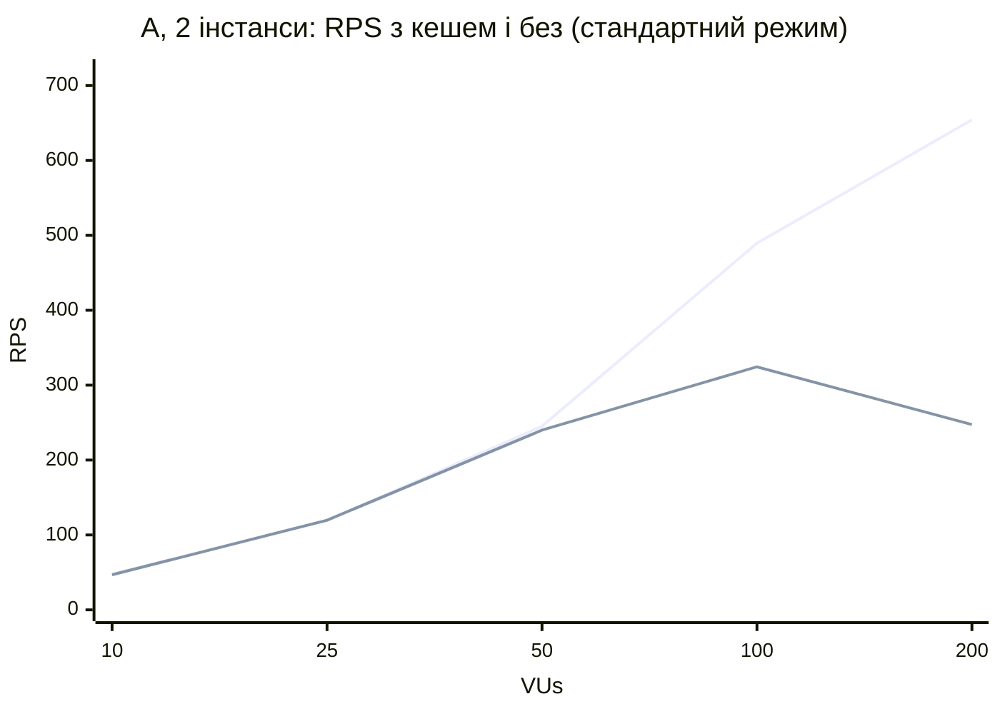

<sub>лінія 1 — `кеш увімкнено` · лінія 2 — `кеш вимкнено`</sub>

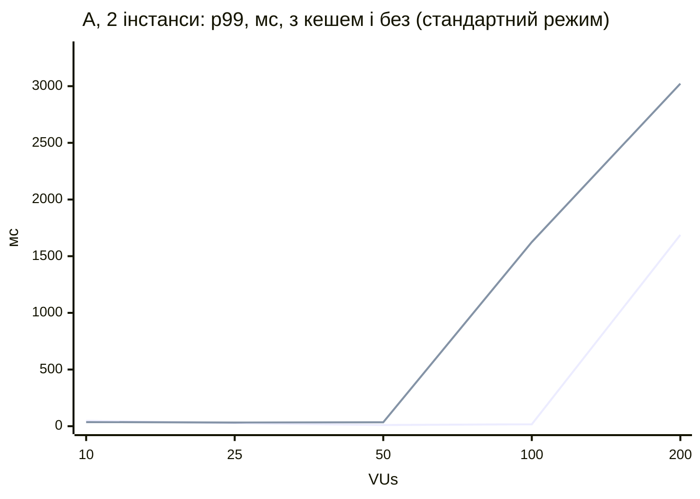

<sub>лінія 1 — `кеш увімкнено` · лінія 2 — `кеш вимкнено`</sub>

**Висновки.** До 50 VU обидва варіанти встигають (БД швидка, дані в `shared_buffers`), різниця лише в p99 (11 проти 34 мс). На 100 VU без кешу система вже насичена: RPS 325 замість 490, p99 1.6 с замість 17 мс. Кеш прибирає з PostgreSQL ~99.5% роботи (×217 менше прочитаних рядків), звільняючи БД для транзакцій бронювання — саме тих, які кешувати не можна. Без кешу межею все одно лишається CPU API (серіалізація 1000 рядків на кожен запит), але БД уже завантажена на 76% свого ліміту і була б наступною.

### 10.6. Знахідка: Redis «не витримував» великих значень, і як це виправлено

Перші stress-прогони A показали, що кеш під навантаженням **сам вимикався**, а весь трафік ішов у БД. Розслідування по логах StackExchange.Redis (`RedisTimeoutException` з діагностикою пулу потоків і буферів) дало три послідовні виправлення:

| Крок | Симптом під stress A | Причина (з діагностики) | Виправлення | Результат |
|---|---|---|---|---|
| 1 | 15 756 відповідей `BYPASS`, ~76 000 транзакцій БД | `WORKER: Min=1` — при ліміті 1 CPU .NET стартує з 1 потоком у пулі, і продовження async-команд Redis чекали на потік довше за таймаут 500 мс (thread pool starvation) | `ThreadPool:MinWorkerThreads = 32` (`appsettings.json`, `Program.cs`) | starvation зник (`Min=32`), але таймаути лишились |
| 2 | 2 549 `BYPASS`; 908 → 544 RPS між 50 і 200 VU | `in-pipe: 9 681 524`, `inbound=12 МБ`: одне мультиплексоване з'єднання на інстанс тягнуло карти залу по **149 КБ** кожна, і черга відповідей не встигала розбиратись | значення в Redis **стискаються gzip** (~5 КБ) і віддаються клієнтам із `Accept-Encoding: gzip` без розпакування (`CachedPayload.cs`) | трафік Redis ×30 менше, 7 таймаутів на інстанс замість тисяч |
| 3 | на 200 VU (стандартний A) 268 RPS, p99 6.2 с, 976 `BYPASS` на одному інстансі | **metastable failure**: перевантажений по CPU інстанс не встигав прочитати відповідь Redis → таймаути → circuit breaker вимикав кеш → запити йшли в БД, а це дорожче (1000 рядків + серіалізація + gzip) → інстанс ще більше перевантажений → знову таймаути | таймаут команди **не** відкриває circuit breaker (лише обрив з'єднання); таймаут команд 2 с (`Cache:OperationTimeoutMs`) | 0 таймаутів, DB load у stress A — 1,532 транзакцій замість ~76 000 |

Урок: fallback «якщо кеш повільний — іди в БД» безпечний, лише коли Redis справді недоступний. Якщо ж повільний сам інстанс, такий fallback множить навантаження (це той самий механізм, що й у Cache Avalanche).

### 10.7. Масштабування: 1 vs 2 vs 3 інстанси

Stress-режим (без пауз), той самий стенд, змінюється лише `--scale api=N`. Пропускна здатність — максимальний RPS серед ступенів. **Scalability Efficiency Factor** `SEF(N) = RPS(N) / (N × RPS(1))` (1.0 — ідеальне лінійне масштабування).

| Сценарій | 1 інстанс, RPS | 2 інстанси, RPS | 3 інстанси, RPS | SEF(2) | SEF(3) |
|---|---:|---:|---:|---:|---:|
| A — Read (кеш) | 461 | 741 | 922 | 0.80 | 0.67 |
| B — Write | 412 | 804 | 1010 | 0.98 | 0.82 |

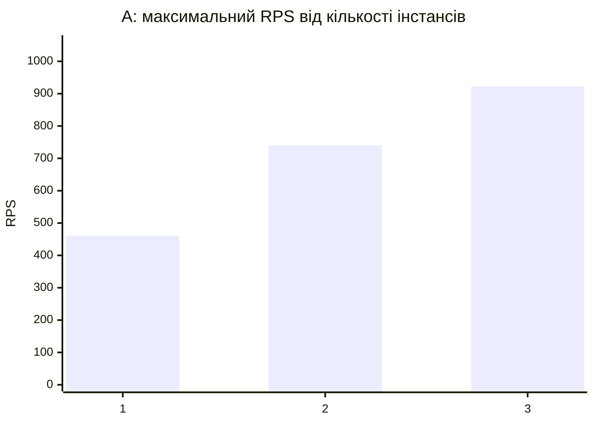

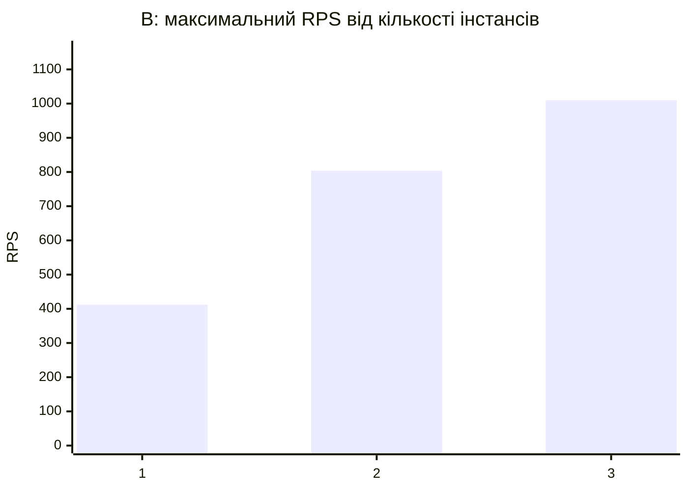

| Прогін | CPU API (сумарно, p75) | CPU PostgreSQL (ліміт 200%) | CPU Nginx | CPU Redis |
|---|---:|---:|---:|---:|
| A, 1 інстанс | 100% | 0% | 34% | 3% |
| A, 2 інстанси | 201% | 1% | 46% | 5% |
| A, 3 інстанси | 306% | 4% | 59% | 8% |
| B, 1 інстанс | 100% | 76% | 27% | 3% |
| B, 2 інстанси | 203% | 146% | 18% | 5% |
| B, 3 інстанси | 308% | **201%** | 26% | 8% |

**Висновки.**

- **B (запис) масштабується майже лінійно до 2 інстансів (SEF 0.98)**, а на 3 ефективність падає до 0.82: PostgreSQL упирається у свій ліміт 2 CPU (201%) — **вузьке місце переходить з API на БД**. Подальше додавання інстансів API для запису не допоможе; потрібні оптимізація транзакцій, більше CPU для БД або шардування подій.
- **A (читання з кешу) масштабується гірше (SEF 0.80 / 0.67)**, хоча БД і Redis майже не навантажені. Причина: API на кешованих читаннях дуже швидкий, тож усе більша частка часу припадає на спільні ресурси одного хоста — Nginx (34 → 59% CPU), мережевий стек Docker VM і сам k6 на хості (при ~900 RPS з gzip-розпакуванням). Тобто для читань наступне вузьке місце — інфраструктура навколо API, а не БД.
- **Порівняння з ЛР3.** Там додавання інстансів **зменшувало** RPS, бо контейнери не мали лімітів і 1 інстанс уже використовував усі ядра VM. Тут кожен інстанс має фіксований 1 CPU, тож масштабування додає реальну обчислювальну потужність — і ефект видно.

### 10.8. Точка насичення і основне вузьке місце

- **Точка насичення (A, 2 інстанси, кеш): ~650–740 RPS.** У стандартному режимі пропускна здатність росте лінійно з VU до 100 VU (490 RPS = попит), а на 200 VU замість очікуваних ~950 RPS система дає 654 RPS при p99 1.7 с. У stress-режимі ~740 RPS досягається вже на 10 VU, далі RPS не росте (а на 200 VU падає до 534 — ретроградна ділянка через throttling і конкуренцію потоків), латентність росте пропорційно VU (закон Літтла).
- **B, 2 інстанси: ~760–800 RPS** (50–100 VU без пауз), на 200 VU — 658 RPS і p99 ~1 с.
- **C, 2 інстанси:** до 200 VU (652 RPS, 130 покупок/с) помилок немає, p99 395 мс — близько до насичення.
- **Основне вузьке місце — CPU інстансів API** (ліміт 1 CPU кожен): у stress-режимі API використовує 100% ліміту і throttled у 85–99% CFS-періодів, тоді як PostgreSQL (A: 1%) і Redis (≤ 8%) майже вільні. Для запису при 3 інстансах вузьке місце переходить на **PostgreSQL** (2 CPU, 201%).

### 10.9. SYSTEM PERFORMANCE BASELINE

```
┌────────────────────────── SYSTEM PERFORMANCE BASELINE ───────────────────────────┐
│ Стенд        : Apple M1 / Docker Desktop VM 8 vCPU; API 2 × (1 CPU, 512 МБ);     │
│                PostgreSQL 16 (2 CPU, 1 ГБ, pool 20/інстанс); Redis 7 (0.5 CPU,   │
│                128 МБ allkeys-lru, gzip-значення); Nginx Round Robin; k6 2.4.0   │
│ Read  (A)    : 490 RPS при p95 8.8 мс / p99 17 мс (100 VU, think 0.2 с)          │
│                насичення ~650–740 RPS; cache hit ≥ 99.3%                         │
│ Write (B)    : 416 RPS при p95 127 мс / p99 518 мс (100 VU, think 0.2 с)         │
│                насичення ~760–800 RPS; 0% помилок, 0 конфліктів                  │
│ Flow  (C)    : 130 покупок/с (652 RPS) при p99 395 мс (200 VU)                   │
│ Помилки      : 0.00% на всіх ступенях усіх сценаріїв                             │
│ Bottleneck   : CPU API (throttled 85–99% CFS-періодів у stress);                 │
│                для запису при 3 інстансах — CPU PostgreSQL (201% з 200%)         │
│ Масштабування: SEF(2) = 0.80 (read) / 0.98 (write); SEF(3) = 0.67 / 0.82         │
│ Кеш          : ×217 менше рядків з БД; +73% пропускної здатності;                │
│                p99 при 100 VU 17 мс замість 1625 мс                              │
└──────────────────────────────────────────────────────────────────────────────────┘
```

### 10.10. Теорія до захисту

- **Saturation Point (точка насичення)** — навантаження, після якого збільшення кількості клієнтів не підвищує пропускну здатність, а лише збільшує латентність (черги). На графіку RPS(VU) крива виходить на плато (або падає — ретроградна ділянка, як у stress A на 200 VU), а latency(VU) перетворюється з плоскої на лінійно зростаючу: `W = N / X` (закон Літтла). Насичення визначається найповільнішим ресурсом (тут — CPU API); робоча точка системи має бути помітно нижче (зазвичай 60–70% від точки насичення), щоб мати запас на піки.
- **Coordinated Omission** — систематичне заниження percentiles у **закритій** моделі навантаження (наш `ramping-vus`): коли система «зависає», кожен VU чекає на свою відповідь і **не надсилає** запити, які за планом мали б іти в цей час. Затримка, яку відчули б ці невідправлені запити, не потрапляє в статистику, тож p99 виглядає кращим, ніж для реальних користувачів, які приходять незалежно від стану сервера. У нас це видно на прогоні `run1`: під час зависання інстансу RPS падав (305 замість 490), тобто частина «запланованих» запитів просто не відбулася. Як уникнути: відкрита модель (`constant-arrival-rate` / `ramping-arrival-rate` у k6 — запити йдуть за розкладом, незалежно від відповідей), або корекція в HdrHistogram. Ми свідомо лишили закриту модель для пошуку точки насичення (вона не дає генератору «закидати» систему нескінченною чергою), але для SLO-вимірювань варто використовувати відкриту.
- **Вплив GC/JIT на percentiles.**
  - *JIT*: .NET компілює методи при першому виклику (tiered compilation: спершу швидкий неоптимізований код, потім рекомпіляція гарячих методів). Перші запити повільні — це впливає на max/p99 перших секунд, тому warm-up виключено з метрик. Ефект видно на першому ступені B (p99 466 мс на 10 VU проти 60 мс на 25 VU): шлях запису до warm-up майже не виконувався.
  - *GC*: збирання сміття зупиняє (повністю або частково) потоки застосунку. Gen0-збирання короткі й часті — майже не впливають на p50; Gen2 і особливо Large Object Heap (об'єкти > 85 КБ) — дорогі й рідкісні, тому б'ють саме по p99/max. До gzip кожна HIT-відповідь карти залу створювала рядок у 149 КБ (два об'єкти в LOH на запит), після — масив ~5 КБ. В обмеженому контейнері (1 CPU) GC ще й конкурує з обробкою запитів за ту саму квоту CFS.
  - Обидва ефекти дають **бімодальний розподіл**: p50 стабільний, а p99 «стрибає» між прогонами, тому порівнювати конфігурації треба за кількома прогонами і за p95/p99, а не лише за середнім.

### 10.11. Як відтворити

```bash
# 1. Стенд з лімітами ресурсів (2 інстанси)
docker compose -f docker-compose.yml -f load-tests/docker-compose.loadtest.yml up -d --build --scale api=2
docker compose restart nginx

# 2. Тестові дані для навантаження (один раз, ~15 с)
docker exec -i ticket-booking-db psql -U postgres -d ticket_booking_db < load-tests/seed.sql

# 3. Один прогін: сценарій, мітка, додаткові параметри k6
load-tests/run.sh a-read A_read_2inst_cache                       # стандартний режим
load-tests/run.sh b-write B_write_2inst_stress -e THINK_SECONDS=0  # stress

# 4. Уся серія (baseline, stress, масштабування 1/3, кеш вимкнено; ~50 хв)
load-tests/run-all.sh all

# 5. Таблиці
python3 load-tests/report.py                    # → load-tests/results/REPORT.md

# 6. Повернути звичайний стенд без лімітів
docker compose up -d --build --scale api=2 && docker compose restart nginx
```

Потрібен k6 на хості (`brew install k6`). Параметри профілю: `LEVELS`, `HOLD_SECONDS`, `RAMP_SECONDS`, `WARMUP_SECONDS`, `THINK_SECONDS`, `BASE_URL`.

---

## 11. Лабораторна робота №6: реплікація БД та Read/Write Separation

Основна БД тепер складається з двох вузлів PostgreSQL 16: **Primary** (`ticket-booking-db`) приймає всі записи, **Read Replica** (`ticket-booking-db-replica`) — Hot Standby, що асинхронно програє журнал WAL Primary і обслуговує читання. Який вузол обслуговує конкретне читання, вирішує `DbRouter` у шарі доступу до даних — за вимогою бізнес-сценарію до узгодженості.

### 11.1. Топологія реплікації (Primary / Replica)

| Що | Де | Значення |
|---|---|---|
| WAL для реплікації | `docker-compose.yml`, `db.command` | `wal_level=replica`, `max_wal_senders=10`, `wal_keep_size=256MB` (запас WAL для репліки, що відстала або перезапускалась) |
| Користувач реплікації | `db/primary/initdb/10-replication-user.sh` (новий volume), `db/replica/bootstrap.sh` (існуючий volume, ідемпотентно) | `replicator` з атрибутом `REPLICATION`, пароль SCRAM |
| Доступ | `db/primary/pg_hba.conf` (монтується, `-c hba_file=...`) | `host replication replicator all scram-sha-256` — реплікаційне з'єднання дозволене лише цьому користувачу |
| Ініціалізація репліки | `db/replica/bootstrap.sh` | Порожній data-каталог → `pg_basebackup --wal-method=stream` (фізична копія Primary), `standby.signal` + `primary_conninfo` |
| Режим репліки | там само | `hot_standby=on` (читання під час програвання WAL), `hot_standby_feedback=on` (Primary не прибирає рядки, які ще читає репліка → менше скасованих запитів) |
| Тип | — | Асинхронна потокова (`sync_state = async`): Primary не чекає репліку при коміті |
| Порти на хості | — | Primary 5432, Replica 5433 |

Перевірка (`scripts/replication-demo.sh replication`): бронювання, створене через API, одразу видно на репліці; спроба запису на репліку відхиляється самою СУБД; `pg_stat_replication` на Primary показує стрімінг і нульове відставання.

```text
=== 2.1 Реплікація: запис на Primary → дані на Replica ===
POST /bookings → бронювання 2a11602e-8a4a-4ed5-8072-ea97cd54dedf створено на Primary
Primary: Pending
Replica: Pending
Спроба запису на репліку:
  ERROR:  cannot execute DELETE in a read-only transaction
== Primary: pg_stat_replication
 application_name | client_addr |   state   | sync_state | primary_lsn | replay_lsn | lag_bytes |   replay_lag    
------------------+-------------+-----------+------------+-------------+------------+-----------+-----------------
 db_replica       | 172.18.0.4  | streaming | async      | 0/75B00D90  | 0/75B00D90 |         0 | 00:00:00.000937
(1 row)

== Replica
 in_recovery | received_lsn | replayed_lsn | since_last_replayed_xact | apply_delay 
-------------+--------------+--------------+--------------------------+-------------
 t           | 0/75B00D90   | 0/75B00D90   | 00:00:00.124558          | 0
(1 row)
```

### 11.2. Read/Write Separation у коді (`Infrastructure/Replication/DbRouter.cs`)

Маршрутизація програмна (Multi-Pool Manager): у застосунку два пули з'єднань Npgsql — Primary (`ConnectionStrings:DefaultConnection`) і Replica (`ConnectionStrings:ReplicaConnection`, `Timeout=2`).

- **Запис** — завжди Primary. Контролери, що змінюють дані, працюють із `router.Primary` — тим самим `AppDbContext`, що й раніше; транзакції, блокування й OCC не змінилися.
- **Читання** — `router.ReadAsync(consistency, scope, query)`. Контролер описує лише вимогу до узгодженості, а вузол обирає роутер:

```csharp
// Публічний каталог: Eventual → репліка
router.ReadAsync(ReadConsistency.Eventual, null, (db, ct) => db.Events...ToListAsync(ct), ct);
// Статус оплати: Strong → завжди Primary
router.ReadAsync(ReadConsistency.Strong, null, (db, ct) => LoadBookingWithTickets(db, id, ...), ct);
// Історія бронювань: Read-Your-Writes → репліка, якщо вона вже має останній запис цього користувача
router.ReadAsync(ReadConsistency.ReadYourWrites, DbRouter.UserScope(userId), (db, ct) => ..., ct);
```

Обраний вузол і причина повертаються в заголовках `X-Db-Node: primary|replica` і `X-Db-Route` (`eventual`, `strong`, `session-no-writes`, `session-caught-up`, `replica-behind`, `replica-down`, `no-replica`, `single-primary`). `Replication:Enabled=false` (env `REPLICA_ENABLED=false`) вмикає топологію Single Primary без зміни коду — так виконано порівняння в 11.6.

Чому в коді, а не в проксі (Pgpool-II / MaxScale): проксі бачить лише SQL і не відрізнить «каталог» від «мої бронювання одразу після оплати». Рівень узгодженості — властивість бізнес-сценарію, тому рішення ухвалює код, який цей сценарій знає.

### 11.3. Класифікація читань і Replication Lag

| Операція | Ендпоінт | Узгодженість | Вузол | Чому |
|---|---|---|---|---|
| Каталог подій | `GET /api/v1/events` | Eventual | Replica | Публічний список; нова подія може з'явитися на мілісекунди пізніше |
| Схема залу | `GET /api/v1/events/{id}/tickets` | Eventual + межа запису події | Replica (Primary, поки репліка не наздогнала останнє бронювання події) | Показ місць допускає застарілість: сам продаж перевіряється на Primary (OCC). Але після бронювання кеш (ЛР4) інвалідується, і повторне заповнення з репліки, що відстає, поклало б у Redis на 30 с стан до продажу. Тому подія має свою «межу запису» (11.4) |
| Історія бронювань | `GET /api/v1/users/{id}/bookings` | Read-Your-Writes | Replica або Primary | Користувач щойно оплатив і має побачити своє бронювання |
| Профіль | `GET /api/v1/auth/me` | Read-Your-Writes | Replica або Primary | Одразу після реєстрації |
| Статус бронювання / оплати | `GET /api/v1/bookings/{id}` | Strong | Primary | Підтвердження транзакції: застаріле «Pending» після оплати — це помилка, а не затримка |
| Логін | `POST /api/v1/auth/login` | Strong | Primary | Автентифікація: щойно змінений пароль має діяти одразу |
| Бронювання, оплата, скасування, реєстрація | `POST`/`DELETE` | — (запис) | Primary | Мутуючі операції |

**Відставання під навантаженням.** `scripts/replication-lag-under-load.sh`: сценарій B (бронювання без пауз, 10→100 VU) і кожні 0.5 с — `pg_stat_replication` (сирі дані: `experiments/raw/lab6_replication_lag.csv`):

| Метрика | Медіана | p95 | Максимум |
|---|---:|---:|---:|
| Відставання, байт WAL (`pg_current_wal_lsn() − replay_lsn`) | 640 | 26 256 | 49 256 |
| `replay_lag` (запис закомічено → видно на репліці), мс | 0.85 | 8.17 | 36.43 |

На одній машині репліка відстає на одиниці мілісекунд — Stale Read на живому стенді зловити складно, але він реальний: між комітом на Primary і появою рядка на репліці завжди є вікно. У продакшені (окремий сервер, мережа між AZ, важкий запит на репліці, `VACUUM`) це вже сотні мілісекунд — секунди. Для демонстрації лаг відтворено синтетично: `recovery_min_apply_delay` — репліка отримує WAL одразу, але програє його із затримкою (`scripts/replica-lag.sh 3000`).

**Stale Read** (`scripts/replication-demo.sh stale-read`, лаг 3 с): користувач створив бронювання й одразу відкрив історію. Заголовок `X-Read-Consistency: eventual` примусово читає з репліки (лише для демонстрації) — бронювання у відповіді немає.

```text
=== 2.3–2.4 Stale Read і Read-Your-Writes (lag 3 с) ===
recovery_min_apply_delay = 3s
POST /bookings → 85b4ad00-8755-4027-9323-486fe4cdfc21

--- одразу ж читаємо історію з репліки БЕЗ захисту (X-Read-Consistency: eventual):
HTTP/1.1 200 OK
X-Db-Node: replica
X-Db-Route: eventual
  STALE READ: нового бронювання у відповіді НЕМАЄ

--- те саме читання із захистом Read-Your-Writes (поведінка за замовчуванням):
HTTP/1.1 200 OK
X-Db-Node: primary
X-Db-Route: replica-behind
  нове бронювання є у відповіді (репліка відстає → прочитано з Primary)

--- через 4 с репліка наздогнала, той самий запит знову йде на репліку:
HTTP/1.1 200 OK
X-Db-Node: replica
X-Db-Route: session-caught-up
  бронювання є у відповіді
recovery_min_apply_delay = 0
```

### 11.4. Read-After-Write Consistency: перевірка LSN

Реалізовано **Read-Your-Own-Writes Verification** (звірка LSN), а не просте Sticky Routing з TTL:

1. Після коміту запису `DbRouter.RecordWriteAsync` читає з Primary `pg_current_wal_lsn()` — позицію журналу, що вже містить цей коміт, — і зберігає її в Redis як **межу запису** сесії: `tb:v1:replication:write-fence:user:{id}:lsn` (і `event:{id}` для схеми залу) з TTL 30 с.
2. Читання Read-Your-Writes бере межу сесії. Якщо її немає (сесія нічого не писала 30 с) — одразу репліка (`session-no-writes`).
3. Якщо межа є — запит до репліки `pg_last_wal_replay_lsn()`. Репліка вже програла журнал до межі → читаємо з неї (`session-caught-up`), інакше → Primary (`replica-behind`).
4. Redis недоступний, і межу прочитати не вдалося → Primary (`session-unknown`): безпечніше переплатити читанням з Primary, ніж показати застарілі дані.

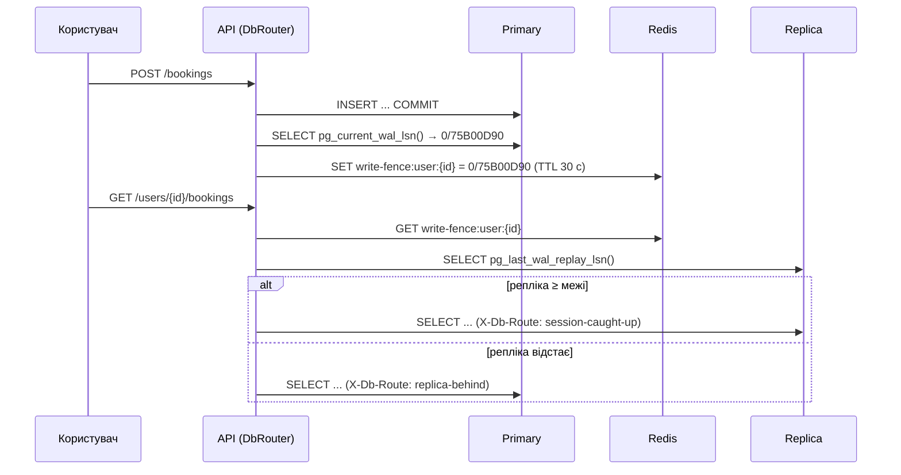

Порівняння зі Sticky Routing (усі читання користувача на Primary протягом N секунд після запису): sticky простіший, але гарантує консистентність лише якщо лаг < N, і при цьому відправляє на Primary всі читання навіть тоді, коли репліка давно наздогнала (на нашому стенді — через ~1 мс). LSN-перевірка точна в обидва боки: на Primary йдуть лише ті читання, для яких репліка справді ще не має запису. Ціна — додатковий `GET` у Redis і короткий запит до репліки на кожне Read-Your-Writes читання (у сценарії D це видно як Redis misses у `*.env.txt`).

Межа ставиться **до** інвалідації кешу (`BookingsController`, `ExpiredBookingsCleaner`): інакше паралельний запит міг би між інвалідацією і записом межі заповнити кеш з репліки, що відстає.

### 11.5. Відмовостійкість: втрата Replica і Primary

**Втрата Replica** (`docker stop ticket-booking-db-replica`): перше читання отримує помилку з'єднання і прозоро повторюється на Primary (`X-Db-Route: replica-down`). Репліка виключається з маршрутизації на 10 с (`ReplicaHealth`, circuit breaker) — наступні читання одразу йдуть на Primary без спроби підключення. Через 10 с роутер знову пробує репліку; після `docker start` читання повертаються на неї без рестарту API.

```text
=== 2.5 Втрата репліки: docker stop ticket-booking-db-replica ===
--- каталог (eventual), кеш порожній:
HTTP/1.1 200 OK
X-Db-Node: primary
X-Db-Route: replica-down
X-Cache: MISS
--- повторно (репліка вже виключена з маршрутизації на 10 с):
HTTP/1.1 200 OK
X-Db-Node: primary
X-Db-Route: replica-down
X-Cache: MISS
--- запис працює як завжди:
  бронювання 5ecbd2f6-de42-43a5-8446-a13da0e6d01d створено
Репліку запущено знову; через ~10 с читання повертаються на неї.
HTTP/1.1 200 OK
X-Db-Node: replica
X-Db-Route: eventual
X-Cache: MISS
```

**Втрата Primary** (`docker stop ticket-booking-db`): каталог і схема залу продовжують читатися з репліки. Мутації отримують контрольовану відповідь **503 «Система в режимі лише читання»** з `Retry-After: 10` (`GlobalExceptionHandler`: помилка з'єднання з БД на не-GET запиті). Strong-читання (статус оплати) — 503, бо їх свідомо не обслуговують з репліки. API-контейнери не падають, після `docker start` запис відновлюється сам (пул з'єднань перевіряє «мертві» з'єднання, ЛР2).

```text
=== 2.5 Втрата Primary: docker stop ticket-booking-db ===
--- каталог читається з репліки:
HTTP/1.1 200 OK
X-Db-Node: replica
X-Db-Route: eventual
X-Cache: MISS
--- запис блокується (Read-Only Mode):
HTTP/1.1 503 Service Unavailable
Retry-After: 10
  title: Система в режимі лише читання
  detail: Основний вузол бази даних (Primary) недоступний: операції запису тимчасово заблоковано. Перегляд каталогу працює. Спробуйте пізніше.
--- статус оплати (strong, лише Primary) — контрольована помилка, без падіння API:
  HTTP 503
Primary запущено знову.
Запис знову працює: бронювання 3d61f075-8c98-4c0e-bb12-e806e73df397
```

**Знахідка: Nginx «вбивав» і читання.** Перша спроба сценарію з Primary дала 502 на каталозі: у конфігах ЛР3 `proxy_next_upstream ... http_503`, тож кожен 503 від API рахувався відмовою інстансу (`max_fails=2`). Після кількох записів у режимі лише читання Nginx виключав з ротації **обидва** здорові інстанси (`no live upstreams`), і падали навіть читання з репліки. 503 від нашого API означає недоступність спільної залежності (Primary), а не самого інстансу: повтор на іншому інстансі не допоможе. Тому `http_503` прибрано з `proxy_next_upstream` у всіх конфігах `nginx/` (`error`, `timeout`, `http_500`, `http_502` лишились — для падіння самого інстансу, як у ЛР3).

| Сценарій збою | Читання eventual | Читання strong | Запис | API |
|---|---|---|---|---|
| Replica down | Primary (fallback), 200 | Primary, 200 | 200/201 | Працює |
| Primary down | Replica, 200 | 503 | 503 Read-Only + `Retry-After` | Працює |
| Primary down (до виправлення Nginx) | 502 після кількох 503 | 503 → 502 | 503 → 502 | Обидва інстанси виключено Nginx |

Автоматичного промоуту репліки немає свідомо (див. split-brain у 11.8): у цій топології втрата Primary — це деградація до Read-Only, а не відмова.

### 11.6. Read Scaling: Single Primary vs Primary + Replica

**Методика.** Сценарій **D — Mixed** (`load-tests/d-mixed.js`): 80% читань (схема залу на 1000 квитків і каталог), 20% бронювань. Кеш вимкнено, бо з кешем читання майже не доходять до БД (ЛР5: 7 транзакцій БД на 1000 запитів) і репліці нічого розвантажувати. Кожен вузол БД обмежено **0.5 CPU** (однакові вузли в обох топологіях), API — 4 інстанси по 1 CPU, щоб у Single Primary вузьким місцем була саме БД. Профіль той самий, що в ЛР5 (рівні 10→200 VU по 30 с); `REPLICA_ENABLED=false/true` перемикає лише маршрутизацію. Запуск: `load-tests/run-lab6.sh` (~30 хв). Додатково сценарій A (100% читань).

**Стандартний профіль (пауза 0.2 с), сценарій D:**

| VUs | RPS: Single | RPS: + Replica | p95, мс: Single | p95, мс: + Replica | p99, мс: Single | p99, мс: + Replica |
|---:|---:|---:|---:|---:|---:|---:|
| 10 | 47.1 | **47.3** | 26.3 | **23.1** | 38.4 | **37.0** |
| 25 | 120.2 | **119.2** | 15.1 | **20.1** | 24.6 | **29.0** |
| 50 | 230.9 | **240.4** | 26.0 | **15.1** | 308.3 | **31.5** |
| 100 | 226.4 | **469.9** | 725.0 | **18.0** | 1 209.0 | **201.2** |
| 200 | 270.1 | **536.7** | 1 311.6 | **439.4** | 1 897.7 | **607.3** |

**Stress (без пауз), сценарій D, два прогони:**

| VUs | RPS: Single | RPS: + Replica | p95, мс: Single | p95, мс: + Replica | p99, мс: Single | p99, мс: + Replica |
|---:|---:|---:|---:|---:|---:|---:|
| 10 | 296.6 | **523.8** | 90.7 | **61.9** | 105.2 | **77.5** |
| 25 | 256.4 | **513.7** | 207.7 | **108.9** | 305.7 | **160.1** |
| 50 | 257.7 | **518.4** | 493.6 | **223.7** | 691.6 | **312.6** |
| 100 | 259.8 | **531.8** | 964.9 | **468.9** | 1 301.4 | **603.8** |
| 200 | 291.9 | **528.4** | 1 518.8 | **960.0** | 1 890.0 | **1 196.6** |

<sub>Прогін 2 (`*_stress_run2`). Прогін 1: Single — 308.1 / 255.2 / 256.0 / 282.0 / 279.3 RPS, + Replica — 516.9 / 425.1 / 471.0 / 465.2 / 511.0 RPS.</sub>

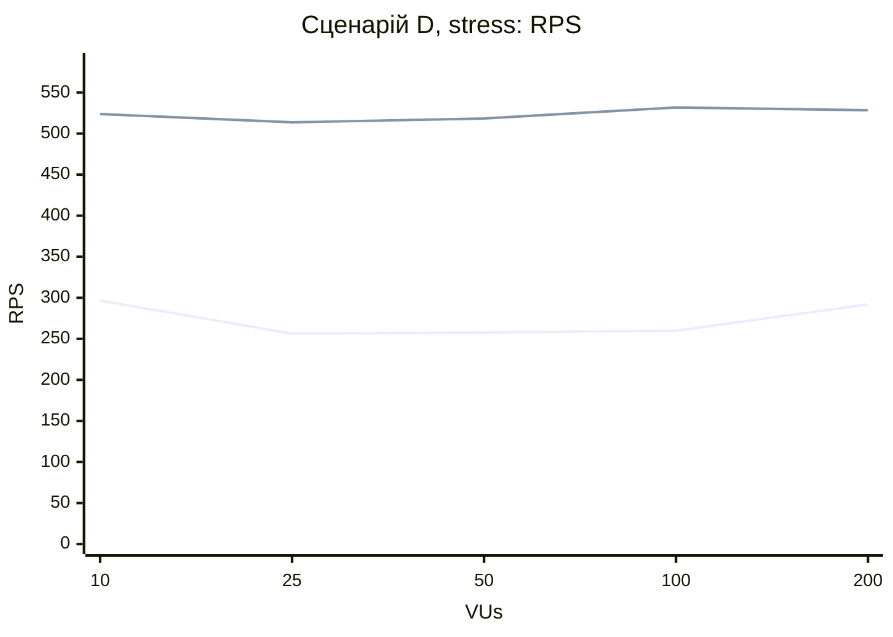

<sub>лінія 1 — `Single Primary` · лінія 2 — `Primary + Replica`</sub>

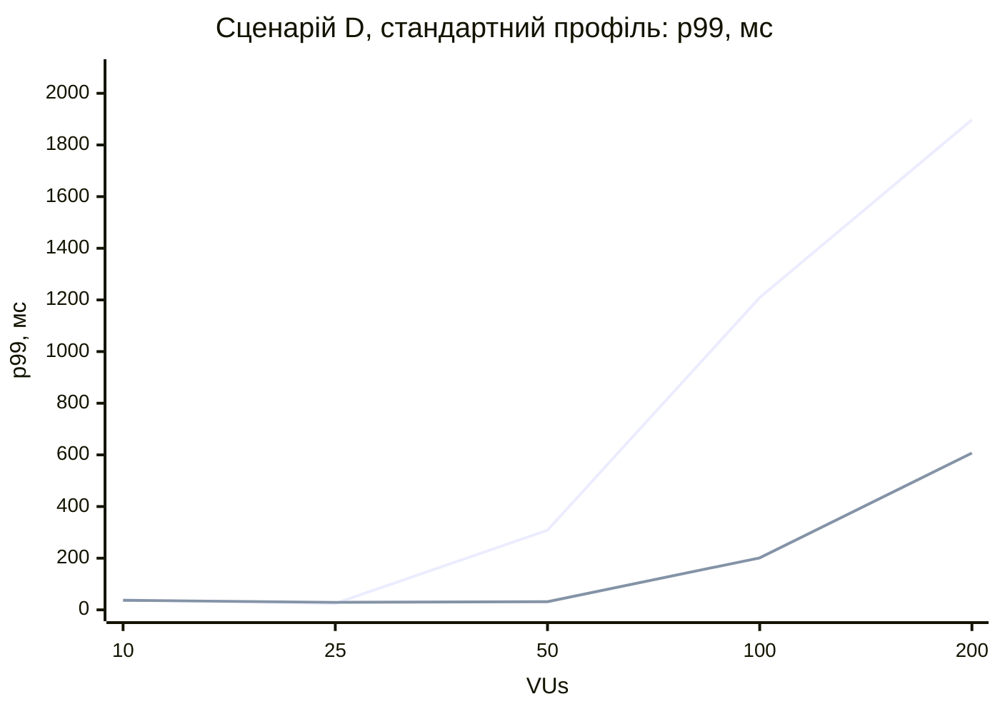

<sub>лінія 1 — `Single Primary` · лінія 2 — `Primary + Replica`</sub>

**Ресурси (середнє / максимум CPU контейнера за stress-прогін, ліміт вузла БД — 50%):**

| Топологія | Primary | Replica | API (кожен) | Транзакцій на Primary на 1000 запитів | Рядків прочитано на Primary |
|---|---:|---:|---:|---:|---:|
| Single Primary | 47% / 52% — **упирається в ліміт** | 2% (простоює) | ~36% | 6 268 | 43 680 378 |
| Primary + Replica | 28% / 41% | 47% / 54% — **упирається в ліміт** | ~58% | 2 370 | 5 407 189 |

**Результат.**

| Метрика | Single Primary | Primary + Replica | Зміна |
|---|---:|---:|---:|
| Пропускна здатність, stress (середнє по рівнях, прогін 1 / 2) | 276.1 / 272.5 | 477.8 / 523.2 | ×1.73 / ×1.92 |
| Точка насичення (стандартний профіль) | ~50 VU, ~230 RPS: далі RPS не росте, p99 стрибає до 0.3–1.2 с | ~100–200 VU, ~470–540 RPS: до 100 VU p95 = 18 мс | Удвічі пізніше |
| p95 / p99 на 100 VU (стандартний) | 725.0 / 1 209.0 мс | 18.0 / 201.2 мс | ×40 / ×6 нижче |
| p99 на 200 VU, stress (прогін 2) | 1 890.0 мс | 1 196.6 мс | −37% |
| Помилки | 0% | 0% | — |

Винесення читань на репліку подвоїло ресурс БД для змішаного навантаження: запис і strong-читання лишились на Primary, а 80% читань пішли на окремий вузол. Вузьке місце перемістилося з Primary на репліку (47% із 50%), а Primary має запас для записів — наступний крок масштабування — друга репліка з розподілом eventual-читань між ними.

**Чесне застереження: чисте читання майже не виграє.** Сценарій A (100% читань, stress): Single — 313.4 / 276.7 / 279.2 / 273.8 / 261.4 RPS; + Replica — 332.7 / 315.8 / 310.4 / 308.9 / 302.1 RPS (+12%). Усі читання просто переїхали з Primary (CPU 1%) на репліку з тим самим лімітом — сумарний ресурс для читань не змінився. Read Scaling працює, коли (1) є записи, які репліка звільняє від конкуренції з читаннями, або (2) реплік кілька і читання розподіляються між ними. І третє: з увімкненим кешем (ЛР4) більшість читань не доходить ні до Primary, ні до репліки — репліка допомагає на cache miss, на холодному старті після рестарту Redis і для персональних читань, які не кешуються (історія бронювань).

### 11.7. Тести

`tests/TicketBooking.IntegrationTests/ReplicationRoutingTests.cs` (у тестах немає справжньої потокової реплікації, тому «репліка» — той самий PostgreSQL, а «мертва репліка» — неіснуючий хост): eventual-читання йде на репліку, strong — на Primary; після власного запису історія бронювань перевіряє межу запису; репліка недоступна → Primary fallback, і другий запит уже не пробує репліку (circuit breaker); `Replication:Enabled=false` → Single Primary. `LsnTests.cs` — розбір і порівняння LSN. Усього 53 тести, усі проходять; Newman (папки 01, 02, 03, 05): 37 запитів, 123 перевірки, 0 помилок.

### 11.8. Теорія до захисту

**Синхронна, асинхронна і напівсинхронна реплікація.**

| Режим | Коли Primary відповідає клієнту «закомічено» | Втрата даних при падінні Primary | Затримка запису | У PostgreSQL |
|---|---|---|---|---|
| Асинхронна (наш стенд) | Одразу після запису WAL на свій диск | Можлива: останні транзакції, які репліка ще не отримала | Мінімальна | `synchronous_standby_names = ''` (за замовчуванням) |
| Напівсинхронна | Після того, як **хоча б одна** репліка підтвердила отримання (не обов'язково застосування) WAL | Лише якщо одночасно впадуть Primary і та репліка | + 1 мережевий RTT | `synchronous_commit = remote_write` / `on` + `synchronous_standby_names = 'ANY 1 (...)'` |
| Синхронна | Після того, як репліка **застосувала** WAL (запис видно в читаннях з неї) | Немає (RPO = 0) | + RTT + час застосування; якщо репліка зависла — зависає і запис | `synchronous_commit = remote_apply` |

Ми обрали асинхронну: репліка не впливає на латентність і доступність запису, а її відставання ми явно обробляємо (Read-Your-Writes). Плата — RPO > 0: при втраті Primary можуть зникнути останні мілісекунди транзакцій (у тесті під навантаженням записом — до ~50 КБ WAL, див. 11.3).

**Split-Brain.** Два вузли одночасно вважають себе Primary і приймають записи → дві розбіжні історії даних, які неможливо автоматично злити (наприклад, той самий квиток продано двічі). Виникає, якщо при автоматичному failover старий Primary не помер, а лише втратив мережу з частиною кластера. Захист: кворум (новий лідер обирається більшістю вузлів, меншість не може прийняти записи), fencing / STONITH (старий Primary примусово вимикається або відрізається від сховища), лідерська оренда з TTL (Patroni + etcd). У нашому стенді автоматичного failover немає, тому немає і split-brain: при втраті Primary система свідомо переходить у Read-Only (11.5), а промоут репліки (`pg_ctl promote` / `SELECT pg_promote()`) — ручне рішення оператора.

**CAP-теорема.** При мережевому розділенні (Partition) розподілена система мусить обрати: Consistency (відмовити в операції, якщо не може гарантувати актуальні дані) або Availability (відповісти, ризикуючи застарілими даними). Наш вибір різний для різних операцій:
- запис і strong-читання (оплата, логін) — **CP**: без Primary повертаємо 503, але не приймаємо запис «кудись»;
- каталог і схема залу — **AP**: при втраті Primary читаємо з репліки, навіть якщо вона трохи відстає.

**PACELC.** Розширення CAP: якщо Partition — обираємо A чи C; **Else** (у нормальному режимі) — обираємо Latency чи Consistency. Асинхронна репліка — класичний PA/EL: у нормальному режимі ми віддаємо перевагу низькій латентності (не чекаємо репліку при записі), погоджуючись на eventual consistency читань із неї. Read-Your-Writes — точкове повернення до C там, де це помітно користувачу: ціною одного додаткового запиту до репліки (перевірка LSN) або читання з Primary.

**Вибір нового лідера, Raft.** Автоматичний failover потребує консенсусу щодо того, хто новий Primary. Raft: вузли мають терміни (term); якщо фоловер не отримує heartbeat від лідера протягом випадкового election timeout, він стає кандидатом, збільшує term і просить голоси; лідером стає той, хто отримав **більшість** голосів, причому вузол голосує лише за кандидата, чий журнал не старіший за його власний (тому новий лідер має всі закомічені записи). Більшість з N = 2f + 1 вузлів переживає відмову f вузлів, і два лідери в одному term неможливі (дві більшості перетинаються) — це і є захист від split-brain. Для PostgreSQL це роблять зовнішні менеджери: Patroni (лідерство через etcd/Consul/ZooKeeper, які самі працюють на Raft/ZAB), pg_auto_failover, Stolon. Для такого кластера потрібно щонайменше 3 вузли консенсусу.

**Чому не PgBouncer / Pgpool для розділення R/W.** PgBouncer — лише пул з'єднань, маршрутизувати запити за типом він не вміє. Pgpool-II уміє, але аналізує SQL і не знає бізнес-сенсу: він не відрізнить «каталог» від «мої бронювання одразу після оплати». Тому маршрутизація зроблена в коді (`DbRouter`): рівень узгодженості — властивість бізнес-сценарію, а не SQL-запиту.

### 11.9. Як відтворити

```bash
# Стенд: Primary + Replica (репліка ініціалізується сама через pg_basebackup)
docker compose up -d --build && docker compose restart nginx

# Стан реплікації: pg_stat_replication на Primary, LSN на репліці
scripts/replication-status.sh

# Демонстрації: replication | stale-read | replica-down | primary-down | all
scripts/replication-demo.sh all

# Синтетичний лаг (мс) і вимкнення
scripts/replica-lag.sh 3000
scripts/replica-lag.sh 0

# Лаг під навантаженням записом (потрібен k6)
scripts/replication-lag-under-load.sh

# Порівняння Single Primary vs Primary + Replica (~30 хв)
load-tests/run-lab6.sh
python3 load-tests/report.py lab6_D_mixed_single lab6_D_mixed_replica
```

Якщо після `docker volume rm ticket-booking_pgdata` (новий Primary) репліка не стартує з помилкою `database system identifier differs`, її volume треба теж перестворити: `docker compose rm -sf db-replica && docker volume rm ticket-booking_pgdata-replica && docker compose up -d db-replica`. `docker compose down -v` прибирає обидва volume одразу.

---

## 12. Лабораторна робота №7: шардинг і партиціонування (Data Scaling)

Шардовано набір даних **замовлень** (`Orders`): кожна оплата створює замовлення на одному з двох незалежних вузлів PostgreSQL — `shard-a` або `shard-b`. Вузол обчислює Shard Router у коді API за ключем `UserId`. Каталог, квитки й бронювання лишаються в основній БД (Primary + Replica з ЛР6).

### 12.1. Dataset і вибір Shard Key

**Чому замовлення.** Це єдиний набір, що росте необмежено: квитки й події обмежені місткістю залів, а замовлення накопичуються з кожним продажем і ніколи не видаляються (історія покупок, бухгалтерія, повернення). Він append-heavy (запис на кожну оплату), а читається переважно двома способами: «мої замовлення» конкретного користувача (часто) і аналітика продажів по подіях (рідко, але по всьому набору).

| Кандидат у Shard Key | Cardinality | Query Locality | Рівномірність запису | Висновок |
|---|---|---|---|---|
| `Order.Id` (сурогатний UUID) | Найвища | Немає: «мої замовлення» — fan-out на всі шарди при кожному відкритті кабінету | Рівномірно | Відкинуто: «сліпий» ключ, не пов'язаний із жодним запитом |
| `CreatedAt` (діапазони за часом) | Висока | Лише для звітів за період | **Усі нові записи — в один (останній) шард**: класичний hot shard | Відкинуто |
| `EventId` | Низька (десятки–сотні подій) | Аналітика однієї події — локально | Продаж мега-концерту монополізує один шард; одну подію не можна розділити | Відкинуто |
| `City` | Дуже низька (кілька міст) | Регіональні звіти | Київ ≫ інші міста | Відкинуто |
| **`UserId`** | Висока (кожен покупець) | **«Мої замовлення» і передача свого замовлення — на одному шарді**; всі рядки агрегату разом | Рівномірно (тисячі незалежних покупців) | **Обрано** |

Ризик `UserId` — «кит» (корпоративний покупець з тисячами замовлень): його рядки не діляться між шардами. Для квиткового сервісу це обмежено лімітами квитків на одного покупця; за потреби — складений ключ `(UserId, місяць)`, ціною fan-out для історії такого користувача.

**Чому не автоінкрементний ключ.** `key % N` по послідовному `id` розкладає рядки рівно, але жоден запит не знає `id` наперед: усі запити користувача стають fan-out, а розширення кластера переносить майже всі дані (12.7).

### 12.2. Архітектура і Shard Router

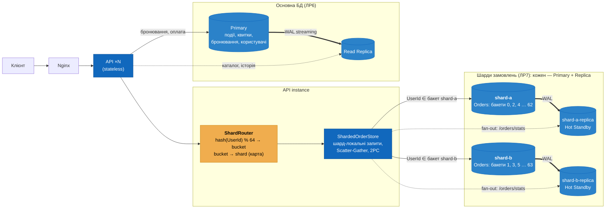

**Маршрутизація** (`Infrastructure/Sharding/ShardRouter.cs`) — чиста функція від ключа і конфігурації, однакова на всіх інстансах API, без звернень до мережі чи довідника:

1. `hash = SplitMix64(FNV-1a-64("UserId у форматі N"))` — `Infrastructure/Sharding/ShardHash.cs`. Не `string.GetHashCode()`: у .NET він рандомізований для кожного процесу, і два інстанси API відправили б того самого користувача на різні шарди.
2. `bucket = hash % 64` — віртуальний бакет; кількість бакетів фіксована на весь час життя кластера.
3. `shard = map[bucket]` — карта бакетів (за замовчуванням `bucket % N`, перевизначення через `Sharding:BucketMap`).

Стратегія задається конфігурацією `Sharding:Strategy` (`Modulo` | `Hash` | `VirtualBuckets`) — так у 12.4 порівнюються наївна і оптимізована маршрутизація на тому самому коді. Обраний шард видно в заголовку відповіді `X-Shard` (і `X-Shard-Bucket`), а `GET /api/v1/lab/sharding/route/{userId}` показує всі проміжні значення.

**Конфігурація** (`docker-compose.yml`): сервіси `shard-a`, `shard-b` (PostgreSQL 16, БД `orders`, `max_prepared_transactions=20` для 2PC) і їхні репліки `shard-a-replica`, `shard-b-replica` (12.9); у API — `Sharding__Shards__{i}__Name/ConnectionString`, `Sharding__Strategy`, `Sharding__ActiveShards` (1 = топологія Single Node). Схема `Orders` створюється на кожному шарді при старті (`EnsureSchemaAsync` з advisory lock, як і основна БД).

**Ендпоінти:**

| Метод | URL | Тип операції |
|---|---|---|
| `POST` | `/api/v1/orders` | Шард-локальний запис (шард за `userId`) |
| `GET` | `/api/v1/users/{userId}/orders` | Шард-локальне читання (1 шард) |
| `GET` | `/api/v1/users/{userId}/orders?scatter=true` | Той самий запит через fan-out (для порівняння вартості) |
| `GET` | `/api/v1/orders/stats?eventId=` | Cross-Shard Query: Scatter-Gather з `GROUP BY` на кожному шарді |
| `POST` | `/api/v1/orders/{id}/transfer` | Cross-Shard Write: передача замовлення іншому користувачу (2PC) |
| `POST` | `/api/v1/bookings/{id}/confirm` | Оплата бронювання додатково створює замовлення на шарді користувача (ідемпотентно за `BookingId`) |
| `GET` | `/api/v1/lab/sharding/route/{key}` | Куди потрапить ключ: стратегія, хеш, бакет, шард |
| `POST` | `/api/v1/lab/sharding/generate` | Генерація тестового масиву (COPY BINARY, кожен рядок через ShardRouter) |
| `GET` | `/api/v1/lab/sharding/distribution` | Data Distribution Matrix: записи і операції запису по шардах |
| `GET`/`POST` | `/api/v1/lab/sharding/in-doubt[/resolve]` | «Завислі» 2PC-транзакції та їх відновлення |

### 12.3. Розподіл даних (Data Distribution Baseline)

Тестовий масив: 200 000 замовлень, 20 000 користувачів, 20 подій (`POST /api/v1/lab/sharding/generate` або `scripts/sharding/generate-orders.sh`). Кожен рядок маршрутизує той самий `ShardRouter`, що й робочі запити, і вставляється на свій шард через `COPY BINARY`. Частка операцій запису — з `pg_stat_user_tables` (лічильники скидаються перед генерацією).

**Базовий розподіл (обрана стратегія `VirtualBuckets`, випадкові UUID):**

| Шард / Вузол | Кількість записів | Частка даних (%) | Частка Write Operations (%) |
|---|---:|---:|---:|
| shard-a | 99 924 | 49.96 | 49.96 |
| shard-b | 100 076 | 50.04 | 50.04 |

**Data Distribution Matrix: усі стратегії × два способи генерації id** (`experiments/raw/lab7_distribution_*.json`):

| Стратегія | Ключі користувачів | shard-a: записів | shard-b: записів | Частка даних A / B, % | Частка Write Operations A / B, % |
|---|---|---:|---:|---:|---:|
| `Modulo` | випадкові UUID v4 | 99 509 | 100 491 | 49.8 / 50.2 | 49.8 / 50.2 |
| `Modulo` | з префіксом `c0ffee03-…` | 0 | 200 000 | **0.0 / 100.0** | 0.0 / 100.0 |
| `Hash` | випадкові UUID v4 | 99 924 | 100 076 | 50.0 / 50.0 | 50.0 / 50.0 |
| `Hash` | з префіксом `c0ffee03-…` | 99 243 | 100 757 | 49.6 / 50.4 | 49.6 / 50.4 |
| `VirtualBuckets` | випадкові UUID v4 | 99 924 | 100 076 | 50.0 / 50.0 | 50.0 / 50.0 |
| `VirtualBuckets` | з префіксом `c0ffee03-…` | 99 243 | 100 757 | 49.6 / 50.4 | 49.6 / 50.4 |

Наївний `Modulo` бере перший сегмент UUID як число. Для випадкових UUID v4 він рівномірний, але id з фіксованим префіксом (так генерує k6, так виглядають id з namespace / типом об'єкта, а в UUID v7 перші 48 біт — це час) дають **100% даних на одному шарді**. Хешування всього ключа робить розподіл незалежним від того, як влаштовані id.

**Детермінованість** (`scripts/sharding/sharding-demo.sh routing`): кожне нове замовлення того самого користувача потрапляє на той самий шард, а на іншому шарді рядків цього користувача немає.

```text
=== 2.2 Детермінована маршрутизація: UserId → hash → бакет → шард ===
стратегія: VirtualBuckets
користувач ddc0c740-fde6-4679-a073-923ab1a9ef14 → shard-b bucket 27 hash 525a9d99d612611b
   POST /orders → X-Shard: shard-b
   POST /orders → X-Shard: shard-b
   рядків цього користувача на shard-a: 0
   рядків цього користувача на shard-b: 2
користувач 5bda8883-cb53-41e8-b328-4d5c5aadc10c → shard-b bucket 55 hash 3b349150ac3d6937
   POST /orders → X-Shard: shard-b
   POST /orders → X-Shard: shard-b
   рядків цього користувача на shard-a: 0
   рядків цього користувача на shard-b: 2
користувач 87f86f1f-78cc-402d-9c75-1f4d2e853522 → shard-b bucket 35 hash 547cb4910b1be8a3
   POST /orders → X-Shard: shard-b
   POST /orders → X-Shard: shard-b
   рядків цього користувача на shard-a: 0
   рядків цього користувача на shard-b: 2
```

### 12.4. Hot Shard і оптимізація стратегії

**Сценарій.** Запис замовлень без пауз (k6 `e-orders.js`, `MODE=write`, 10→200 VU) від 20 000 користувачів з id формату `c0ffee03-0000-4000-8000-{n}`. Однакові вузли-шарди по **0.5 CPU**, 4 інстанси API. Перший прогін — `Sharding:Strategy=Modulo`, другий — `VirtualBuckets`. Код, дані й навантаження однакові.

**Розподіл після прогону запису:**

| Стратегія | shard-a: записів / частка запису | shard-b: записів / частка запису | CPU шардів (середнє / максимум; ліміт 50%) | Пам'ять шардів за прогін, MiB |
|---|---|---|---|---|
| `Modulo` | 0 / 0.0% | 489 593 / 100.0% | shard-a 0% / 3%, shard-b 46% / 52% — **shard-b у ліміті, shard-a простоює** | shard-a 69 → 69, **shard-b 96 → 276** |
| `VirtualBuckets` | 302 145 / 49.6% | 307 163 / 50.4% | shard-a 40% / 55%, shard-b 41% / 55% | shard-a 71 → 234, shard-b 140 → 278 |

**Латентність і пропускна здатність:**

| VUs | RPS: Modulo | RPS: Buckets | p95, мс: Modulo | p95, мс: Buckets | p99, мс: Modulo | p99, мс: Buckets |
|---:|---:|---:|---:|---:|---:|---:|
| 10 | 1 424.7 | **1 238.1** | 17.4 | **21.4** | 38.4 | **42.8** |
| 25 | 1 513.9 | **1 838.6** | 56.4 | **42.3** | 72.1 | **61.3** |
| 50 | 1 668.6 | **2 632.8** | 77.7 | **46.8** | 90.7 | **72.7** |
| 100 | 1 628.0 | **2 886.0** | 106.6 | **81.6** | 179.9 | **106.4** |
| 200 | 1 550.4 | **2 651.2** | 262.9 | **183.0** | 304.3 | **276.3** |

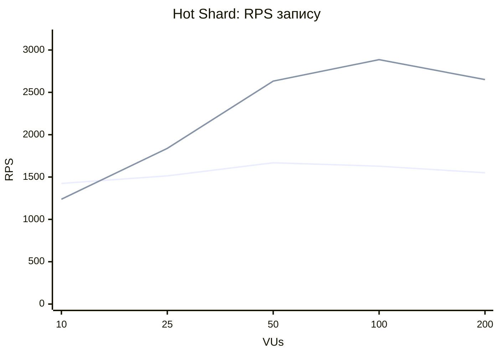

<sub>лінія 1 — `Modulo (hot shard)` · лінія 2 — `VirtualBuckets`</sub>

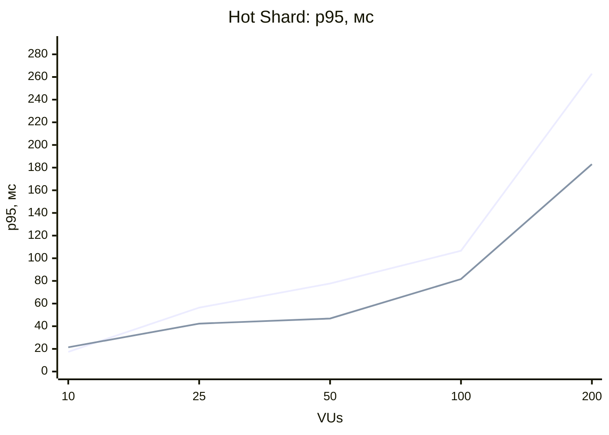

<sub>лінія 1 — `Modulo (hot shard)` · лінія 2 — `VirtualBuckets`</sub>

**Висновок.** При `Modulo` усе навантаження лягає на shard-b. Пропускна здатність упирається в ліміт одного вузла (~1.5–1.7 тис. RPS) і не росте з VU, а латентність росте: p95 на 100 VU — 106.6 мс, на 200 VU — 262.9 мс. Другий вузол при цьому простоює. Після переходу на хешування з віртуальними бакетами обидва вузли завантажені порівну. Пікова пропускна здатність зросла з 1 668.6 до 2 886.0 RPS (×1.73), p95 на 200 VU знизився з 262.9 до 183.0 мс. Межу тепер задає CPU API (89% у середньому), а не вузол БД.

**Live-демо для захисту** (`scripts/sharding/hot-shard-demo.sh`, ~1 хв). Скрипт вмикає ту саму пару стратегій на 50 000 замовлень і 20-секундному записі при 50 VU. На час демо шарди обмежено 0.5 CPU, потім ліміт знімається. Вивід — `experiments/raw/lab7_hotshard_demo.txt`:

```text
=== Стратегія Modulo ===
користувач …000000000042 → shard-b | bucket None
--- генерація 50 000 замовлень (20 000 користувачів, префіксні id):
|---|---:|---:|---:|---:|
| shard-a | 0 | 0.00 | 0 | 0.00 |
| shard-b | 50 000 | 100.00 | 50 000 | 100.00 |
--- запис без пауз: 50 VU × 20 с
VUs   RPS      avg ms   p50 ms   p95 ms   p99 ms   max ms   errors %
50     1468.3     33.8     17.2     84.4    100.5    208.7       0.00
   shard-a  CPU сер.   1.5% / макс.  10.3% (ліміт 50%) | пам'ять 44.24MiB
   shard-b  CPU сер.  43.1% / макс.  51.1% (ліміт 50%) | пам'ять 112.6MiB

=== Стратегія VirtualBuckets ===
користувач …000000000042 → shard-a | bucket 16
--- генерація 50 000 замовлень (20 000 користувачів, префіксні id):
|---|---:|---:|---:|---:|
| shard-a | 24 812 | 49.62 | 24 812 | 49.62 |
| shard-b | 25 188 | 50.38 | 25 188 | 50.38 |
--- запис без пауз: 50 VU × 20 с
VUs   RPS      avg ms   p50 ms   p95 ms   p99 ms   max ms   errors %
50     2575.3     19.2     14.9     49.0     76.5    187.1       0.00
   shard-a  CPU сер.  43.9% / макс.  53.0% (ліміт 50%) | пам'ять 110.6MiB
   shard-b  CPU сер.  42.3% / макс.  52.8% (ліміт 50%) | пам'ять 112.7MiB

=== Повернення: ліміт CPU шардів знято, стратегія VirtualBuckets ===
```

Інший тип hot shard — «гарячий ключ» (мега-подія, якщо ключем був би `EventId`, або «кит»-покупець при ключі `UserId`). Його хешування не розподілить: усі рядки одного ключа завжди на одному шарді. Протидія — складений ключ (`UserId` + місяць або `EventId` + сектор) ціною fan-out для запитів по цьому ключу. Саме тому ключем обрано `UserId` з високою кардинальністю, а не `EventId` (12.1).

### 12.5. Cross-Shard Query: Scatter-Gather

`ShardedOrderStore` виконує запит на всіх шардах **паралельно** (`Task.WhenAll`) і зливає результати на координаторі (інстанс API). Для «моїх замовлень» злиття — це `ORDER BY CreatedAt DESC LIMIT n` по об'єднаних рядках. Для аналітики кожен шард робить `GROUP BY EventId` локально, а координатор лише сумує часткові агрегати.

```text
=== 2.4 Shard-Local vs Cross-Shard (Scatter-Gather) ===
--- «мої замовлення» шард-локально (1 шард):
  замовлень: 7 | шарди: [('shard-a', 2.0)]
--- той самий запит через fan-out (усі шарди + злиття):
  замовлень: 7 | шарди: [('shard-a', 1.4, 7), ('shard-b', 0.9, 0)]
--- аналітика продажів події (GROUP BY на кожному шарді, сума на координаторі):
   {'eventId': 'c0ffee0e-0000-4000-8000-000000000003', 'orders': 9968, 'tickets': 24741, 'revenue': 17350500.0} | шарди: [('shard-a', 6.2), ('shard-b', 6.0)]
--- час відповіді (curl, 20 запитів, медіана):
   users/c0ffee03-0000-4000-8000-000000000042/orders?limit=20                2.9 мс
   users/c0ffee03-0000-4000-8000-000000000042/orders?limit=20&scatter=true    3.0 мс
   orders/stats?eventId=c0ffee0e-0000-4000-8000-000000000003                 4.7 мс
   orders/stats                                                             16.9 мс
```

**Під навантаженням (2 шарди, stress):** той самий запит «мої замовлення» шард-локально і через fan-out:

| VUs | RPS: Local | RPS: Fan-out | p95, мс: Local | p95, мс: Fan-out | p99, мс: Local | p99, мс: Fan-out |
|---:|---:|---:|---:|---:|---:|---:|
| 10 | 1 091.3 | **1 312.8** | 26.3 | **20.8** | 51.3 | **42.6** |
| 25 | 1 505.6 | **1 174.3** | 51.0 | **63.0** | 82.0 | **95.8** |
| 50 | 1 685.4 | **1 006.6** | 84.7 | **108.4** | 197.1 | **278.9** |
| 100 | 1 982.9 | **1 308.7** | 128.7 | **177.5** | 270.3 | **296.9** |
| 200 | 2 877.2 | **1 209.2** | 165.6 | **347.7** | 250.0 | **603.7** |

**Оверхед fan-out:**
- **Ресурси.** Кожен fan-out запит виконує N запитів до БД замість одного й тримає N з'єднань. Сумарна робота БД зростає в N разів, хоча корисні рядки є лише на одному шарді.
- **Хвіст латентності.** Відповідь не швидша за найповільніший шард. p99 fan-out = max(p99 шардів) плюс злиття, і з ростом N хвіст лише гіршає.
- **Масштабування.** Додавання шардів не збільшує пропускну здатність fan-out запитів: кожен новий вузол додає ще один запит до кожного з них. Шард-локальний запит масштабується лінійно.
- **Висновок.** Пікова пропускна здатність fan-out — 1 312.8 RPS проти 2 877.2 у шард-локального запиту. Тому ключ шардингу мусить збігатися з ключем найчастішого запиту.

### 12.6. Cross-Shard Write: передача замовлення (2PC)

**Сценарій.** Користувач передає квиток (замовлення) іншому користувачу. Рядок має переїхати на шард нового власника: `INSERT` на одному вузлі і `DELETE` на іншому. Локальна ACID-транзакція PostgreSQL охоплює лише один вузол. Без координації можливий частковий результат: збій після `INSERT` дає замовлення у двох власників, а збій після `DELETE` — замовлення, що зникло.

**Реалізація** (`ShardedOrderStore.TransferAsync`):
- **Власники на одному шарді** — звичайний `UPDATE` в одній транзакції.
- **Власники на різних шардах** — **двофазна фіксація** на механізмі PostgreSQL:
  1. `BEGIN` на обох шардах.
  2. Шард-відправник: `SELECT … FOR UPDATE`, потім `DELETE`. Шард-отримувач: `INSERT`.
  3. **Фаза 1.** `PREPARE TRANSACTION '<gid>:shard-a'` і `'<gid>:shard-b'`. Кожен учасник записав зміни у WAL і пообіцяв закомітити навіть після рестарту.
  4. **Фаза 2.** `COMMIT PREPARED` на обох.
- **Помилка до кінця фази 1** — `ROLLBACK` або `ROLLBACK PREPARED` усіх учасників.
- **Шарди:** `max_prepared_transactions=20`.

```text
=== 2.4 Cross-Shard Write: передача замовлення іншому користувачу ===
--- обидва користувачі на shard-a → звичайна локальна ACID-транзакція:
   {'orderId': '0b40eae8-061e-45d4-b385-3bc8e0897166', 'outcome': 'SameShard', 'from': 'shard-a', 'to': 'shard-a', 'gid': None}
--- shard-a → shard-b → двофазна фіксація (PREPARE TRANSACTION / COMMIT PREPARED):
   {'orderId': '292668e3-d573-4c8e-b1f2-c7872fc53614', 'outcome': 'TwoPhaseCommitted', 'from': 'shard-a', 'to': 'shard-b', 'gid': 'tb-transfer-292668e3d5734c8eb1f2c7872fc53614-20261124230228015'}
   shard-a: 0 рядків, shard-b: 1 рядків
--- той самий 2PC, але координатор «падає» після PREPARE (simulateCoordinatorCrash):
   HTTP 202
   pg_prepared_xacts:
     shard-a: tb-transfer-cab8728937e643a5b7468a0710e0a5db-20261124230228267:shard-a
     shard-b: tb-transfer-cab8728937e643a5b7468a0710e0a5db-20261124230228267:shard-b
   рядок на shard-a заблоковано in-doubt транзакцією — спроба змінити його чекає (lock_timeout 2 с):
     ERROR:  canceling statement due to lock timeout
   зміни ще не видно: shard-a 1, shard-b 0
--- відновлення координатора: обидва учасники підготовані → COMMIT PREPARED:
   [{'gid': 'tb-transfer-cab8728937e643a5b7468a0710e0a5db-20261124230228267', 'decision': 'commit'}]
   shard-a: 0 рядків, shard-b: 1 рядків
```

**Слабке місце 2PC, видно в демонстрації.** Якщо координатор впав між фазами (`simulateCoordinatorCrash=true`), обидва учасники лишаються в стані *in-doubt*:
- запис є в `pg_prepared_xacts`;
- рядок замовлення на shard-a **заблоковано**, і чужий `UPDATE` чекає до `lock_timeout`;
- змін не видно ніде.

Учасник не може сам вирішити, комітити чи відкочувати, бо не знає, як проголосував інший. Відновлення (`POST /api/v1/lab/sharding/in-doubt/resolve`) знаходить учасників за спільним префіксом gid. Якщо підготовлені всі — `COMMIT PREPARED`, якщо лише частина — `ROLLBACK PREPARED` (presumed abort). У продакшені координатор записує своє рішення в довговічний журнал до фази 2 і відновлюється з нього.

**Альтернативи:**

| Підхід | Атомарність | Блокування / доступність | Коли |
|---|---|---|---|
| 2PC (реалізовано) | Так | Блокує рядки до рішення; потрібні всі учасники одночасно | Рідкісні операції, де проміжний стан неприпустимий |
| Saga | Ні — eventual, через компенсації | Без розподілених блокувань; кожен крок — локальна транзакція | Довгі бізнес-процеси (оплата → видача квитка → лист) |
| Перепроєктований агрегат | Так, локально | Без координації | Якщо дані, що змінюються разом, мають спільний shard key. Наш вибір `UserId` робить усі операції над власними замовленнями шард-локальними; міжшардова лише зміна власника |

**Оплата бронювання → замовлення.** Це теж запис у два вузли: основна БД і шард. Ми свідомо не робимо тут 2PC. Бронювання комітиться в основній БД, після чого замовлення створюється на шарді ідемпотентно: `INSERT … ON CONFLICT (BookingId) DO NOTHING`, тож повтор безпечний (`BookingsController.RecordOrder`). Якщо шард недоступний, оплата не відкочується, а замовлення пропускається і логується. Надійний варіант — Transactional Outbox: запис «створити замовлення» в тій самій транзакції основної БД і фоновий доставник із повторами.

### 12.7. Решардинг і Consistent Hashing

**Модель.** Ключ k з рівномірним hash(k) змінює шард при переході N → M вузлів, якщо `hash(k) mod N ≠ hash(k) mod M`. Для `hash % N` частка переміщених ключів дорівнює 1 − (частка h, для яких h mod N = h mod M). Для N і M без спільних дільників це ≈ **1 − 1/M**, тобто майже всі дані (2 → 3: 2/3, 3 → 4: 3/4). Виняток — кратне розширення N → 2N (лише 1/2). Мінімум, що задовольняє рівномірність, — **(M − N)/M**: новим вузлам переходить лише їхня частка, ≈ 1/M на кожен новий вузол.

- **Consistent hashing.** Вузли і ключі розміщуються на кільці 2⁶⁴. Новий вузол забирає ключі лише з відрізків перед своїми точками, тому переноситься ≈ 1/M даних.
- **Virtual buckets** (реалізовано). Кількість бакетів фіксована: B = 64, `bucket = hash % 64`. Змінюється лише карта бакет → шард: розширення 2 → 3 переносить 21 бакет із 64 і рівно ці дані. Перенесення відбувається по одному бакету: скопіювати рядки бакета на новий шард, перемкнути `Sharding:BucketMap`, видалити на старому. Решта бакетів не зупиняється.

`scripts/sharding/resharding_sim.py` (100 000 ключів, та сама хеш-функція, що й у C#: `shardlib.py`):

| Перехід | Мінімум (M−N)/M | hash(key) % N | Consistent hashing (кільце, vnodes) | Virtual buckets |
|---|---:|---:|---:|---:|
| 2 → 3 | 33.3% | 66.6% | 34.5% | 33.1% |
| 2 → 4 | 50.0% | 50.2% | 51.5% | 50.3% |
| 3 → 4 | 25.0% | 74.8% | 24.1% | 25.2% |
| 4 → 5 | 20.0% | 80.1% | 17.9% | 19.0% |

Рівномірність після розширення (макс. відхилення шарду від середнього):

| Шардів | hash % N | Кільце, 1 vnode | Кільце, 16 vnodes | Кільце, 128 vnodes | Virtual buckets (64) |
|---:|---:|---:|---:|---:|---:|
| 2 | ±0.1% | ±70.9% | ±39.8% | ±5.4% | ±0.1% |
| 3 | ±0.3% | ±116.6% | ±62.9% | ±7.2% | ±2.1% |
| 4 | ±0.7% | ±188.9% | ±59.1% | ±9.5% | ±1.1% |
| 5 | ±1.1% | ±191.4% | ±59.6% | ±10.2% | ±5.9% |

- **`hash % N`.** Переносить 67–80% даних при кожному розширенні.
- **Consistent hashing і virtual buckets.** Близькі до теоретичного мінімуму (M − N)/M.
- **Нерівномірність кільця без віртуальних вузлів.** З однією точкою на вузол шарди відрізняються в рази (±71…191%). Лише ~128 vnodes на вузол дають ±5–10%. Virtual buckets із явною картою рівні з точністю до одного бакета.
- **Перевірка в C#.** Модель перевірено і в C#: `ShardRouterTests.VirtualBuckets_Expansion_MovesOnlyReassignedBuckets` — при 2 → 3 переїжджає ≈ 1/3 ключів, `hash % N` — ≈ 2/3.

### 12.8. Порівняльний бенчмарк: Single Node vs Sharded

**Методика.** Обидві топології використовують однакові вузли по 0.5 CPU, 4 інстанси API і той самий набір даних: 200 000 замовлень, 20 000 користувачів. Single Node — `Sharding:ActiveShards=1`, усі дані на shard-a. Sharded — 2 шарди, `VirtualBuckets`. Профіль ЛР5 у stress-режимі (без пауз, 10→200 VU). Запуск: `load-tests/run-lab7.sh benchmark`. Аналітика в цьому бенчмарку читає з Primary шардів (`SHARD_ANALYTICS=Primary`), щоб порівнювати однакові вузли. Ефект реплік шардів — окремо в 12.9.

**Запис (`POST /orders`):**

| VUs | RPS: Single | RPS: Sharded | p95, мс: Single | p95, мс: Sharded | p99, мс: Single | p99, мс: Sharded |
|---:|---:|---:|---:|---:|---:|---:|
| 10 | 1 025.4 | **1 378.1** | 29.2 | **15.5** | 55.1 | **33.5** |
| 25 | 1 178.4 | **1 537.9** | 64.5 | **40.7** | 88.7 | **88.8** |
| 50 | 1 141.3 | **1 530.9** | 95.8 | **94.5** | 121.2 | **249.4** |
| 100 | 1 394.9 | **2 238.4** | 120.2 | **106.3** | 193.5 | **198.3** |
| 200 | 1 311.2 | **1 425.7** | 301.9 | **462.4** | 398.0 | **990.7** |

<sub>Sharded-прогін на 200 VU просів до 1 425.7 RPS (p99 990.7 мс) — шум стенда. Той самий запис на 2 шардах у 12.4 (`lab7_E_write_VirtualBuckets_stress`) дав 1 238.1 / 1 838.6 / 2 632.8 / 2 886.0 / 2 651.2 RPS. Перший прогін Single завис після 10 VU і збережений як `lab7_E_write_single_stress_stalled`.</sub>

**Шард-локальне читання («мої замовлення»):**

| VUs | RPS: Single | RPS: Sharded | p95, мс: Single | p95, мс: Sharded | p99, мс: Single | p99, мс: Sharded |
|---:|---:|---:|---:|---:|---:|---:|
| 10 | 1 385.3 | **1 091.3** | 29.4 | **26.3** | 45.9 | **51.3** |
| 25 | 1 472.4 | **1 505.6** | 68.1 | **51.0** | 79.2 | **82.0** |
| 50 | 1 475.1 | **1 685.4** | 89.7 | **84.7** | 104.1 | **197.1** |
| 100 | 1 546.7 | **1 982.9** | 114.1 | **128.7** | 194.5 | **270.3** |
| 200 | 1 673.0 | **2 877.2** | 212.4 | **165.6** | 298.2 | **250.0** |

**Cross-Shard аналітика (`GET /orders/stats?eventId=`: GROUP BY по ~10 тис. рядків події):**

| VUs | RPS: Single | RPS: Sharded | p95, мс: Single | p95, мс: Sharded | p99, мс: Single | p99, мс: Sharded | Помилки: Single | Помилки: Sharded |
|---:|---:|---:|---:|---:|---:|---:|---:|---:|
| 10 | 48.0 | **105.6** | 498.6 | **196.0** | 716.2 | **204.1** | 0.0% | 0.0% |
| 25 | 35.1 | **73.5** | 1 501.5 | **801.8** | 2 199.9 | **1 289.2** | 0.0% | 0.0% |
| 50 | 21.7 | **53.8** | 5 482.1 | **2 798.7** | 6 903.7 | **4 594.6** | 5.2% | 0.0% |
| 100 | 42.7 | **76.8** | 4 495.4 | **3 103.4** | 5 622.6 | **4 491.2** | 42.9% | 0.0% |
| 200 | 82.3 | **101.2** | 3 207.3 | **3 203.7** | 4 035.1 | **3 797.2** | 70.9% | 0.0% |

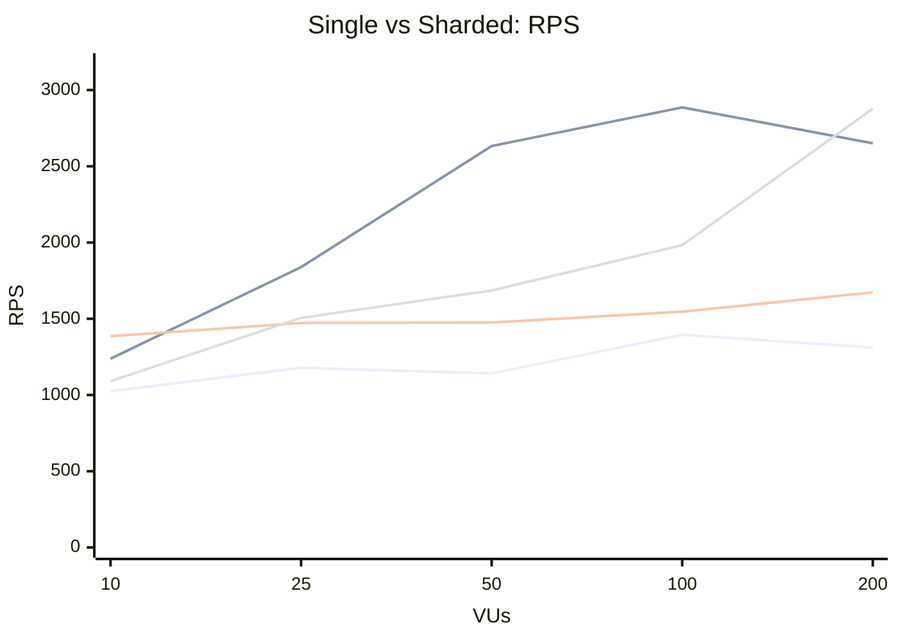

<sub>лінія 1 — `Запис, Single` · лінія 2 — `Запис, Sharded (12.4)` · лінія 3 — `Читання, Single` · лінія 4 — `Читання, Sharded`</sub>

**Висновки:**

| Операція | Single Node | Sharded (2 вузли) | Пояснення |
|---|---|---|---|
| Запис | Пік 1 394.9 RPS, вузол у ліміті CPU | Пік 2 886.0 RPS (12.4) | Записи діляться між вузлами. Ресурс БД подвоєно, межею стає CPU API |
| Шард-локальне читання | До 1 673.0 RPS, p95 на 200 VU 212.4 мс | До 2 877.2 RPS, p95 165.6 мс | Масштабується майже лінійно, як і запис |
| Fan-out аналітика | Насичення вже на 10–25 VU (~48.0 RPS, p95 0.5–1.5 с); з 50 VU — помилки (вичерпаний пул з'єднань) | 105.6 / 73.5 / 53.8 / 76.8 / 101.2 RPS, **0% помилок** до 200 VU | Кожен шард агрегує половину рядків паралельно, тож важкий запит швидшає. Але кожен такий запит займає з'єднання на **всіх** шардах |
| Fan-out «моїх замовлень» | — | Пік 1 312.8 RPS проти 2 877.2 у локального | Оверхед N запитів замість одного (12.5) |

**Точки насичення:**
- **Single Node:** запис і читання впираються в CPU єдиного вузла (~1.3–1.7 тис. RPS). Аналітика ламається вже на 50 VU.
- **Sharded:** запис і локальне читання впираються в CPU API (~2.6–2.9 тис. RPS) за запасу на шардах.

**Знахідка: каскадна відмова через вичерпаний пул з'єднань.** Перший прогін аналітики на Single Node (`lab7_E_stats_single_stress_cascade`) на 200 VU дав **96.6% помилок** при «1701 RPS». Це були не відповіді, а миттєві 502 від Nginx. Ланцюжок:
1. Важкі запити тримали з'єднання по 2–5 с, і пул Npgsql (20 на інстанс) вичерпався.
2. EF Core загорнув помилку пулу в `InvalidOperationException`, тому `GlobalExceptionHandler` віддав **500**.
3. Nginx рахує 500 відмовою інстансу (`proxy_next_upstream http_500`, `max_fails=2`), тож з ротації випали всі 4 інстанси. У лозі Nginx — 174 758 записів `no live upstreams`.

Так перевантаження БД перетворилося на повну недоступність API, включно з ендпоінтами, які БД узагалі не чіпають. Виправлення: обробник розгортає вкладений виняток і для недоступної БД віддає **503** (ЛР6 прибрала 503 з повторів Nginx). Повторний прогін: 0 записів `no live upstreams`. Клієнти на піку отримують швидкі 503 (load shedding), а інстанси лишаються в ротації. Це та сама проблема, що й у ЛР6: Nginx не повинен вважати відмовою інстансу помилку спільної залежності.

### 12.9. Реплікація шардів: кожен шард — Primary + Replica

Кожен шард — така сама пара, як основна БД у ЛР6: `shard-a` → `shard-a-replica`, `shard-b` → `shard-b-replica`. Реплікація асинхронна потокова (Hot Standby), а bootstrap репліки — той самий `db/replica/bootstrap.sh`. Hot Standby вимагає `max_prepared_transactions` не менше, ніж на Primary, тому репліки шардів стартують з `-c max_prepared_transactions=20`. Стан реплікації: `scripts/sharding/shard-replication-status.sh`.

**Хто що читає:**

| Операція | Вузол | Чому |
|---|---|---|
| Запис, передача (2PC), «мої замовлення» | Primary шарду | Strong / Read-Your-Writes: користувач бачить своє замовлення одразу після оплати |
| Аналітика `/orders/stats` (fan-out) | **Репліки шардів** (`Sharding:AnalyticsReads=Replica`) | Звіт про продажі допускає відставання на мілісекунди, а важкий `GROUP BY` не має конкурувати із записом |
| Аналітика з `?consistency=strong` | Primary шардів | Коли потрібна точна цифра «зараз» |
| Аналітика, репліка шарду **недоступна** | Primary цього шарду (`node: shard-b (replica-down)`) | Primary Fallback, як у ЛР6 |

Вузол кожної частини відповіді видно в заголовку `X-Shard-Nodes`, наприклад `shard-a-replica,shard-b-replica`.

**Експеримент** (`load-tests/run-lab7.sh replicas`): змішане навантаження — 90% записів замовлень і 10% аналітики (`e-orders.js`, `MODE=mixed`). Шарди і репліки по 0.5 CPU, 4 інстанси API, stress-профіль. Прогін 1: аналітика на Primary шардів (`SHARD_ANALYTICS=Primary`). Прогін 2: на репліках. Записи й аналітика заміряні окремо.

| VUs | Записів/с: аналітика на Primary | Записів/с: на репліках | p95 запису, мс: Primary | p95 запису, мс: репліки | p99 запису, мс: Primary | p99 запису, мс: репліки | Аналітика/с: Primary / репліки | p95 аналітики, мс: Primary / репліки | Помилки: Primary / репліки |
|---:|---:|---:|---:|---:|---:|---:|---:|---:|---:|
| 10 | 727.0 | **753.8** | 31.4 | **22.8** | 51.8 | **41.9** | 80.7 / 85.8 | 52.6 / 69.2 | 0.0% / 0.0% |
| 25 | 401.7 | **676.0** | 176.1 | **50.3** | 338.0 | **79.3** | 42.4 / 75.0 | 298.9 / 548.1 | 0.0% / 0.0% |
| 50 | 613.6 | **597.9** | 192.9 | **16.9** | 388.9 | **32.8** | 66.0 / 64.1 | 303.5 / 1 747.0 | 0.0% / 0.0% |
| 100 | 536.7 | **480.7** | 422.7 | **21.6** | 698.9 | **54.2** | 60.7 / 53.1 | 698.6 / 4 629.5 | 0.0% / 0.0% |
| 200 | 307.3 | **639.5** | 1 687.8 | **36.1** | 2 514.2 | **69.1** | 34.7 / 72.2 | 2 696.1 / 4 514.7 | 0.0% / 9.1% |

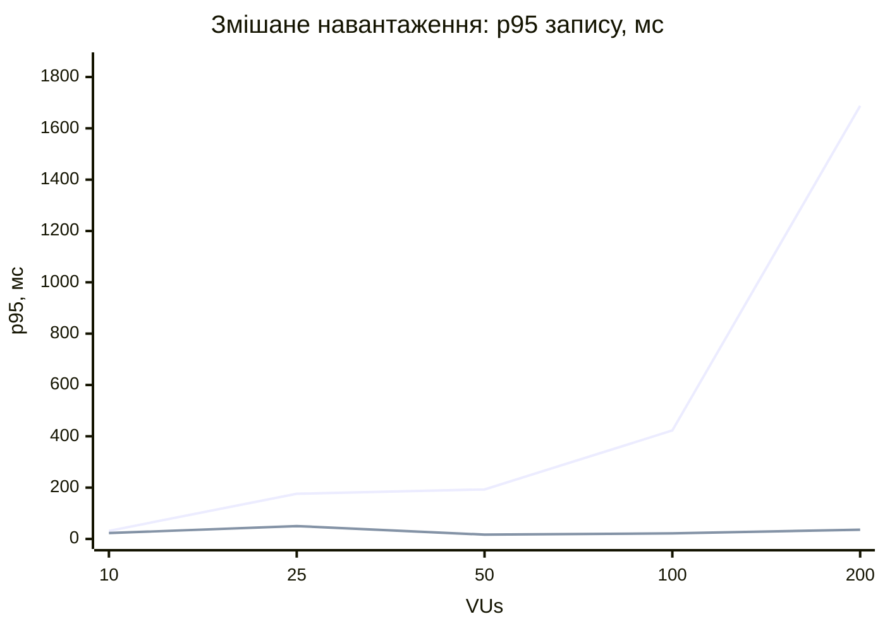

<sub>лінія 1 — `Аналітика на Primary шардів` · лінія 2 — `Аналітика на репліках шардів`</sub>

**CPU вузлів** (середнє за прогін; ліміт 50%):
- **Аналітика на Primary:** shard-a 44%, shard-b 46% (піки 61% / 59%), репліки простоюють (6–7%).
- **Аналітика на репліках:** Primary шардів по 20%, репліки 43–46%.

**Висновок.** Коли аналітика читає з Primary шардів, кожен важкий `GROUP BY` забирає CPU у записів. p95 запису росте з 31.4 до 1 687.8 мс на 200 VU. З репліками записи ізольовані: p95 запису лишається 16.9–50.3 мс на всіх рівнях, на 200 VU це в 47 разів менше. Пропускна здатність записів на 200 VU — 639.5 проти 307.3 за секунду.

Межу аналітики тепер задають репліки: p95 аналітики 1.7–4.6 с, а на 200 VU — 9.1% помилок. Усі ці помилки — 503 на аналітику: у логах API 154 з 154 випадків — вичерпаний пул саме реплік (`Timeout` 2 с, у Primary шардів 3 с). Записи при цьому проходять. Записи ростуть разом із шардами, аналітика — разом із репліками.

<sub>Записів/с при аналітиці на репліках на 50–100 VU не вищі, ніж при аналітиці на Primary, бо k6 працює за замкненою моделлю: VU, що чекає 2–4 с на аналітику, у цей час не пише. Тому для записів показова латентність, а не RPS.</sub>

**Знахідка: fallback, що переливає перевантаження на Primary.** Перша версія переходила на Primary шарду при будь-якій помилці з'єднання з реплікою, включно з вичерпаним пулом. Прогін `lab7_E_mixed_analytics_Replica_stress_fallback_cascade` показав, що з цього виходить:
- **50 VU.** Репліка shard-a упирається в свій ліміт CPU, і її пул вичерпується.
- **100 VU.** Кожна аналітика, що не дочекалася з'єднання з реплікою, переходить на shard-a: його CPU стрибає до 50%, а CPU репліки падає до 15%.
- **Наслідок для записів.** Primary насичується аналітикою. p95 запису — 3 293.6 / 3 161.8 мс на 100 / 200 VU, помилок 11.6% / 26.4%, записів лише 124.5 / 165.4 за секунду.

Тобто механізм відмовостійкості перетворив перевантаження репліки на відмову запису.

**Виправлення** (`ShardedOrderStore.IsReplicaUnreachable`). Fallback спрацьовує лише тоді, коли репліка справді недоступна: мережева помилка (`SocketException`), standby не приймає з'єднань (`57P03`) або вимикається. Вичерпаний пул і таймаут означають перевантаження. Тоді аналітика отримує 503 (load shedding), а Primary лишається для записів. Ціна: якщо репліка «зависла», а не впала, аналітика отримує 503 замість відповіді з Primary. Для звіту це прийнятно, для запису — ні.

### 12.10. Теорія до захисту

**Партиціонування, шардинг, реплікація.**

| | Що ділимо | Де живуть частини | Що дає | Наш стенд |
|---|---|---|---|---|
| Партиціонування | Таблицю на частини за ключем (range / list / hash) | В одному екземплярі СУБД | Partition pruning, швидке видалення старих даних (`DROP PARTITION`), менші індекси | — (можна для `Orders` за `CreatedAt` всередині кожного шарду) |
| Шардинг | Набір даних на частини за shard key | На різних вузлах СУБД | Масштабування запису й обсягу: кожен вузол має свої CPU, диск, пам'ять | `Orders` на `shard-a` / `shard-b` |
| Реплікація | Нічого не ділимо — копіюємо весь набір | На кількох вузлах | Масштабування читання і відмовостійкість; запис не масштабує | Primary → Replica (ЛР6) |

Вони комбінуються: кожен шард у продакшені — це своя пара Primary + Replica, а всередині шарду таблиця може бути партиціонована за часом.

**Distributed JOIN.** JOIN між таблицями з різних шардів СУБД виконати не може: дані треба витягнути на координатор і з'єднати там (дорого: мережа + пам'ять), або продублювати малу довідкову таблицю на кожен шард (broadcast / reference table), або з'єднувати лише дані з однаковим ключем шардингу (co-location). Тому ми шардуємо агрегат «замовлення користувача» цілком (усі його рядки на одному шарді), а довідники (події) лишаються в основній БД.

**Unique constraints.** Унікальний індекс діє лише в межах одного вузла. Глобально унікальними є: (1) поле, що є або містить ключ шардингу — дублікат завжди потрапить на той самий шард (наш `BookingId`: бронювання належить одному користувачу → одному шарду); (2) значення, що генеруються без координації (UUID). Для інших полів (наприклад, email у шардованій таблиці користувачів) потрібна окрема глобальна таблиця-індекс (lookup table) або резервування значення до запису.

**2PC (Two-Phase Commit).** Координатор просить усіх учасників виконати зміни і підготуватися (`PREPARE TRANSACTION`: зміни записано в WAL, блокування утримуються, учасник обіцяє закомітити за командою). Якщо всі відповіли «готовий» — `COMMIT PREPARED` на всіх, інакше `ROLLBACK PREPARED`. Гарантує атомарність, але:
- блокуючий протокол: якщо координатор упав між фазами, учасники тримають блокування до його відновлення (демонстрація в 12.6 — рядок замовлення заблокований, поки транзакція in-doubt);
- латентність: мінімум два раунди мережевих запитів і fsync на кожному учаснику;
- доступність: транзакція можлива лише коли живі всі учасники.

**Saga.** Довга бізнес-транзакція як послідовність локальних транзакцій, кожна з яких має компенсуючу дію. Для передачі замовлення: (1) на шарді-отримувачі вставити замовлення зі статусом `Pending`; (2) на шарді-відправнику видалити (або позначити `Transferred`); (3) на отримувачі зробити `Active`. Якщо крок 2 не вдався — компенсація: видалити `Pending` на отримувачі. Немає блокувань між кроками й залежності від усіх вузлів одночасно, але є проміжні стани, видимі іншим (немає ізоляції) — їх треба проєктувати явно. Оркестрація (координатор-сервіс) або хореографія (події через брокер); надійна доставка кроків — Transactional Outbox.

**Consistent Hashing.** Простір хешів — кільце 0…2⁶⁴−1. Кожен вузол займає на кільці точки, ключ належить першій точці за годинниковою стрілкою від hash(key). При додаванні вузла він «забирає» лише ключі на відрізках перед своїми точками — у середньому 1/(N+1) даних, і лише від сусідів. З однією точкою на вузол відрізки дуже нерівні (у моделі 12.7 — до ±190%), тому кожен вузол отримує 100–200 віртуальних вузлів (vnodes) і нерівність падає до кількох відсотків. Virtual buckets — практичний варіант тієї самої ідеї (Couchbase vBuckets, Redis Cluster з 16384 hash slots, Vitess keyspace ranges): фіксована кількість бакетів і явна карта «бакет → вузол», яку можна змінювати по одному бакету й переносити дані поступово.

### 12.11. Тести

- **`ShardRouterTests.cs`:**
  - детермінованість для всіх стратегій;
  - еталонні значення хешу збігаються з Python-моделлю, тож хеш не залежить від процесу;
  - рівномірність hash і buckets для будь-яких id;
  - `Modulo` для префіксних id кладе 100% на один шард;
  - решардинг 2 → 3: buckets переносять ≈ 1/3, `hash % N` — ≈ 2/3.
- **`OrdersShardingTests.cs`** (два логічні шарди — бази `shard_a` і `shard_b` у тестовому PostgreSQL):
  - замовлення потрапляє на шард із `X-Shard`, локальне читання опитує 1 шард, fan-out — 2;
  - генерація розподіляє дані 40–60%, а аналітика сумує всі шарди;
  - передача між шардами — `TwoPhaseCommitted`;
  - падіння координатора → дві in-doubt транзакції, змін не видно, відновлення комітить;
  - оплата бронювання створює замовлення на шарді користувача;
  - аналітика читає з реплік шардів; мертва репліка → Primary цього шарду; `?consistency=strong` → лише Primary.
- **Разом:** 67 тестів, усі проходять.

### 12.12. Як відтворити

```bash
docker compose up -d --build && docker compose restart nginx

# Куди потрапить ключ; генерація даних і Data Distribution Matrix
curl -s http://localhost/api/v1/lab/sharding/route/8a7d183f-6712-401c-b26a-9f5e13d1fa82
scripts/sharding/generate-orders.sh 200000 20000 random
scripts/sharding/distribution.sh

# Демонстрації: routing | cross-shard | transfer | all
scripts/sharding/sharding-demo.sh all

# Live-демо Hot Shard (~3 хв): Modulo vs VirtualBuckets, розподіл, RPS/p95, CPU і пам'ять шардів
scripts/sharding/hot-shard-demo.sh

# Реплікація шардів: стан і відставання; аналітика з реплік / з Primary
scripts/sharding/shard-replication-status.sh
curl -s -D - -o /dev/null "http://localhost/api/v1/orders/stats?eventId=c0ffee0e-0000-4000-8000-000000000003" | grep -i x-shard-nodes
curl -s -D - -o /dev/null "http://localhost/api/v1/orders/stats?consistency=strong" | grep -i x-shard-nodes

# Модель решардингу
python3 scripts/sharding/resharding_sim.py

# Уся серія замірів (~55 хв): distribution | hot-shard | benchmark | replicas | all
load-tests/run-lab7.sh all
python3 load-tests/report.py lab7_E_write_Modulo_stress lab7_E_write_VirtualBuckets_stress
```

Порти на хості: shard-a — 5441, shard-b — 5442, shard-a-replica — 5443, shard-b-replica — 5444 (`psql -h localhost -p 5441 -U postgres orders`). Дані, графіки й модель — також у `docs/lab7/`.
