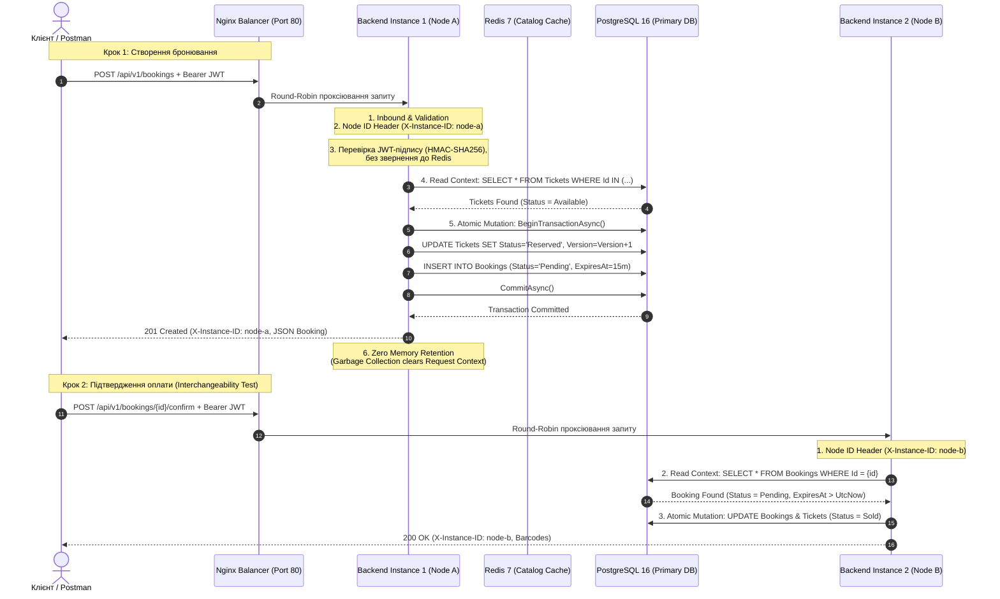
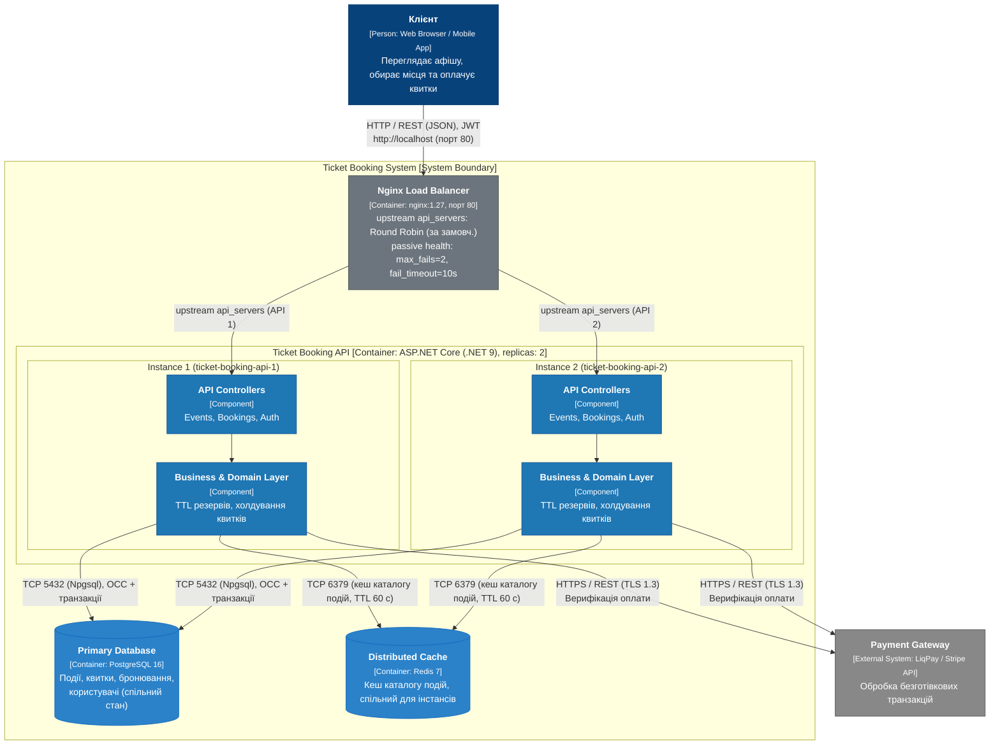
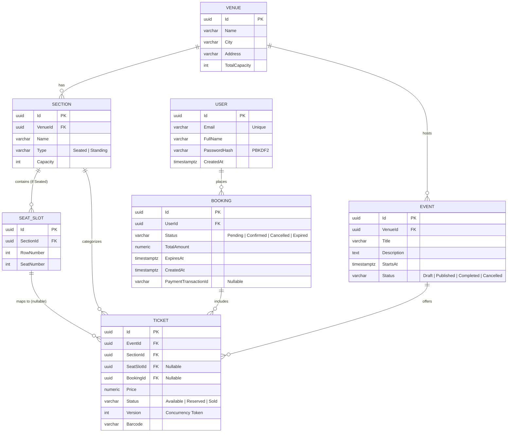

# Concert Ticketing Engine (High-Load & Stateless Booking Platform)

Платформа для онлайн-бронювання та продажу квитків на концерти в умовах високої конкуренції за спільні ресурси (High Contention / Flash Crowds). Систему спроєктовано з урахуванням пікових навантажень на старті продажів популярних подій із забезпеченням транзакційної цілісності, захисту від подвійного продажу (Double-Booking) та **горизонтального масштабування (Stateless Architecture)**.

Підтримуються комбіновані типи майданчиків:

- **Сидячі сектори (Seated):** із фіксованими координатами крісел (ряд, номер місця).
- **Зони вільного входу (Standing / General Admission):** фан-зони з контролем загальної місткості (Capacity).

---

## Зміст

1. [Аудит та класифікація стану](#1-аудит-та-класифікація-стану-state-audit-report)
   - [1.1. Рефакторинг та декомпозиція локального стану](#11-рефакторинг-та-декомпозиція-локального-стану-stateless-architecture)
   - [1.2. Специфікація Stateless Request Flow](#12-специфікація-stateless-request-flow)
2. [Архітектура системи](#2-архітектура-системи-c4-container--component-model)
3. [Схема даних](#3-схема-даних-erd--persistence-layer)
4. [Специфікація REST API](#4-специфікація-rest-api)
5. [Матриця відповідальності (RACI)](#5-матриця-відповідальності-raci)
6. [Інструкція із детермінованого запуску системи](#6-інструкція-із-детермінованого-запуску-системи)
7. [Результати аналізу вузьких місць](#7-результати-аналізу-вузьких-місць-bottleneck-analysis)
8. [Лабораторна робота №3: балансування, відмовостійкість, масштабування](#8-лабораторна-робота-3-балансування-відмовостійкість-масштабування)

---

## 1. Аудит та класифікація стану (State Audit Report)

Для підготовки backend-сервісу `TicketBooking.Api` до горизонтального масштабування та переведення в безстатусну архітектуру (**Stateless Application Architecture**) було проведено аудит вихідного коду проєкту. Усі компоненти та типи даних, якими оперує сервіс під час обробки запитів, класифіковано за трьома категоріями.

### Таблиця класифікації стану системи

| Категорія стану | Компоненти та елементи коду | Сховище та час життя | Статус та обґрунтування Stateless-придатності |
|---|---|---|---|
| **1. Ephemeral / Local Safe**<br/>*(Тимчасовий / локально безпечний)* | • HTTP-контекст запиту (`HttpContext`)<br/>• Вхідні DTO (`CreateBookingRequest`, `ConfirmPaymentRequest`, `RegisterRequest`, `LoginRequest`)<br/>• Локальні стекові змінні методів у контролерах<br/>• Контекст логування (Trace ID, HTTP Request logs) | RAM .NET-процесу<br/>*(Managed Heap, Gen 0 / Stack frame)* | **Безпечно.** Існує виключно протягом обробки одного HTTP-запиту. Автоматично знищується Garbage Collector (GC) після формування відповіді. Не впливає на обробку інших запитів. |
| **2. Shared / Externalized**<br/>*(Спільний / зовнішній бізнес-стан)* | • Каталог подій, секторів та крісел (`Events`, `Sections`, `SeatSlots`)<br/>• Квитки та їх транзакційні статуси (`Tickets`: `Available`, `Reserved`, `Sold`)<br/>• Бронювання та TTL-резерви (`Bookings`: `Pending`, `Confirmed`, `Expired`, `Cancelled`)<br/>• Користувачі та хеші паролів (`Users`, PBKDF2)<br/>• Сесії та авторизаційні дані | **Primary DB:** PostgreSQL 16<br/>**Distributed Cache (каталог подій):** Redis 7<br/>**Client:** JWT Bearer tokens | **Винесено у зовнішній шар.** Увесь транзакційний та бізнес-стан зберігається в централізованих зовнішніх сховищах. Будь-який інстанс API може прочитати або змінити цей стан через асинхронні запити. |
| **3. Critical Stateful Dependencies**<br/>*(Критичні stateful-залежності, підлягають вилученню)* | • In-Memory колекції (`List<T>`, `ConcurrentDictionary` для збереження сесій чи броней)<br/>• Local Locks (`lock()`, `SemaphoreSlim` для блокування квитків)<br/>• In-Memory кеш (`IMemoryCache`)<br/>• Локальні лічильники / Singleton state<br/>• Sticky Sessions / Session Cookies | **Пам'ять (RAM) конкретного контейнера/процесу** | **Повністю усунено / відсутні.** Жодні бізнес-дані, прапорці стану або внутрішньопроцесні блокування не зберігаються у пам'яті C#-процесу. Інстанси є 100% взаємозамінними (Interchangeable Workers). |

### Детальний аналіз та докази усунення In-Memory залежностей у коді

1. **Безстатусна автентифікація (Stateless JWT Authentication).**
   У файлах `AuthController.cs` та `JwtTokenService.cs` авторизація побудована на стандарті RFC 7519 (JWT). Усі дані про користувача зашифровані в підписаному токені (HMAC-SHA256). Сервер не зберігає таблиці активних сесій у локальній пам'яті (`SessionState`). Кожен екземпляр API верифікує токен самостійно за допомогою єдиного ключа `Jwt:Key`, що дозволяє будь-якому інстансу обробити запит `GET /api/v1/auth/me`.

2. **Відмова від Application-Level Locks (`lock` / `SemaphoreSlim`) на користь DB ACID та OCC.**
   У `BookingsController.cs` під час створення броні не використовуються C#-блокування. Натомість виконується відкриття асинхронної транзакції бази даних `BeginTransactionAsync()` та перевірка токена оптимістичного блокування `Version` (`[ConcurrencyCheck]` на сутності `Ticket`). Захист від Double-Booking працює на рівні PostgreSQL, а не у пам'яті .NET-процесу.

3. **Розподілений фоновий сервіс (`ExpiredBookingsCleaner`).**
   У файлі `Services/ExpiredBookingsCleaner.cs` фонова задача оновлення прострочених бронювань спирається на прямий SQL-запит до бази даних (`WHERE Status = Pending AND ExpiresAt < UtcNow`). Сервіс не зберігає таймери або списки броней у RAM, спираючись на індекс `IX_Bookings_Status_ExpiresAt`.

4. **Централізований Distributed Cache (Redis 7).**
   Каталог подій (`GET /api/v1/events`) кешується в Redis через `IDistributedCache` на 60 с (ключ `events:{city|all}`). Кеш спільний для всіх інстансів, тому запис з одного вузла видно на інших. Квитки кешем не є: їхній статус змінюється при кожному бронюванні, тож `GET /events/{id}/tickets` читається з PostgreSQL. Якщо Redis недоступний, каталог віддається з БД (збій кешу не валить API).

---

## 1.1. Рефакторинг та декомпозиція локального стану (Stateless Architecture)

На основі проведеного аудиту було виконано рефакторинг архітектури backend-сервісу `TicketBooking.Api` з дотриманням принципів безстатусності (Stateless Application Architecture).

1. **Забезпечення взаємозамінності вузлів (Interchangeable Workers).**
   - Усі контролери та сервіси позбавлені локального стану (`static` колекцій, in-memory сесій чи синглтон-прапорців).
   - Сервіс спирається на безстатусну JWT-автентифікацію (HMAC-SHA256). Будь-який вузол за балансувальником Nginx здатний обробити довільний HTTP-запит, спираючись на стан у PostgreSQL 16 та заголовок `Authorization: Bearer <token>`. Redis використовується лише як кеш каталогу подій, а не як сховище сесій.

2. **Декомпозиція та винесення кешу в Redis 7.**
   - Зареєстровано `AddStackExchangeRedisCache`; каталог подій кешується у зовнішньому сховищі `redis:6379` з TTL 60 с.
   - Статуси квитків і місць Redis не кешує, щоб уникнути застарілих даних (Stale Data Cache) при бронюванні; вони завжди читаються з PostgreSQL.

3. **Розподілена транзакційність та захист від Race Condition.**
   - Захист від подвійного бронювання (Double-Booking) перенесено на рівень **PostgreSQL ACID-транзакцій** (`BeginTransactionAsync`) та токена оптимістичного блокування **`Version` (OCC)**.
   - Оскільки перевірка та оновлення статусу квитка є атомарною операцією СУБД, цілісність даних гарантується без використання локальних C#-блокувань (`lock`, `SemaphoreSlim`).

4. **Механізм ідентифікації вузлів (`X-Instance-ID`).**
   - Впроваджено HTTP Middleware, яке автоматично додає до всіх відповідей заголовок `X-Instance-ID: Environment.MachineName`. Це дозволяє фіксувати конкретний контейнер/вузол, що обробив запит під час балансування Nginx.

---

## 1.2. Специфікація Stateless Request Flow

Для підтвердження безстатусності сервісу було зафіксовано та деталізовано сквозний потік виконання запиту (Request Flow) для ключового бізнес-сценарію — **транзакційне створення бронювання квитків (`POST /api/v1/bookings`)**.

### Схема сквозного потоку (Sequence Diagram)



### Фіксація параметрів та дій за вимогами

1. **Вхідні параметри (Inbound Parameters & Token).**
   - HTTP-маршрут: `POST /api/v1/bookings`
   - Header: `Authorization: Bearer <jwt_access_token>` (самодостатній токен з `UserId` та `Email`).
   - Body: `{"userId": "8a7d183f-...", "ticketIds": ["7b0a793c-..."]}`

2. **Вичитування контексту зі Shared Storage.**
   - Перевірка токена виконується без звернення до локальної пам'яті (криптографічний верифікатор `JwtOptions`).
   - Читання статусу квитків з **PostgreSQL 16** (`SELECT ... FROM Tickets WHERE Id = ANY(@ids)`). Redis на цьому кроці не використовується.

3. **Атомарні зміни стану.**
   - Відкриття явної транзакції `BeginTransactionAsync()`.
   - Оновлення статусу квитків із токеном версіонування `Version += 1` (OCC-блокування).
   - Фіксація броні у СУБД та `CommitAsync()`.

4. **Відсутність залишкових мутацій у пам'яті (Zero Memory Retention).**
   - Після відправки відповіді `201 Created` усі об'єкти запиту виходять із зони видимості й утилізуються Garbage Collector (GC).
   - У RAM `Instance 1` не залишається локальних локів або прапорців броні.
   - Наступний запит `POST /confirm` перенаправляється на `Instance 2`, який зчитує створену бронь напряму з PostgreSQL і успішно завершує оплату.

---

## 2. Архітектура системи (C4 Container & Component Model)

Архітектурна схема з кількома інстансами API за балансувальником Nginx (upstream `api_servers`, алгоритм Round Robin за замовчуванням; без sticky sessions). Усі інстанси ходять у спільний PostgreSQL 16 (бізнес-стан) і Redis 7 (розподілений кеш); жодного стану в пам'яті контейнера немає, тому будь-який інстанс може обробити будь-який запит.



## 3. Схема даних (ERD & Persistence Layer)

Модель нормалізована до 3NF. Топологія майданчика (`Venue`, `Section`, `SeatSlot`) строго відділена від комерційних сутностей події (`Event`, `Ticket`), що дозволяє повторно використовувати конфігурацію майданчика для різних концертів без дублювання записів геометрії.



### Ключові оптимізації бази даних

- **Фан-зони:** для квитків стоячих секторів поле `SeatSlotId` встановлюється в `NULL`, а контроль переповнення виконується на рівні квоти сектора `Section.Capacity`.
- **Індексація:** складений індекс `IX_Tickets_EventId_Status` оптимізує фільтрацію доступних квитків під час перегляду схеми залу.
- **Concurrency Check:** поле `Version` у сутності `Ticket` реалізує токен оптимістичного блокування (OCC) для контролю паралельного доступу.
- **TTL резервів:** індекс `IX_Bookings_Status_ExpiresAt` використовується фоновим сервісом `ExpiredBookingsCleaner`, який кожні 30 с переводить прострочені `Pending`-броні в `Expired` і повертає квитки у продаж.
- **Унікальність:** `IX_Users_Email` (логін) та `IX_Tickets_Barcode` (штрихкод квитка).

---

## 4. Специфікація REST API

Інтерактивна документація ендпоінтів та тестування доступні через Swagger UI:

- **Swagger URL:** <http://localhost/swagger> (через Nginx)

### Перелік контрактів системи

| Метод | Маршрут | Опис | Відповідає |
|---|---|---|---|
| `GET` | `/api/v1/events` | Отримання каталогу подій з фільтрацією за містом | Катерина |
| `GET` | `/api/v1/events/{id}/tickets` | Перегляд схеми залу та доступних квитків за подією | Катерина |
| `POST` | `/api/v1/bookings` | Транзакційне холдування квитків (TTL 15 хв, захист від Race Condition) | Напарник |
| `POST` | `/api/v1/bookings/{id}/confirm` | Підтвердження оплати, генерація штрихкодів, статус `Sold` | Напарник |
| `DELETE` | `/api/v1/bookings/{id}` | Скасування бронювання та повернення квитків у продаж | Напарник |
| `GET` | `/api/v1/bookings/{id}` | Перегляд бронювання з квитками та залишком TTL | Напарник |
| `POST` | `/api/v1/auth/register` | Реєстрація користувача (пароль хешується PBKDF2), повертає JWT | Напарник |
| `POST` | `/api/v1/auth/login` | Автентифікація за email/паролем, повертає JWT (HMAC-SHA256, 60 хв) | Напарник |
| `GET` | `/api/v1/auth/me` | Профіль поточного користувача (`Authorization: Bearer <token>`) | Напарник |
| `GET` | `/health` | Health check для оркестрації контейнерів | Напарник |

### Коди відповідей бронювання

| Ендпоінт | Успіх | Помилки |
|---|---|---|
| `POST /api/v1/bookings` | `201 Created` + `Location` | `400` валідація / квитки з різних подій, `404` користувач або квиток не існує, `409` квиток уже `Reserved`/`Sold` (Double-Booking) або паралельний конфлікт `Version` |
| `POST /api/v1/bookings/{id}/confirm` | `200 OK` + штрихкоди `TCK-XXXXXXXX` | `400` валідація, `404` бронь не існує, `409` статус не `Pending` або вичерпано TTL (бронь → `Expired`, квитки → `Available`) |
| `DELETE /api/v1/bookings/{id}` | `204 No Content` | `404` бронь не існує, `409` бронь уже `Confirmed` / `Cancelled` / `Expired` |

### Захист від Double-Booking

1. Бронювання виконується в явній транзакції (`BeginTransactionAsync`).
2. Перевіряється, що **всі** квитки мають статус `Available`; інакше — `RollbackAsync` і `409 Conflict`.
3. Під час оновлення квитків `Version += 1`. Оскільки `Version` позначено `[ConcurrencyCheck]`, EF Core генерує `UPDATE ... WHERE "Id" = @id AND "Version" = @old`. Якщо дві транзакції одночасно прочитали той самий вільний квиток, друга після коміту першої оновить 0 рядків → `DbUpdateConcurrencyException` → `409 Conflict`. Таким чином подвійний продаж неможливий навіть за гонки між перевіркою і записом.

### Input Validation (FluentValidation)

| DTO | Правила |
|---|---|
| `CreateBookingRequest` | `UserId` ≠ `Guid.Empty`; `TicketIds` не `null` і не порожній; не більше **4** квитків в одні руки; без дублікатів; жоден id ≠ `Guid.Empty` |
| `ConfirmPaymentRequest` | `PaymentTransactionId` обов'язковий, 6–100 символів, лише `[A-Za-z0-9_-]` |
| `RegisterRequest` | коректний email ≤ 255; пароль 8–128 символів, щонайменше одна літера й одна цифра; `FullName` обов'язковий |
| `LoginRequest` | коректний email, пароль обов'язковий |

Валідатори підключені глобальним фільтром `FluentValidationFilter` — контролери отримують уже перевірені дані.

### Формат помилок (RFC 7807 ProblemDetails)

Усі помилки (валідація, 401/404/409, неперехоплені винятки) повертаються як `application/problem+json`. Глобальний `GlobalExceptionHandler` (`IExceptionHandler` + `UseExceptionHandler`) не віддає стек-трейси назовні.

```json
{
  "type": "https://tools.ietf.org/html/rfc9110#section-15.5.10",
  "title": "Квитки вже заброньовані або продані",
  "status": 409,
  "detail": "Один або кілька вибраних квитків недоступні для бронювання.",
  "instance": "POST /api/v1/bookings",
  "traceId": "00-...",
  "unavailableTickets": [ { "ticketId": "7b0a793c-...", "status": "Reserved" } ]
}
```

### Тестові дані (seed)

| Сутність | Значення |
|---|---|
| Користувач | `8a7d183f-6712-401c-b26a-9f5e13d1fa82`, `katerina@example.com` / пароль `Katerina123` |
| Подія | `e5b87192-3c2b-4d43-9821-82d2cbb54d01` — «Океан Ельзи. Світовий тур» |
| Квитки | 2 місця в партері (850 грн) + 30 квитків фан-зони (600 грн) |

### Колекція запитів для захисту

- `postman/TicketBooking.postman_collection.json` — імпортувати в Postman (File → Import). Містить 4 папки: сценарій захисту за регламентом, негативні кейси, авторизацію та тест персистентності. ID події/квитків/броней зберігаються у змінні колекції автоматично, кожен запит має автотести (вкладка *Test Results*).
- `TicketBooking.Api.http` — той самий сценарій для VS Code REST Client / Visual Studio.

---

## 5. Матриця відповідальності (RACI)

Розподіл інженерних завдань між учасниками команди згідно з вимогами лабораторних робіт № 1 та № 2:

| Етап / Модуль розробки | Катерина | Напарник |
|---|---|---|
| **Проєктування домену, структури секторів та ER-моделі** | **A / R** | C |
| **Шар персистентності (EF Core, Npgsql, DDL, Seeder)** | **A / R** | I |
| **Модуль каталогу подій (`EventsController`)** | **A / R** | I |
| **Інтеграція та налаштування OpenAPI / Swagger UI** | **A / R** | I |
| **Проведення аудиту стану (State Audit Report) та класифікація за 3 категоріями** | **A / R** | C |
| **Рефакторинг Stateless Architecture та Middleware `X-Instance-ID`** | **A / R** | I |
| **Специфікація Stateless Request Flow (Sequence Diagram)** | **A / R** | I |
| **Модуль бронювання (`BookingsController`) та автентифікації (`AuthController`)** | C | **A / R** |
| **Input Validation (FluentValidation) та глобальний Middleware помилок** | I | **A / R** |
| **Контейнеризація, Nginx Balancer та `docker-compose.yml` (`--scale api=2`)** | I | **A / R** |
| **Resilience & Cross-Instance Consistency Testing (`docker kill`)** | I | **A / R** |
| **Аналіз вузьких місць (Bottleneck Analysis за шаблоном)** | C | **A / R** |
| **Колекція API-запитів (Postman/Bruno з негативними кейсами)** | I | **A / R** |

---

## 6. Інструкція із детермінованого запуску системи

Потрібні лише Docker та Docker Compose (локальні .NET SDK, PostgreSQL і Redis не потрібні). Порти `80` (Nginx) і `5432` (PostgreSQL) мають бути вільні.

```bash
# 1. Клонування репозиторію
git clone https://github.com/katushhiaa/ticket-booking-platform.git
cd ticket-booking-platform

# 2. Збірка і запуск: PostgreSQL 16, Redis 7, 2 інстанси API та Nginx
docker compose up -d --build --scale api=2

# 3. Перевірка статусу: db і redis — healthy; api-1, api-2, nginx — Up
docker compose ps
docker compose logs api
```

- **Після `--scale`** перезапустіть Nginx (`docker compose restart nginx`): він запам'ятовує адреси upstream при старті, тому без перезапуску бачить лише старі репліки.
- **Топологія:** клієнт → Nginx (`http://localhost`, порт 80) → `api` (2 репліки, Round-Robin) → спільні PostgreSQL та Redis. Порт API напряму назовні не публікується: усі запити йдуть через Nginx.
- **Перевірка балансування:** кожна відповідь містить заголовок `X-Instance-ID` (ID контейнера, що обробив запит). Послідовні запити до `http://localhost/api/v1/events` мають чергувати два різні значення:

  ```bash
  for i in 1 2 3 4; do curl -s -D - -o /dev/null http://localhost/api/v1/events | grep -i x-instance-id; done
  ```

- **Swagger UI:** <http://localhost/swagger>
- При старті API сам створює схему (`EnsureCreated`) і заповнює тестові дані (див. розділ «Тестові дані (seed)»).
- **Тестовий логін:** `POST /api/v1/auth/login` з `{"email": "katerina@example.com", "password": "Katerina123"}` → JWT; для `GET /api/v1/auth/me` додати заголовок `Authorization: Bearer <token>`.
- **Postman:** File → Import → `postman/TicketBooking.postman_collection.json`, далі Run collection (папки виконувати по порядку 01 → 02 → 03 → 05; змінні зберігаються між запитами). Колекційний тест перевіряє `X-Instance-ID` у кожній відповіді.
- **Newman (CLI):**

  ```bash
  npx newman run postman/TicketBooking.postman_collection.json \
    --folder "01 Сценарій захисту (регламент викладача)" \
    --folder "02 Негативні кейси (валідація, 404, 409)" \
    --folder "03 Авторизація (JWT)" \
    --folder "05 Cross-Instance (2 репліки за Nginx)"
  ```

- **Скидання бази (чистий стан перед повторним прогоном):**

  ```bash
  docker compose down -v && docker compose up -d --build
  ```

- **Тест персистентності:** створити бронювання, виконати `docker compose restart db`, дочекатися `healthy` у `docker compose ps` і перевірити `GET /api/v1/bookings/{id}` (статус `Pending`) та `GET /api/v1/events/{eventId}/tickets` (квиток `Reserved`). Дані зберігаються у volume `pgdata`; «мертві» з'єднання в пулі Npgsql після рестарту БД перевіряються й замінюються автоматично (`Infrastructure/PooledConnectionValidator.cs`).
- **Сценарій А (Cross-Instance Consistency):** логін → створення броні → перегляд → оплата. Запити обробляють різні інстанси (`X-Instance-ID` у відповідях), але стан однаковий: броня, створена на одному вузлі, видна і підтверджується на іншому. Папка `05` у Postman робить це автоматично.
- **Сценарій Б (Instance Loss):** створити бронь, знайти інстанс, що її обробив, вбити його `docker kill ticket-booking-api-1`, одразу підтвердити оплату. Запит проходить через уцілілий `api-2`, квиток стає `Sold`. Вбитий контейнер Docker сам не піднімає (ручна зупинка вимикає `restart`), тому повернути другу репліку можна так: `docker compose up -d --scale api=2`.
- **Зупинка:** `docker compose down` (дані зберігаються), `docker compose down -v` (разом з даними).

### 6.1. Інтеграційні тести

Проєкт `tests/TicketBooking.IntegrationTests` (xUnit + `WebApplicationFactory` + Testcontainers). Кожен запуск сам піднімає тимчасовий `postgres:16-alpine` у Docker, стартує справжнє API в пам'яті й ганяє запити по HTTP; між тестами база скидається до стану після сідера.

Покрито: успішне бронювання, Double-Booking (у т.ч. 20 паралельних запитів → рівно один `201`), валідацію (`400`), `404`/`409`, оплату і штрихкоди, TTL (прострочена бронь → `409`, квитки знову `Available`), скасування, авторизацію (JWT).

```bash
# Варіант 1: повністю в Docker (потрібен лише Docker)
docker compose --profile tests run --rm tests

# Варіант 2: локально (потрібні .NET 9 SDK/runtime і запущений Docker)
dotnet test tests/TicketBooking.IntegrationTests
```

> **Примітка.** Варіант 1 збирає проєкт усередині Linux-контейнера й перезаписує `bin/`/`obj/`; перед локальним `dotnet test` може знадобитися `dotnet restore`.

---

## 7. Результати аналізу вузьких місць (Bottleneck Analysis)

### 7.1. Row Lock Contention (транзакційне блокування при купівлі популярних місць)

- **Точка відмови:** таблиця `Tickets` під час одночасного виконання транзакцій бронювання (`POST /api/v1/bookings`) за наявності тисяч запитів на обмежений пул квитків.
- **Причина:** конкуренція за ексклюзивне блокування рядків у реляційній базі даних. У разі використання песимістичного блокування виникає черга очікування локів (Lock Wait Timeout) і ризик виникнення Deadlock.
- **Вплив:** різке зростання p99-затримки відповіді з <100 мс до кількох секунд, масові помилки `504 Gateway Timeout` та `409 Conflict`.
- **Шляхи оптимізації:** використання черги повідомлень (RabbitMQ/Kafka) для серіалізації запитів на бронювання або застосування in-memory сховища (Redis) з атомарними операціями через Lua-скрипти перед записом у реляційну БД.

### 7.2. Database Connection Pool Exhaustion (вичерпання пулу з'єднань БД)

- **Точка відмови:** пул підключень Npgsql / PostgreSQL (`Max Pool Size`).
- **Причина:** під час сплеску трафіку (Flash Crowd) кількість одночасних HTTP-запитів значно перевищує ліміт пулу з'єднань до бази даних (за замовчуванням 100 підключень).
- **Вплив:** потоки ASP.NET Core блокуються в очікуванні вільного підключення з пулу, що призводить до вичерпання пулу потоків веб-сервера (Thread Pool Starvation) і відмови всього API.
- **Шляхи оптимізації:** впровадження connection pooler (PgBouncer) на рівні інфраструктури, агресивне кешування незмінних даних (каталог подій, геометрія залу) на рівні Redis/CDN, скорочення часу утримання відкритих транзакцій до мінімуму.

### 7.3. Read Amplification & I/O Overhead при читанні схеми залу

- **Точка відмови:** дискова підсистема СУБД (Disk I/O) під час масового опитування схеми квитків (`GET /api/v1/events/{id}/tickets`).
- **Причина:** користувачі постійно оновлюють сторінку вибору місць, генеруючи важкі `SELECT`-запити з `JOIN` до таблиць `Sections`, `SeatSlots` і `Tickets`.
- **Вплив:** вичерпання буферного пулу PostgreSQL (`shared_buffers`), зростання черги читання з диска, деградація продуктивності всієї системи.
- **Шляхи оптимізації:** використання HTTP-кешування із заголовками `ETag` / `If-None-Match`, оновлення стану зайнятих місць на клієнті через Server-Sent Events (SSE) або WebSockets замість частих опитувань (polling).

---

## 8. Лабораторна робота №3: балансування, відмовостійкість, масштабування

Усі числа нижче отримано на одному MacBook (Docker Desktop, спільна VM на всі контейнери) інструментом ApacheBench (`ab`): 2000 запитів при паралельності 50 до `GET /api/v1/events/{eventId}/tickets` (читає PostgreSQL, не кешується Redis). Сирі виводи лежать у `experiments/raw/`.

> **Застереження про точність.** На одній машині шум між прогонами ±20–30%, а між серіями, виконаними в різний час, значення помітно відрізняються. Тому порівнюються лише прогони **однієї серії**, а висновки є напрямними, а не абсолютними. Для точних цифр потрібні окремі хости.

### 8.1. Алгоритми балансування (пункт 2.3)

Конфіги лежать у `nginx/algorithms/`. Перемикання: `scripts/switch-balancer.sh <алгоритм>` (копіює конфіг в `nginx/active/default.conf` і перезавантажує Nginx). Замір: `scripts/bench.sh <мітка>`.

| Алгоритм | Конфіг | Запис у upstream | Поведінка |
|---|---|---|---|
| **Round Robin** (базовий) | `round_robin.conf` | `server api:8080` | По черзі на кожен сервер; розподіл рівний (≈50/50) |
| **Least Connections** | `least_conn.conf` | `least_conn;` | Новий запит — на сервер з найменшою кількістю активних з'єднань |
| **IP Hash** | `ip_hash.conf` | `ip_hash;` | Хеш від IP клієнта: один клієнт → один сервер (псевдо-sticky) |

Результати (2 інстанси, пул Npgsql = 20, два прогони кожного алгоритму):

| Алгоритм | RPS (прогін 1 / 2) | Середнє RPS | p99, мс | Розподіл запитів |
|---|---|---|---|---|
| Round Robin | 1390 / 1102 | **1246** | 132 / 133 | ≈50/50 (1001 / 999 у прогоні з пулом 50) |
| Least Connections | 1404 / 1529 | **1467** | 125 / 107 | ≈50/50 (998 / 1002 у прогоні з пулом 50) |
| IP Hash | 1552 | 1552 | 81 | **2000 / 0** (усі запити з одного IP → один вузол) |

**Висновок.** На симетричних інстансах Round Robin і Least Connections дають однаковий розподіл, різниця в RPS у межах шуму. **IP Hash** на тестовому стенді зламаний за дизайном: `ab`, `curl` та Newman працюють з одного IP, тож весь трафік іде на один вузол, інший простоює. Для реальних клієнтів (багато IP) розподіл був би рівномірнішим, але при NAT (багато користувачів за одним IP) ситуація повторюється. Тому для stateless API за Nginx кращий Round Robin або Least Connections.

### 8.2. Асиметричне навантаження (затримка на одному інстансі)

Експеримент: пул із трьох серверів — `api` (2 репліки) і `api-slow`, у якого кожен API-запит затримується на 300 мс (`Lab:SimulatedLatencyMs=300`, сервіс у профілі `experiment`). Конфіги: `round_robin_asymmetric.conf`, `least_conn_asymmetric.conf`.

| Алгоритм | RPS | p50, мс | p95, мс | p99, мс | Запитів на повільний вузол |
|---|---|---|---|---|---|
| Round Robin | 400 | 10 | 323 | **639** | 668 з 2000 (33%) |
| Least Connections | **1136** | 14 | 309 | **344** | 316 з 2000 (16%) |

**Висновок.** Round Robin шле третину трафіку на повільний вузол незалежно від його стану, і кожен такий запит тримає клієнта 300+ мс. Least Connections бачить, що повільний вузол має більше активних з'єднань, і відправляє йому вдвічі менше. Результат: RPS вищий приблизно у 2.8 раза, p99 нижчий на 46% (639 → 344 мс). Цифри p50 майже однакові, бо більшість запитів обслуговують швидкі вузли; різниця видна саме в хвості розподілу, тобто в p99.

### 8.3. Passive Health Checks та відмовостійкість (пункт 2.4)

Директиви в усіх конфігах:

```nginx
upstream api_servers {
    server api:8080 max_fails=2 fail_timeout=10s;
}
# у location /
proxy_next_upstream error timeout http_500 http_502 http_503;
proxy_next_upstream_tries 3;
```

Як працює: після 2 помилок поспіль сервер виключається з ротації на 10 с (`max_fails`/`fail_timeout`), а `proxy_next_upstream` повторює запит на наступному сервері. Повтор робиться **до** того, як відповідь пішла клієнту, тож клієнт помилки не бачить.

Сценарій: 8000 запитів при паралельності 20, через 2 с після старту вбиваємо `ticket-booking-api-2` (`docker kill`). Скрипт: `scripts/failover-experiment.sh <мітка>`.

| Конфігурація | Запитів | Помилок для клієнта (Failed / Non-2xx) | Записів про недоступний upstream у логах Nginx |
|---|---|---|---|
| **З `proxy_next_upstream`** (наш конфіг) | 8000 | **0 / 0** | 161 |
| **Контроль** `proxy_next_upstream off` (`round_robin_no_failover.conf`) | 8000 | **24 / 24** (502) | 243 |

**Висновок.** Без повторів (контроль) за секунду падіння клієнти отримують 502 (0.3% запитів). З повторами втрат немає: Nginx фіксує помилки на вбитому інстансі (ті самі записи в логах) і переадресовує запит на живий. Важливо: **за замовчуванням** Nginx уже має `proxy_next_upstream error timeout`, тож відмова з'єднання повторюється і без наших директив; явний рядок у конфігу додає повтори для 5xx-відповідей (`http_500/502/503`), які самі по собі за замовчуванням не повторюються.

Відновлення: Docker не перезапускає вручну зупинений (`docker kill`) контейнер, тому повертаємо репліку `docker compose up -d --scale api=2`, а потім `docker compose restart nginx`, щоб Nginx побачив нову адресу.

### 8.4. Масштабування: 1, 2, 3+ інстанси (пункт 2.5)

Серія: Round Robin, пул Npgsql = 20, по 3 прогони на кожну кількість інстансів (2000 запитів, паралельність 50, усі в межах одного часу).

| Інстанси API | RPS (прогони) | Середнє RPS | p99, мс (прогони) | Помилки |
|---|---|---|---|---|
| 1 | 2346 / 2169 / 2600 | **2372** | 55 / 48 / 35 | 0 |
| 2 | 1223 / 1729 / 1882 | **1611** | 302 / 92 / 65 | 0 |
| 3 | 1198 / 1688 / 1584 | **1490** | 184 / 100 / 105 | 0 |

Завантаження CPU при 3 інстансах (`docker stats`, під навантаженням, 1645 RPS): `api-1..3` разом ~366%, PostgreSQL ~153%, Nginx ~42%, Redis <1%.

**Висновок 1: горизонтальне масштабування на одній машині не додає пропускної здатності.** З 1 до 3 інстансів RPS падає з ~2370 до ~1490, а p99 росте. Причина: усі інстанси ділять один CPU-ресурс (Docker VM), а кожен новий вузол додає накладні витрати (додатковий hop через Nginx, ще один пул з'єднань, ще одна ASP.NET-процес з GC і JIT). Масштабування має сенс, коли компонент, що обмежує, — сам обчислювальний шар, а на цьому стенді обмежує спільний ресурс.

**Висновок 2: після масштабування обчислень вузьке місце переходить до бази.** Перевірено на практиці:

1. **Пул з'єднань БД (підтверджено).** За замовчуванням Npgsql тримає до 100 з'єднань на інстанс, а PostgreSQL за замовчуванням приймає 100 клієнтів загалом. Три інстанси під навантаженням вичерпують ліміт: `FATAL: sorry, too many clients already` (зафіксовано в логах API, а на рівні `psql` клієнт не міг підключитися). Виправлено обмеженням `Maximum Pool Size=20` у рядку підключення: 3×20 = 60 з'єднань, помилок немає. Побічний ефект: пул 20 на одному інстансі обмежує паралельність і без збільшення `max_connections` скоро стане новою межею.
2. **CPU спільної VM (виміряно).** PostgreSQL сам споживає ~153% CPU, а API разом ~366%. Додавання інстансів збільшує конкуренцію за той самий CPU, а не потужність.
3. **Locks на рядках квитків (за дизайном, не відтворено під масштабуванням).** Конфлікти на одному квитку вирішуються OCC (`Version`) і `UPDATE ... WHERE Version = @v`: при 20 паралельних бронюваннях одного квитка рівно один отримує 201, решта 409 (інтеграційний тест). Під високою конкуренцією за **різні** квитки цей механізм не дає блокувань, але кожен невдалий OCC-запит — це повтор від клієнта, тобто додаткове навантаження на БД.
4. **Network I/O та Nginx (очікування, не виміряно окремо).** Кожен запит проходить додатковий hop клієнт → Nginx → API → БД. Nginx при 3 інстансах споживає ~42% CPU; окремого стенду для вимірювання мережевого I/O у цій роботі немає. За власним оцінюванням, при багатьох інстансах на одному хості Nginx і мережа стають наступним обмеженням після БД.

**Шляхи подальшої оптимізації.** Пул з'єднань за інстансом або PgBouncer (поширює обмеження `max_connections`), реплікація читань для `GET /tickets` (вони не потребують узгодженості з записом), окремі хости для API, БД і Nginx (щоб CPU не був спільним).

### 8.5. Як відтворити

```bash
docker compose up -d --build --scale api=2              # базовий стенд
scripts/switch-balancer.sh round_robin                  # або least_conn | ip_hash
scripts/bench.sh "мітка" 2000 50                        # замір RPS, p99, розподіл по інстансах
scripts/failover-experiment.sh "мітка" ticket-booking-api-2   # вбиття інстансу під навантаженням

docker compose --profile experiment up -d --scale api=2 # + api-slow з затримкою 300 мс
scripts/switch-balancer.sh round_robin_asymmetric
```
