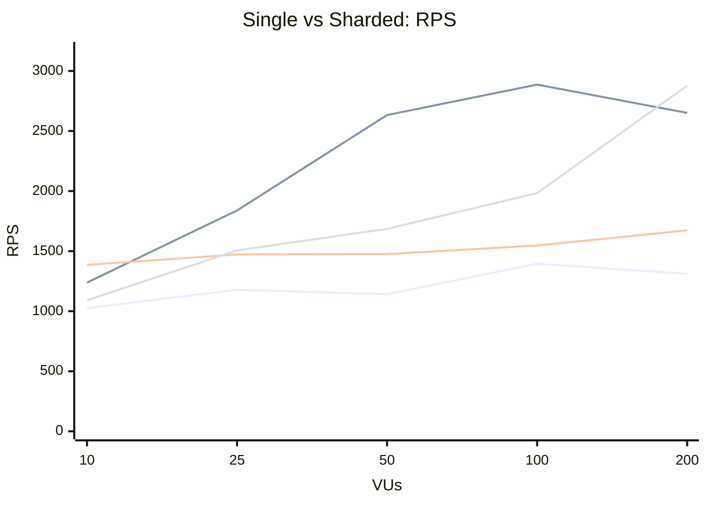

# ЛР7: Single Node vs Sharded

> Згенеровано з `experiments/raw/lab7_*` і `load-tests/results/lab7_E_*`. Повний звіт — README, розділ 12.

## 12.5. Cross-Shard Query: Scatter-Gather

`ShardedOrderStore` виконує запит на всіх шардах **паралельно** (`Task.WhenAll`) і зливає результати на координаторі (інстанс API). Для «моїх замовлень» злиття — це `ORDER BY CreatedAt DESC LIMIT n` по об'єднаних рядках. Для аналітики кожен шард робить `GROUP BY EventId` локально, а координатор лише сумує часткові агрегати.

```text
=== 2.4 Shard-Local vs Cross-Shard (Scatter-Gather) ===
--- «мої замовлення» шард-локально (1 шард):
  замовлень: 7 | шарди: [('shard-a', 2.0)]
--- той самий запит через fan-out (усі шарди + злиття):
  замовлень: 7 | шарди: [('shard-a', 1.4, 7), ('shard-b', 0.9, 0)]
--- аналітика продажів події (GROUP BY на кожному шарді, сума на координаторі):
   {'eventId': 'c0ffee0e-0000-4000-8000-000000000003', 'orders': 9968, 'tickets': 24741, 'revenue': 17350500.0} | шарди: [('shard-a', 6.2), ('shard-b', 6.0)]
--- час відповіді (curl, 20 запитів, медіана):
   users/c0ffee03-0000-4000-8000-000000000042/orders?limit=20                2.9 мс
   users/c0ffee03-0000-4000-8000-000000000042/orders?limit=20&scatter=true    3.0 мс
   orders/stats?eventId=c0ffee0e-0000-4000-8000-000000000003                 4.7 мс
   orders/stats                                                             16.9 мс
```

**Під навантаженням (2 шарди, stress):** той самий запит «мої замовлення» шард-локально і через fan-out:

| VUs | RPS: Local | RPS: Fan-out | p95, мс: Local | p95, мс: Fan-out | p99, мс: Local | p99, мс: Fan-out |
|---:|---:|---:|---:|---:|---:|---:|
| 10 | 1 091.3 | **1 312.8** | 26.3 | **20.8** | 51.3 | **42.6** |
| 25 | 1 505.6 | **1 174.3** | 51.0 | **63.0** | 82.0 | **95.8** |
| 50 | 1 685.4 | **1 006.6** | 84.7 | **108.4** | 197.1 | **278.9** |
| 100 | 1 982.9 | **1 308.7** | 128.7 | **177.5** | 270.3 | **296.9** |
| 200 | 2 877.2 | **1 209.2** | 165.6 | **347.7** | 250.0 | **603.7** |

**Оверхед fan-out:**
- **Ресурси.** Кожен fan-out запит виконує N запитів до БД замість одного й тримає N з'єднань. Сумарна робота БД зростає в N разів, хоча корисні рядки є лише на одному шарді.
- **Хвіст латентності.** Відповідь не швидша за найповільніший шард. p99 fan-out = max(p99 шардів) плюс злиття, і з ростом N хвіст лише гіршає.
- **Масштабування.** Додавання шардів не збільшує пропускну здатність fan-out запитів: кожен новий вузол додає ще один запит до кожного з них. Шард-локальний запит масштабується лінійно.
- **Висновок.** Пікова пропускна здатність fan-out — 1 312.8 RPS проти 2 877.2 у шард-локального запиту. Тому ключ шардингу мусить збігатися з ключем найчастішого запиту.

## 12.8. Порівняльний бенчмарк: Single Node vs Sharded

**Методика.** Обидві топології використовують однакові вузли по 0.5 CPU, 4 інстанси API і той самий набір даних: 200 000 замовлень, 20 000 користувачів. Single Node — `Sharding:ActiveShards=1`, усі дані на shard-a. Sharded — 2 шарди, `VirtualBuckets`. Профіль ЛР5 у stress-режимі (без пауз, 10→200 VU). Запуск: `load-tests/run-lab7.sh benchmark`. Аналітика в цьому бенчмарку читає з Primary шардів (`SHARD_ANALYTICS=Primary`), щоб порівнювати однакові вузли. Ефект реплік шардів — окремо в 12.9.

**Запис (`POST /orders`):**

| VUs | RPS: Single | RPS: Sharded | p95, мс: Single | p95, мс: Sharded | p99, мс: Single | p99, мс: Sharded |
|---:|---:|---:|---:|---:|---:|---:|
| 10 | 1 025.4 | **1 378.1** | 29.2 | **15.5** | 55.1 | **33.5** |
| 25 | 1 178.4 | **1 537.9** | 64.5 | **40.7** | 88.7 | **88.8** |
| 50 | 1 141.3 | **1 530.9** | 95.8 | **94.5** | 121.2 | **249.4** |
| 100 | 1 394.9 | **2 238.4** | 120.2 | **106.3** | 193.5 | **198.3** |
| 200 | 1 311.2 | **1 425.7** | 301.9 | **462.4** | 398.0 | **990.7** |

<sub>Sharded-прогін на 200 VU просів до 1 425.7 RPS (p99 990.7 мс) — шум стенда. Той самий запис на 2 шардах у 12.4 (`lab7_E_write_VirtualBuckets_stress`) дав 1 238.1 / 1 838.6 / 2 632.8 / 2 886.0 / 2 651.2 RPS. Перший прогін Single завис після 10 VU і збережений як `lab7_E_write_single_stress_stalled`.</sub>

**Шард-локальне читання («мої замовлення»):**

| VUs | RPS: Single | RPS: Sharded | p95, мс: Single | p95, мс: Sharded | p99, мс: Single | p99, мс: Sharded |
|---:|---:|---:|---:|---:|---:|---:|
| 10 | 1 385.3 | **1 091.3** | 29.4 | **26.3** | 45.9 | **51.3** |
| 25 | 1 472.4 | **1 505.6** | 68.1 | **51.0** | 79.2 | **82.0** |
| 50 | 1 475.1 | **1 685.4** | 89.7 | **84.7** | 104.1 | **197.1** |
| 100 | 1 546.7 | **1 982.9** | 114.1 | **128.7** | 194.5 | **270.3** |
| 200 | 1 673.0 | **2 877.2** | 212.4 | **165.6** | 298.2 | **250.0** |

**Cross-Shard аналітика (`GET /orders/stats?eventId=`: GROUP BY по ~10 тис. рядків події):**

| VUs | RPS: Single | RPS: Sharded | p95, мс: Single | p95, мс: Sharded | p99, мс: Single | p99, мс: Sharded | Помилки: Single | Помилки: Sharded |
|---:|---:|---:|---:|---:|---:|---:|---:|---:|
| 10 | 48.0 | **105.6** | 498.6 | **196.0** | 716.2 | **204.1** | 0.0% | 0.0% |
| 25 | 35.1 | **73.5** | 1 501.5 | **801.8** | 2 199.9 | **1 289.2** | 0.0% | 0.0% |
| 50 | 21.7 | **53.8** | 5 482.1 | **2 798.7** | 6 903.7 | **4 594.6** | 5.2% | 0.0% |
| 100 | 42.7 | **76.8** | 4 495.4 | **3 103.4** | 5 622.6 | **4 491.2** | 42.9% | 0.0% |
| 200 | 82.3 | **101.2** | 3 207.3 | **3 203.7** | 4 035.1 | **3 797.2** | 70.9% | 0.0% |



<sub>лінія 1 — `Запис, Single` · лінія 2 — `Запис, Sharded (12.4)` · лінія 3 — `Читання, Single` · лінія 4 — `Читання, Sharded`</sub>

**Висновки:**

| Операція | Single Node | Sharded (2 вузли) | Пояснення |
|---|---|---|---|
| Запис | Пік 1 394.9 RPS, вузол у ліміті CPU | Пік 2 886.0 RPS (12.4) | Записи діляться між вузлами. Ресурс БД подвоєно, межею стає CPU API |
| Шард-локальне читання | До 1 673.0 RPS, p95 на 200 VU 212.4 мс | До 2 877.2 RPS, p95 165.6 мс | Масштабується майже лінійно, як і запис |
| Fan-out аналітика | Насичення вже на 10–25 VU (~48.0 RPS, p95 0.5–1.5 с); з 50 VU — помилки (вичерпаний пул з'єднань) | 105.6 / 73.5 / 53.8 / 76.8 / 101.2 RPS, **0% помилок** до 200 VU | Кожен шард агрегує половину рядків паралельно, тож важкий запит швидшає. Але кожен такий запит займає з'єднання на **всіх** шардах |
| Fan-out «моїх замовлень» | — | Пік 1 312.8 RPS проти 2 877.2 у локального | Оверхед N запитів замість одного (12.5) |

**Точки насичення:**
- **Single Node:** запис і читання впираються в CPU єдиного вузла (~1.3–1.7 тис. RPS). Аналітика ламається вже на 50 VU.
- **Sharded:** запис і локальне читання впираються в CPU API (~2.6–2.9 тис. RPS) за запасу на шардах.

**Знахідка: каскадна відмова через вичерпаний пул з'єднань.** Перший прогін аналітики на Single Node (`lab7_E_stats_single_stress_cascade`) на 200 VU дав **96.6% помилок** при «1701 RPS». Це були не відповіді, а миттєві 502 від Nginx. Ланцюжок:
1. Важкі запити тримали з'єднання по 2–5 с, і пул Npgsql (20 на інстанс) вичерпався.
2. EF Core загорнув помилку пулу в `InvalidOperationException`, тому `GlobalExceptionHandler` віддав **500**.
3. Nginx рахує 500 відмовою інстансу (`proxy_next_upstream http_500`, `max_fails=2`), тож з ротації випали всі 4 інстанси. У лозі Nginx — 174 758 записів `no live upstreams`.

Так перевантаження БД перетворилося на повну недоступність API, включно з ендпоінтами, які БД узагалі не чіпають. Виправлення: обробник розгортає вкладений виняток і для недоступної БД віддає **503** (ЛР6 прибрала 503 з повторів Nginx). Повторний прогін: 0 записів `no live upstreams`. Клієнти на піку отримують швидкі 503 (load shedding), а інстанси лишаються в ротації. Це та сама проблема, що й у ЛР6: Nginx не повинен вважати відмовою інстансу помилку спільної залежності.
