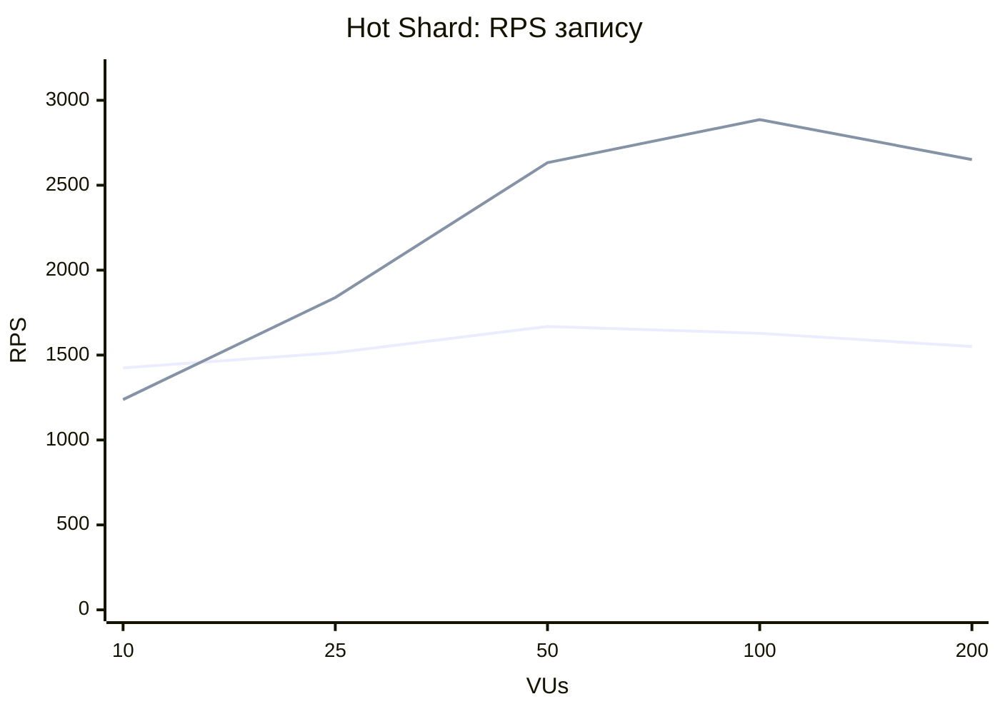
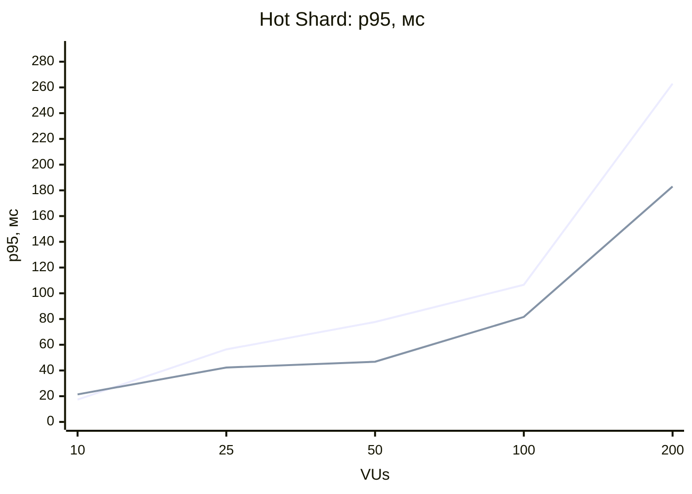

# ЛР7: Hot Shard

> Згенеровано з `experiments/raw/lab7_*` і `load-tests/results/lab7_E_*`. Повний звіт — README, розділ 12.

## 12.4. Hot Shard і оптимізація стратегії

**Сценарій.** Запис замовлень без пауз (k6 `e-orders.js`, `MODE=write`, 10→200 VU) від 20 000 користувачів з id формату `c0ffee03-0000-4000-8000-{n}`. Однакові вузли-шарди по **0.5 CPU**, 4 інстанси API. Перший прогін — `Sharding:Strategy=Modulo`, другий — `VirtualBuckets`. Код, дані й навантаження однакові.

**Розподіл після прогону запису:**

| Стратегія | shard-a: записів / частка запису | shard-b: записів / частка запису | CPU шардів (середнє / максимум; ліміт 50%) | Пам'ять шардів за прогін, MiB |
|---|---|---|---|---|
| `Modulo` | 0 / 0.0% | 489 593 / 100.0% | shard-a 0% / 3%, shard-b 46% / 52% — **shard-b у ліміті, shard-a простоює** | shard-a 69 → 69, **shard-b 96 → 276** |
| `VirtualBuckets` | 302 145 / 49.6% | 307 163 / 50.4% | shard-a 40% / 55%, shard-b 41% / 55% | shard-a 71 → 234, shard-b 140 → 278 |

**Латентність і пропускна здатність:**

| VUs | RPS: Modulo | RPS: Buckets | p95, мс: Modulo | p95, мс: Buckets | p99, мс: Modulo | p99, мс: Buckets |
|---:|---:|---:|---:|---:|---:|---:|
| 10 | 1 424.7 | **1 238.1** | 17.4 | **21.4** | 38.4 | **42.8** |
| 25 | 1 513.9 | **1 838.6** | 56.4 | **42.3** | 72.1 | **61.3** |
| 50 | 1 668.6 | **2 632.8** | 77.7 | **46.8** | 90.7 | **72.7** |
| 100 | 1 628.0 | **2 886.0** | 106.6 | **81.6** | 179.9 | **106.4** |
| 200 | 1 550.4 | **2 651.2** | 262.9 | **183.0** | 304.3 | **276.3** |



<sub>лінія 1 — `Modulo (hot shard)` · лінія 2 — `VirtualBuckets`</sub>



<sub>лінія 1 — `Modulo (hot shard)` · лінія 2 — `VirtualBuckets`</sub>

**Висновок.** При `Modulo` усе навантаження лягає на shard-b. Пропускна здатність упирається в ліміт одного вузла (~1.5–1.7 тис. RPS) і не росте з VU, а латентність росте: p95 на 100 VU — 106.6 мс, на 200 VU — 262.9 мс. Другий вузол при цьому простоює. Після переходу на хешування з віртуальними бакетами обидва вузли завантажені порівну. Пікова пропускна здатність зросла з 1 668.6 до 2 886.0 RPS (×1.73), p95 на 200 VU знизився з 262.9 до 183.0 мс. Межу тепер задає CPU API (89% у середньому), а не вузол БД.

**Live-демо для захисту** (`scripts/sharding/hot-shard-demo.sh`, ~1 хв). Скрипт вмикає ту саму пару стратегій на 50 000 замовлень і 20-секундному записі при 50 VU. На час демо шарди обмежено 0.5 CPU, потім ліміт знімається. Вивід — `experiments/raw/lab7_hotshard_demo.txt`:

```text
=== Стратегія Modulo ===
користувач …000000000042 → shard-b | bucket None
--- генерація 50 000 замовлень (20 000 користувачів, префіксні id):
|---|---:|---:|---:|---:|
| shard-a | 0 | 0.00 | 0 | 0.00 |
| shard-b | 50 000 | 100.00 | 50 000 | 100.00 |
--- запис без пауз: 50 VU × 20 с
VUs   RPS      avg ms   p50 ms   p95 ms   p99 ms   max ms   errors %
50     1468.3     33.8     17.2     84.4    100.5    208.7       0.00
   shard-a  CPU сер.   1.5% / макс.  10.3% (ліміт 50%) | пам'ять 44.24MiB
   shard-b  CPU сер.  43.1% / макс.  51.1% (ліміт 50%) | пам'ять 112.6MiB

=== Стратегія VirtualBuckets ===
користувач …000000000042 → shard-a | bucket 16
--- генерація 50 000 замовлень (20 000 користувачів, префіксні id):
|---|---:|---:|---:|---:|
| shard-a | 24 812 | 49.62 | 24 812 | 49.62 |
| shard-b | 25 188 | 50.38 | 25 188 | 50.38 |
--- запис без пауз: 50 VU × 20 с
VUs   RPS      avg ms   p50 ms   p95 ms   p99 ms   max ms   errors %
50     2575.3     19.2     14.9     49.0     76.5    187.1       0.00
   shard-a  CPU сер.  43.9% / макс.  53.0% (ліміт 50%) | пам'ять 110.6MiB
   shard-b  CPU сер.  42.3% / макс.  52.8% (ліміт 50%) | пам'ять 112.7MiB

=== Повернення: ліміт CPU шардів знято, стратегія VirtualBuckets ===
```

Інший тип hot shard — «гарячий ключ» (мега-подія, якщо ключем був би `EventId`, або «кит»-покупець при ключі `UserId`). Його хешування не розподілить: усі рядки одного ключа завжди на одному шарді. Протидія — складений ключ (`UserId` + місяць або `EventId` + сектор) ціною fan-out для запитів по цьому ключу. Саме тому ключем обрано `UserId` з високою кардинальністю, а не `EventId` (12.1).
