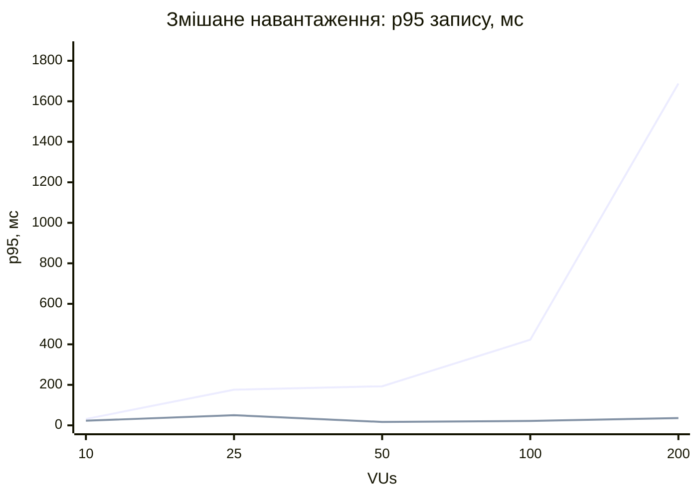

# ЛР7: реплікація шардів

> Згенеровано з `experiments/raw/lab7_*` і `load-tests/results/lab7_E_*`. Повний звіт — README, розділ 12.

## 12.9. Реплікація шардів: кожен шард — Primary + Replica

Кожен шард — така сама пара, як основна БД у ЛР6: `shard-a` → `shard-a-replica`, `shard-b` → `shard-b-replica`. Реплікація асинхронна потокова (Hot Standby), а bootstrap репліки — той самий `db/replica/bootstrap.sh`. Hot Standby вимагає `max_prepared_transactions` не менше, ніж на Primary, тому репліки шардів стартують з `-c max_prepared_transactions=20`. Стан реплікації: `scripts/sharding/shard-replication-status.sh`.

**Хто що читає:**

| Операція | Вузол | Чому |
|---|---|---|
| Запис, передача (2PC), «мої замовлення» | Primary шарду | Strong / Read-Your-Writes: користувач бачить своє замовлення одразу після оплати |
| Аналітика `/orders/stats` (fan-out) | **Репліки шардів** (`Sharding:AnalyticsReads=Replica`) | Звіт про продажі допускає відставання на мілісекунди, а важкий `GROUP BY` не має конкурувати із записом |
| Аналітика з `?consistency=strong` | Primary шардів | Коли потрібна точна цифра «зараз» |
| Аналітика, репліка шарду **недоступна** | Primary цього шарду (`node: shard-b (replica-down)`) | Primary Fallback, як у ЛР6 |

Вузол кожної частини відповіді видно в заголовку `X-Shard-Nodes`, наприклад `shard-a-replica,shard-b-replica`.

**Експеримент** (`load-tests/run-lab7.sh replicas`): змішане навантаження — 90% записів замовлень і 10% аналітики (`e-orders.js`, `MODE=mixed`). Шарди і репліки по 0.5 CPU, 4 інстанси API, stress-профіль. Прогін 1: аналітика на Primary шардів (`SHARD_ANALYTICS=Primary`). Прогін 2: на репліках. Записи й аналітика заміряні окремо.

| VUs | Записів/с: аналітика на Primary | Записів/с: на репліках | p95 запису, мс: Primary | p95 запису, мс: репліки | p99 запису, мс: Primary | p99 запису, мс: репліки | Аналітика/с: Primary / репліки | p95 аналітики, мс: Primary / репліки | Помилки: Primary / репліки |
|---:|---:|---:|---:|---:|---:|---:|---:|---:|---:|
| 10 | 727.0 | **753.8** | 31.4 | **22.8** | 51.8 | **41.9** | 80.7 / 85.8 | 52.6 / 69.2 | 0.0% / 0.0% |
| 25 | 401.7 | **676.0** | 176.1 | **50.3** | 338.0 | **79.3** | 42.4 / 75.0 | 298.9 / 548.1 | 0.0% / 0.0% |
| 50 | 613.6 | **597.9** | 192.9 | **16.9** | 388.9 | **32.8** | 66.0 / 64.1 | 303.5 / 1 747.0 | 0.0% / 0.0% |
| 100 | 536.7 | **480.7** | 422.7 | **21.6** | 698.9 | **54.2** | 60.7 / 53.1 | 698.6 / 4 629.5 | 0.0% / 0.0% |
| 200 | 307.3 | **639.5** | 1 687.8 | **36.1** | 2 514.2 | **69.1** | 34.7 / 72.2 | 2 696.1 / 4 514.7 | 0.0% / 9.1% |

лінія 1 — `Аналітика на Primary шардів` · лінія 2 — `Аналітика на репліках шардів`

**CPU вузлів** (середнє за прогін; ліміт 50%):
- **Аналітика на Primary:** shard-a 44%, shard-b 46% (піки 61% / 59%), репліки простоюють (6–7%).
- **Аналітика на репліках:** Primary шардів по 20%, репліки 43–46%.

**Висновок.** Коли аналітика читає з Primary шардів, кожен важкий `GROUP BY` забирає CPU у записів. p95 запису росте з 31.4 до 1 687.8 мс на 200 VU. З репліками записи ізольовані: p95 запису лишається 16.9–50.3 мс на всіх рівнях, на 200 VU це в 47 разів менше. Пропускна здатність записів на 200 VU — 639.5 проти 307.3 за секунду.

Межу аналітики тепер задають репліки: p95 аналітики 1.7–4.6 с, а на 200 VU — 9.1% помилок. Усі ці помилки — 503 на аналітику: у логах API 154 з 154 випадків — вичерпаний пул саме реплік (`Timeout` 2 с, у Primary шардів 3 с). Записи при цьому проходять. Записи ростуть разом із шардами, аналітика — разом із репліками.

Записів/с при аналітиці на репліках на 50–100 VU не вищі, ніж при аналітиці на Primary, бо k6 працює за замкненою моделлю: VU, що чекає 2–4 с на аналітику, у цей час не пише. Тому для записів показова латентність, а не RPS.

**Знахідка: fallback, що переливає перевантаження на Primary.** Перша версія переходила на Primary шарду при будь-якій помилці з'єднання з реплікою, включно з вичерпаним пулом. Прогін `lab7_E_mixed_analytics_Replica_stress_fallback_cascade` показав, що з цього виходить:
- **50 VU.** Репліка shard-a упирається в свій ліміт CPU, і її пул вичерпується.
- **100 VU.** Кожна аналітика, що не дочекалася з'єднання з реплікою, переходить на shard-a: його CPU стрибає до 50%, а CPU репліки падає до 15%.
- **Наслідок для записів.** Primary насичується аналітикою. p95 запису — 3 293.6 / 3 161.8 мс на 100 / 200 VU, помилок 11.6% / 26.4%, записів лише 124.5 / 165.4 за секунду.

Тобто механізм відмовостійкості перетворив перевантаження репліки на відмову запису.

**Виправлення** (`ShardedOrderStore.IsReplicaUnreachable`). Fallback спрацьовує лише тоді, коли репліка справді недоступна: мережева помилка (`SocketException`), standby не приймає з'єднань (`57P03`) або вимикається. Вичерпаний пул і таймаут означають перевантаження. Тоді аналітика отримує 503 (load shedding), а Primary лишається для записів. Ціна: якщо репліка «зависла», а не впала, аналітика отримує 503 замість відповіді з Primary. Для звіту це прийнятно, для запису — ні.
